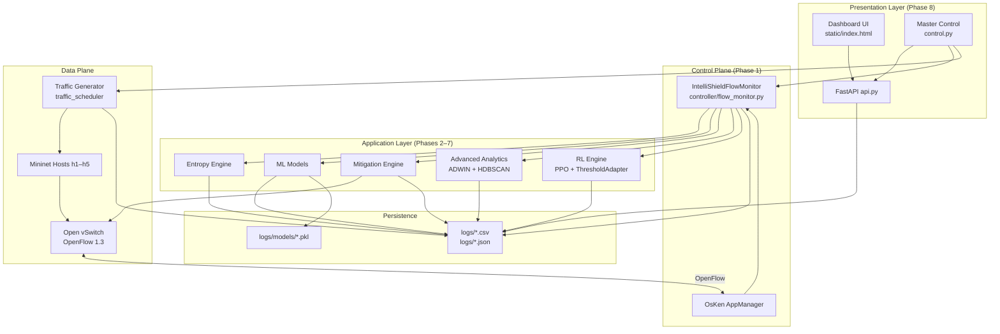
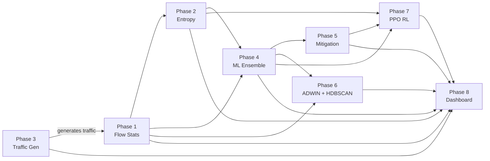
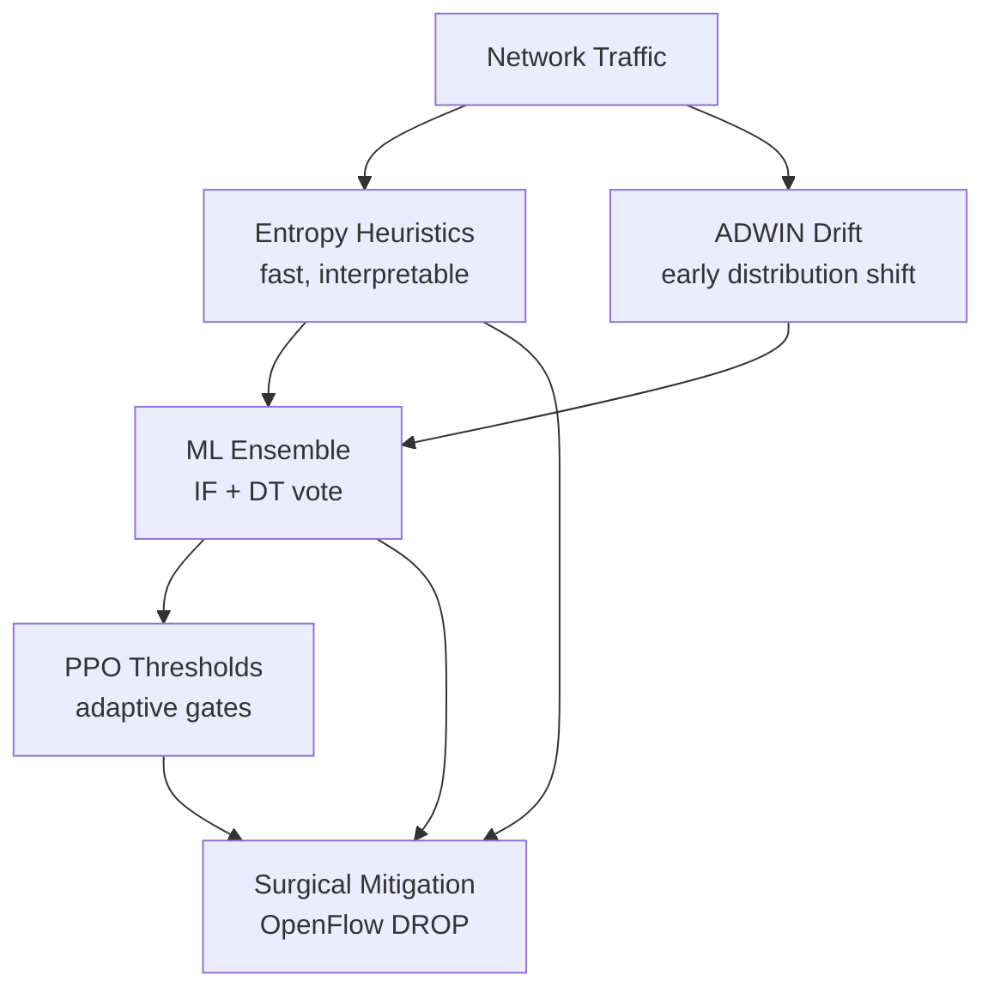

# Overall Architecture

## 1. System Purpose

IntelliShield SDN is a research prototype that combines **OpenFlow telemetry**, **entropy-based heuristics**, **hybrid machine learning**, **concept-drift analytics**, **reinforcement-learning threshold tuning**, and **surgical OpenFlow mitigation** into a single closed-loop SDN security pipeline. Release 1.0 also adds **cross-layer correlation, reliability-aware fusion, multi-stage verification, RCA/XAI, and policy alerting** on shared contracts, plus a **read-only snapshot digital twin**. See [`../02_Novelties/`](../02_Novelties/README.md). The architecture is designed for reproducible Mininet experiments, CSV/JSONL audit trails, and live dashboard monitoring.

## 2. Architectural Style

The system follows a **layered, event-driven, hook-based** architecture:

| Style | Application in IntelliShield |
|-------|------------------------------|
| **Layered** | Data plane → control plane → detection/mitigation apps → presentation |
| **Event-driven** | OsKen handles `PacketIn`, `FlowStatsReply`, `PortStatsReply`, `StateChange` |
| **Polling loop** | Background thread requests stats every 5 seconds per switch |
| **Plugin hooks** | Phases 2–7 attach to the controller via optional imports and `try/except` guards |
| **Log-centric persistence** | All phases append to CSV/JSON under `logs/` for analysis and dashboard polling |

## 3. High-Level Layer Model

## 4. Eight-Phase Functional Map

| Phase | Role | Primary Output |
|-------|------|----------------|
| **1** | OpenFlow telemetry and L2 learning switch | `flow_stats.csv`, `port_stats.csv` |
| **2** | Shannon entropy over 5 dimensions | `entropy_logs.csv`, `detection_alerts.csv` |
| **3** | Reproducible attack/normal scenarios | `scenario_logs.csv`, `attack_logs.csv` |
| **4** | Isolation Forest + Decision Tree ensemble | `ml_predictions.csv`, `ml_alerts.csv` |
| **5** | Confidence-gated FLOW_PAIR / SRC_MAC blocking | `mitigation_actions.csv` |
| **6** | ADWIN drift + HDBSCAN clustering | `drift_alerts.csv`, `cluster_labels.csv` |
| **7** | PPO adaptive pkt/byte/conf thresholds | `rl_decisions.csv`, `ppo_weights.pkl` |
| **8** | Live monitoring + experiment orchestration | HTTP API, Master Control jobs |

## 5. Central Integration Hub

All detection and mitigation intelligence converges in **`IntelliShieldFlowMonitor`** (`controller/flow_monitor.py`). This single OsKen application:

1. Polls flow and port statistics every **5 seconds**
2. Extracts per-flow feature dictionaries (Phase 1 schema)
3. Invokes entropy analysis on each batch (Phase 2)
4. After a **warm-up period**, builds 15-dim ML vectors and predicts (Phase 4)
5. Triggers mitigation on confirmed ATTACK cycles (Phase 5)
6. Updates ADWIN and buffers HDBSCAN vectors (Phase 6)
7. Steps PPO, applies threshold deltas, logs rewards (Phase 7)

Optional phases degrade gracefully: if a package import fails, the controller logs a warning and continues with remaining phases active.

## 6. Detection Philosophy

IntelliShield uses a **defence-in-depth** strategy rather than a single detector:

- **Entropy** catches collapse patterns quickly with explainable dimensions.
- **ADWIN** provides early warning before ML confidence peaks.
- **ML** generalises across attack types using Phase 1 + Phase 2 features.
- **RL** tunes operational thresholds to balance detection latency vs. false positives.
- **Mitigation** acts only above confidence gates with auto-expiring rules.

## 7. Cross-Cutting Concerns

| Concern | Implementation |
|---------|----------------|
| **Timing** | 5 s monitor interval; HDBSCAN every 10 cycles (~50 s); dashboard polls every 5 s |
| **Warm-up** | ML, mitigation, and RL deferred until entropy window fills (configurable cycles) |
| **Attack confirmation** | Consecutive ATTACK/SUSPICIOUS cycles required before block |
| **Safety** | Subnet allowlists in traffic generator; MAC whitelist in mitigation; confidence floor |
| **Observability** | Structured CSV logs + console banners + dashboard API |
| **Experiment reproducibility** | Scenario scheduler S1–S5 with `scenario_logs.csv` ground truth |
| **Evaluation** | `evaluation/experiment_windows.py` provides canonical attack windows; `scripts/compute_metrics.py` joins them with detection/mitigation timestamps |

## 8. Technology Stack

| Layer | Technology |
|-------|------------|
| SDN framework | OsKen (OpenFlow 1.3) |
| Emulation | Mininet + Open vSwitch |
| Language | Python 3.10+ |
| ML | scikit-learn (IsolationForest, DecisionTree, StandardScaler, HDBSCAN) |
| RL | Custom NumPy PPO implementation (no PyTorch dependency) |
| API / UI | FastAPI + vanilla HTML/JS |
| Host OS | macOS development host; Ubuntu 22.04 LTS VM for runtime |

## 9. Design Principles

1. **Single controller, many hooks** — minimise integration surface area; all phases share one monitoring cycle.
2. **Logs as the system of record** — dashboard and metrics read the same CSV files researchers analyse offline.
3. **Fail-open on optional modules** — missing sklearn or rl_engine does not crash the controller.
4. **Surgical mitigation** — prefer `FLOW_PAIR` (src+dst MAC) over blanket blocks to limit collateral damage.
5. **Research-first** — explicit scenario timestamps enable latency and false-positive measurement for papers.
