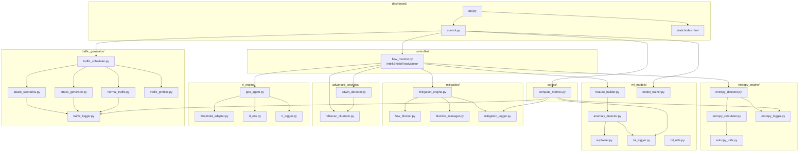
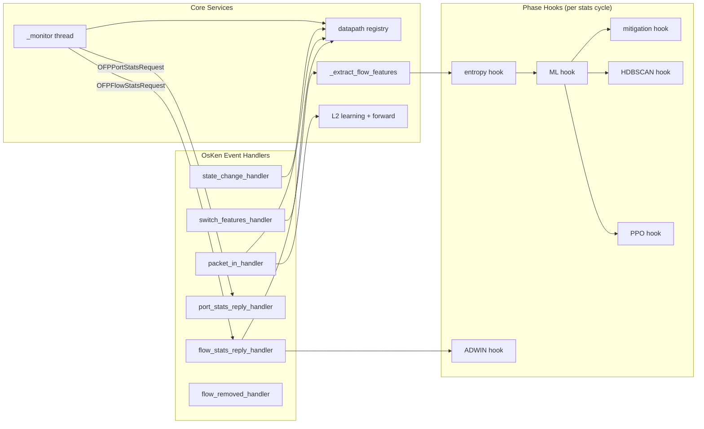
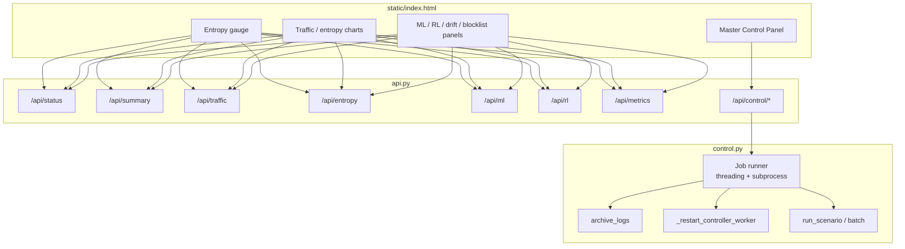

# Component Diagram

## 1. Repository Component Map



## 2. Runtime Process Components

```mermaid
C4Context
    title IntelliShield Runtime Processes

    Person(operator, "Operator / Researcher", "Runs experiments, views dashboard")
    Person(attacker, "Simulated Attacker", "Mininet host running hping3 / iperf")

    System_Boundary(vm, "Ubuntu VM (intellishield-sdn)") {
        System(controller, "osken-manager", "IntelliShieldFlowMonitor — Phases 1–7")
        System(mininet, "traffic_scheduler / mn", "Mininet topology + traffic")
        System(dashboard, "dashboard/api.py", "FastAPI on :8080")
        System(ovs, "Open vSwitch", "OpenFlow 1.3 datapath")
    }

    System_Ext(logs, "logs/", "CSV + JSON persistence")
    System_Ext(models, "logs/models/", "Trained ML weights")

    operator --> dashboard : HTTP :8080
    operator --> dashboard : Master Control API
    dashboard --> logs : read / archive
    dashboard --> controller : restart / stop
    dashboard --> mininet : run scenarios

    mininet --> ovs : host traffic
    attacker --> mininet : SYN/UDP flood

    controller --> ovs : OpenFlow rules + stats
    controller --> logs : append telemetry
    controller --> models : load IF/DT/scaler

    mininet --> logs : scenario + attack events
```

## 3. Controller Internal Components



## 4. Dashboard Component Breakdown



## 5. Component Dependency Matrix

| Component | Depends On | Provides To |
|-----------|------------|-------------|
| `flow_monitor.py` | OsKen, all phase packages | OpenFlow control, unified hook orchestration |
| `entropy_engine` | Phase 1 flow features | Entropy metrics, alerts, baselines |
| `ml_models` | Phase 1 + 2 features | Predictions, attack hints, trained models |
| `mitigation` | Phase 4 predictions, Phase 1 MACs | OpenFlow DROP rules, blocklist state |
| `advanced_analytics` | Phase 4 vectors, Phase 2 metrics | Drift alerts, cluster labels |
| `rl_engine` | ML + entropy feedback | Adaptive thresholds, RL decision log |
| `traffic_generator` | Mininet | Ground-truth scenario timeline |
| `dashboard` | `logs/` CSV files | Live UI, experiment orchestration |
| `compute_metrics.py` | scenario + detection + mitigation logs | IEEE latency / FP report |

## 6. External Interfaces

| Interface | Protocol | Direction | Purpose |
|-----------|----------|-----------|---------|
| Controller ↔ OVS | OpenFlow 1.3 (TCP 6653) | Bidirectional | Stats, PacketIn, FlowMod |
| Mininet ↔ Controller | OpenFlow remote | Outbound from OVS | Connect datapath |
| Dashboard ↔ Browser | HTTP (8080) | Outbound | UI + REST API |
| Dashboard ↔ Filesystem | Local I/O | Read/write | Log tailing, archive, job output |
| Master Control ↔ subprocess | `osken-manager`, `sudo python3 -m traffic_generator...` | Spawn | Automated experiments |
