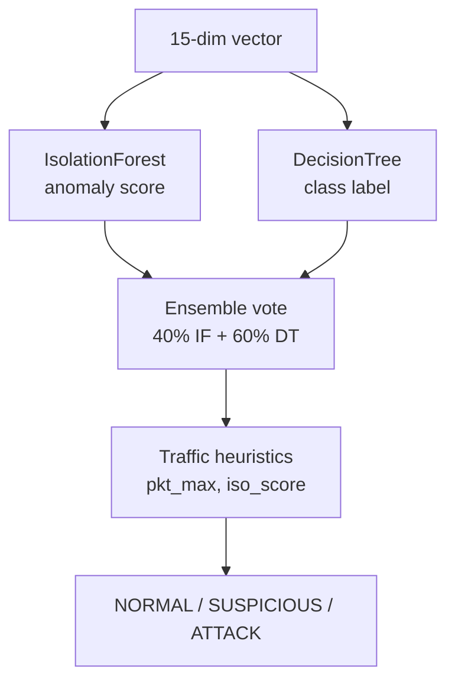

# Module Design

## 1. Package Overview

| Package | Phase | Responsibility |
|---------|-------|----------------|
| `controller/` | 1 | OsKen SDN app: forwarding, stats polling, phase hook orchestration |
| `entropy_engine/` | 2 | Shannon entropy calculation, sliding-window detection, alert logging |
| `traffic_generator/` | 3 | Mininet topology, normal/attack traffic, S1–S5 scenarios |
| `ml_models/` | 4 | Feature engineering, ensemble inference, training, explainability |
| `mitigation/` | 5 | Attacker identification, OpenFlow blocking, blocklist management |
| `advanced_analytics/` | 6 | ADWIN concept drift, HDBSCAN traffic clustering |
| `rl_engine/` | 7 | PPO policy, threshold adaptation, reward computation |
| `dashboard/` | 8 | FastAPI backend, static UI, Master Control job runner |
| `scripts/` | — | Offline metrics computation and reporting |

---

## 2. controller/

### 2.1 `flow_monitor.py`

**Class:** `IntelliShieldFlowMonitor(app_manager.OSKenApp)`

| Method / Area | Responsibility |
|---------------|----------------|
| `packet_in_handler` | L2 MAC learning, ARP-safe forwarding (LLDP-only drop) |
| `switch_features_handler` | Table-miss flow install (priority 0) |
| `_monitor` | Background loop: poll all datapaths every `MONITOR_INTERVAL` (5 s) |
| `_extract_flow_features` | Build Phase 1 feature dict per OpenFlow flow stat |
| `_flow_stats_reply_handler` | Central hook: entropy → ML → mitigation → ADWIN → HDBSCAN → PPO |
| `_request_stats` | `OFPFlowStatsRequest` + `OFPPortStatsRequest` |
| `_map_entropy_attack_hint` | Override uncertain ML hints with entropy-derived labels |

**Key configuration constants:**

| Constant | Default | Purpose |
|----------|---------|---------|
| `MONITOR_INTERVAL` | 5 s | Stats poll period |
| `PACKET_RATE_WARN_THRESHOLD` | 500 pkt/s | Static warn (overridden by RL) |
| `BYTE_RATE_WARN_THRESHOLD` | 500000 B/s | Static warn (overridden by RL) |
| `_warmup_threshold` | configurable | Cycles before ML/mitigation/RL activate |
| `_attack_confirm` | consecutive cycles | ATTACK confirmation before block |

**Phase integration pattern:**

```python
try:
    from <phase_package> import <Class>
    _PHASE_AVAILABLE = True
except ImportError:
    _PHASE_AVAILABLE = False
```

Each hook is wrapped in `try/except` so a single phase failure does not crash the controller.

---

## 3. entropy_engine/

### 3.1 Module Responsibilities

| Module | Class / Functions | Role |
|--------|-------------------|------|
| `entropy_utils.py` | `shannon_entropy`, `normalised_entropy` | Math primitives |
| `entropy_calculator.py` | `calculate_all_entropy` | 5-dimension entropy from flow window |
| `entropy_detector.py` | `EntropyDetector` | Sliding window per switch, composite score, status |
| `entropy_logger.py` | `log_entropy_metrics`, `log_alert`, `update_baseline` | CSV + JSON persistence |

### 3.2 `EntropyDetector` Interface

```text
add_flows(dpid, flow_features: list[dict])  → accumulate window
analyze(dpid)                               → dict with entropy dimensions + status
```

**Status labels:** `NORMAL` | `WARNING` | `ALERT`

**Composite score:** weighted mean of normalised entropies (weights: src 0.30, dst 0.30, packet 0.15, byte 0.15, flow 0.10).

**Thresholds (per dimension):** src/dst/flow ≤ 0.30; packet/byte ≤ 0.20; composite ≤ 0.40.

---

## 4. ml_models/

### 4.1 Module Responsibilities

| Module | Class | Role |
|--------|-------|------|
| `feature_builder.py` | `FeatureBuilder` | Aggregate flow batch + entropy → 15-dim vector |
| `anomaly_detector.py` | `AnomalyDetector` | IsolationForest + DecisionTree ensemble vote |
| `explainer.py` | `Explainer` | Feature importance narrative, attack type hint |
| `model_trainer.py` | training CLI | `--synthetic` or `--from-csv` model fitting |
| `ml_logger.py` | logging helpers | `ml_predictions.csv`, `ml_alerts.csv` |
| `ml_utils.py` | `clamp`, helpers | Shared math |

### 4.2 15-Dimensional Feature Vector

| Index | Feature | Source |
|-------|---------|--------|
| 0 | `packet_rate_mean` | Phase 1 |
| 1 | `packet_rate_max` | Phase 1 |
| 2 | `byte_rate_mean` | Phase 1 |
| 3 | `byte_rate_max` | Phase 1 |
| 4 | `flow_count` | Phase 1 |
| 5 | `duration_mean` | Phase 1 |
| 6 | `unique_src_count` | Phase 1 |
| 7 | `unique_dst_count` | Phase 1 |
| 8–13 | entropy dimensions | Phase 2 |
| 14 | `flow_concentration` | derived |

### 4.3 Ensemble Decision Logic (`AnomalyDetector.predict`)



Special rules: truly quiet baseline (`iso_score > 0.75` and `pkt_max < 100`) forced to `NORMAL`; elevated but non-flood traffic downgraded to `SUSPICIOUS`.

---

## 5. mitigation/

### 5.1 Module Responsibilities

| Module | Class | Role |
|--------|-------|------|
| `mitigation_engine.py` | `MitigationEngine` | Orchestrate alert → identify attacker → block |
| `flow_blocker.py` | `FlowBlocker` | Install OpenFlow DROP rules via `OFPFlowMod` |
| `blocklist_manager.py` | `BlocklistManager` | In-memory block state, whitelist, expiry tracking |
| `mitigation_logger.py` | logging helpers | `mitigation_actions.csv` |

### 5.2 `MitigationEngine.handle_alert` Pipeline

1. Check ML confidence ≥ `conf_threshold` (RL-adaptive, default 0.80)
2. `identify_attackers()` — top packet-rate source MAC from flow batch
3. `BlocklistManager.should_block()` — whitelist + duplicate check
4. `_calculate_timeout()` — 30/60/120 s based on confidence tier
5. `block_src_mac()` or `FLOW_PAIR` block (surgical src+dst)
6. Log action to CSV

**Block types:** `SRC_MAC` | `FLOW_PAIR`

**OpenFlow rule:** priority 200, empty instructions = DROP, `hard_timeout` for auto-expiry.

---

## 6. advanced_analytics/

### 6.1 `adwin_detector.py`

**Class:** `ADWINDetector` (pure-Python ADWIN2)

| Method | Role |
|--------|------|
| `update(metric, value)` | Append observation, test Hoeffding bound cuts |
| `update_all(dpid, metrics_dict)` | Update packet_rate, flow_count, entropy_score, byte_rate |
| `drift_count` | Exposed to RL state vector |

**Output:** `drift_alerts.csv` on distribution shift.

### 6.2 `hdbscan_clusterer.py`

**Class:** `HDBSCANClusterer`

| Method | Role |
|--------|------|
| `add_vector(dpid, vec, feature_names)` | Buffer ML feature vectors |
| `run_clustering(dpid)` | Batch cluster every 10 cycles |

**Cluster labels:** `NORMAL` | `ATTACK` | `SUSPICIOUS` | `NOISE`

**Output:** `cluster_labels.csv`, `cluster_summary.json`

---

## 7. rl_engine/

### 7.1 Module Responsibilities

| Module | Class | Role |
|--------|-------|------|
| `ppo_agent.py` | `PPOAgent`, `_ActorCritic` | Gaussian policy, GAE, clipped surrogate updates |
| `threshold_adapter.py` | `ThresholdAdapter` | Map actions → pkt/byte/conf thresholds; compute reward |
| `rl_env.py` | `SDNEnvironment` | Normalise 10-dim state vector |
| `rl_logger.py` | `RLLogger` | `rl_decisions.csv`, `rl_training.csv` |

### 7.2 RL State Vector (10 dimensions)

| Feature | Description |
|---------|-------------|
| `packet_rate_mean` | Normalised mean pkt/s |
| `byte_rate_mean` | Normalised mean B/s |
| `entropy_score` | Composite entropy |
| `flow_count` | Active flow count |
| `ml_confidence` | Latest ML confidence |
| `pkt_threshold` | Current RL pkt threshold |
| `byte_threshold` | Current RL byte threshold |
| `conf_threshold` | Current RL confidence gate |
| `recent_attack_count` | Rolling attack window |
| `recent_fp_count` | Rolling false-positive window |

### 7.3 RL Action Vector (3 dimensions)

Each action component ∈ [-1, 1] adjusts:

| Action | Threshold | Scale |
|--------|-----------|-------|
| `action[0]` | `pkt_threshold` | ±100 pkt/s |
| `action[1]` | `byte_threshold` | ±100 KB/s |
| `action[2]` | `conf_threshold` | ±0.03 |

### 7.4 Reward Signal (`ThresholdAdapter.compute_reward`)

Rewards true positives, penalises false positives and ML false negatives during flood-like entropy collapse, credits entropy-only detections when ML is blind.

---

## 8. traffic_generator/

### 8.1 Module Responsibilities

| Module | Role |
|--------|------|
| `traffic_scheduler.py` | CLI entry: `--scenario N`, `--all`; spawns Mininet |
| `attack_scenarios.py` | S1–S5 scenario functions with lifecycle logging |
| `attack_generator.py` | hping3 SYN/UDP/ICMP flood, burst attacks |
| `normal_traffic.py` | ICMP, TCP iperf, UDP, HTTP, mixed profiles |
| `traffic_profiles.py` | Dataclass profiles: `PROFILE_NORMAL_LIGHT`, `SYN_FLOOD_HIGH`, etc. |
| `traffic_logger.py` | `scenario_logs.csv`, `attack_logs.csv`, `traffic_logs.csv` |

### 8.2 Experiment Scenarios

| ID | Name | Duration | Attack Pattern |
|----|------|----------|----------------|
| S1 | Normal baseline | 60 s | ICMP-only light profile |
| S2 | SYN flood | 60 s | hping3 SYN flood |
| S3 | UDP flood | 60 s | hping3 UDP flood |
| S4 | Burst attack | 38 s | Short high-rate SYN burst |
| S5 | Mixed attacks | 75 s | Sequential SYN + UDP |

---

## 9. dashboard/

### 9.1 `api.py`

FastAPI application serving:

- Read-only log tail endpoints (`/api/traffic`, `/api/entropy`, `/api/ml`, etc.)
- Phase health (`/api/status`)
- Aggregated summary (`/api/summary`)
- Cached metrics (`/api/metrics` → `metrics_report.json`)
- Static UI at `GET /`

### 9.2 `control.py`

**Class:** `ControlPanel`

| Method | Action |
|--------|--------|
| `archive_logs` | Move CSVs to `logs/archive/<timestamp>/` |
| `restart_controller` | Python PID-based stop + detached `osken-manager` start |
| `stop_controller` | SIGTERM/SIGKILL controller processes |
| `run_scenario` | `sudo python3 -m traffic_generator.traffic_scheduler --scenario N` |
| `run_scenario_batch` | Archive → restart → S3+S4+S5 → compute metrics |
| `compute_metrics` | Run `scripts/compute_metrics.py` |
| `train_models` | Run `ml_models.model_trainer --from-csv` |

**Class:** `Job` — background task with id, status, log tail, exit code.

---

## 10. scripts/

### `compute_metrics.py`

Joins `scenario_logs.csv` attack windows with first-in-window detections from:

- `detection_alerts.csv` (entropy WARNING/ALERT)
- `ml_predictions.csv` (ML ATTACK)
- `mitigation_actions.csv` (BLOCK actions)

Produces per-scenario detection latency, mitigation latency, and false-positive block counts.

---

## 11. Inter-Module Data Contracts

### Phase 1 → All downstream phases

```python
flow_feature = {
    "timestamp", "switch_id", "src_mac", "dst_mac",
    "in_port", "priority", "packet_count", "byte_count",
    "packet_rate", "byte_rate", "duration_sec",
}
```

### Phase 2 → Phase 4

```python
entropy_result = {
    "src_entropy", "dst_entropy", "packet_entropy",
    "byte_entropy", "flow_entropy", "entropy_score",
    "status", "confidence", "n_flows",
}
```

### Phase 4 → Phase 5

```python
prediction = {"status", "confidence", "iso_score", "dt_label", ...}
explanation = {"attack_type_hint", "narrative", "top_features", ...}
```

These contracts are implicit (Python dicts) rather than protobuf/schema-enforced, which keeps the research prototype lightweight while remaining auditable via CSV logs.
