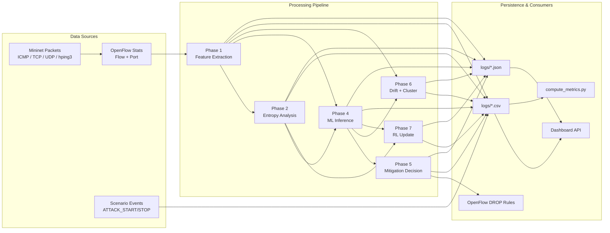
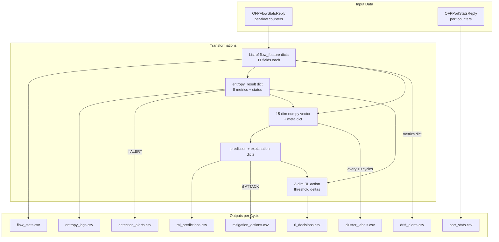
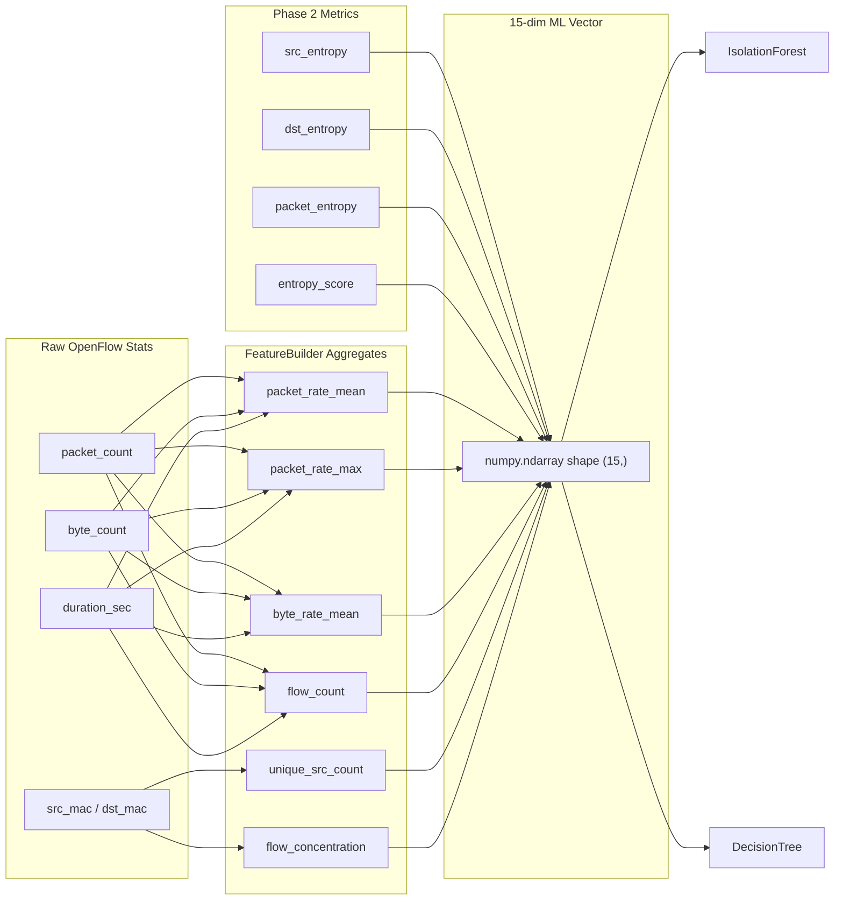
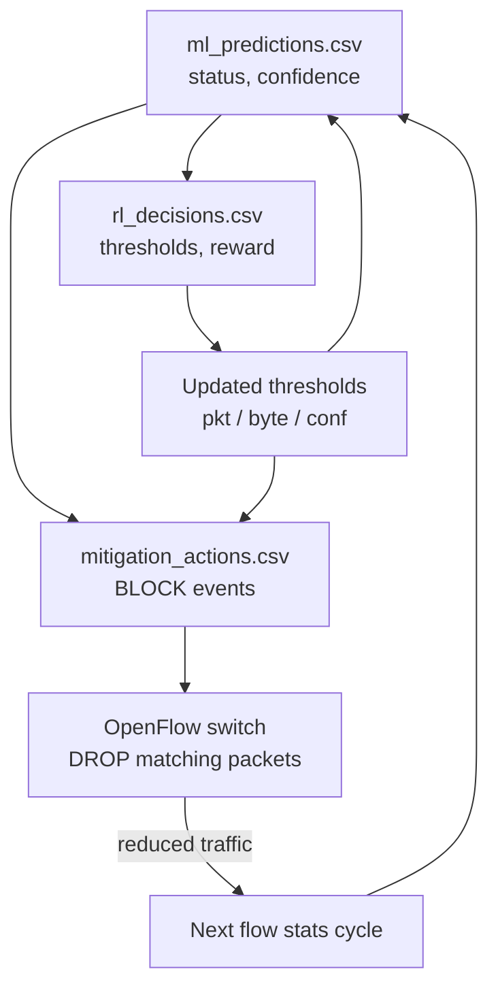
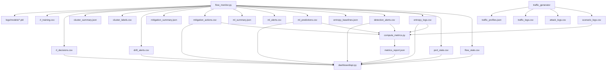
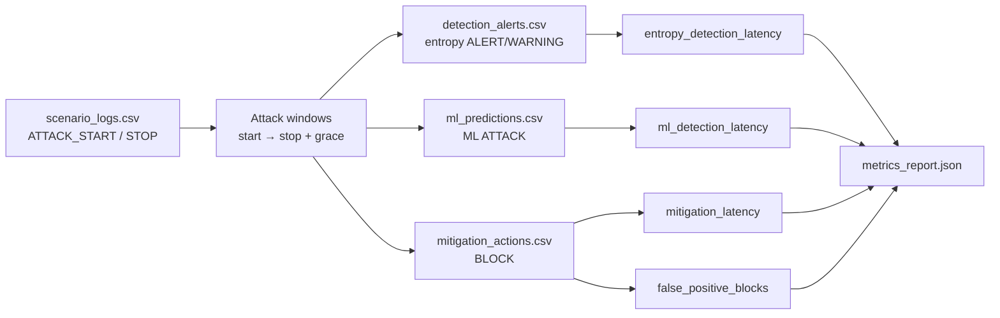

# Data Flow

## 1. End-to-End Data Flow Overview

---

## 2. Per-Cycle Data Flow (5-Second Monitoring Tick)

---

## 3. Feature Data Flow (Phase 1 → Phase 4)

---

## 4. Control-Plane Feedback Data Flow

Mitigation and RL create **feedback loops** back to the data plane and detection gates:

---

## 5. Log File Data Flow Map

---

## 6. Dashboard API Data Flow

| Endpoint | Primary Source Files | Data Returned |
|----------|---------------------|---------------|
| `/api/traffic` | `flow_stats.csv` | packet_rate, byte_rate time series |
| `/api/entropy` | `entropy_logs.csv` | 5 entropy dimensions + composite |
| `/api/alerts` | `detection_alerts.csv` | entropy alert events |
| `/api/ml` | `ml_predictions.csv` | status, confidence, attack hint |
| `/api/blocklist` | `mitigation_actions.csv` | recent BLOCK/UNBLOCK actions |
| `/api/rl` | `rl_decisions.csv` | thresholds, reward, ML label |
| `/api/drift` | `drift_alerts.csv` | ADWIN drift events |
| `/api/summary` | multiple CSVs | aggregated stat cards |
| `/api/metrics` | `metrics_report.json` | experiment evaluation summary |
| `/api/status` | file existence checks | phase health indicators |

**Read pattern:** API opens CSV, reads last *N* rows via `csv.DictReader`, parses timestamps, returns JSON. No database intermediary — files are the single source of truth.

---

## 7. Experiment Metrics Data Join

**Window constraint:** detections counted only within `[attack_start, attack_stop + 60s grace]` to prevent cross-run bleed.

---

## 8. Data Volume and Retention

| Log | Approx. Frequency | Typical Row Size |
|-----|-------------------|------------------|
| `flow_stats.csv` | Every flow × every 5 s | ~150 bytes/row |
| `entropy_logs.csv` | 1 row / switch / 5 s | ~120 bytes/row |
| `ml_predictions.csv` | 1 row / switch / 5 s (post warm-up) | ~200 bytes/row |
| `rl_decisions.csv` | 1 row / switch / 5 s | ~180 bytes/row |
| `scenario_logs.csv` | Event-driven (few per scenario) | ~100 bytes/row |

**Archival:** Master Control `archive_logs` moves CSVs to `logs/archive/<YYYYMMDD_HHMMSS>/` before new experiment runs.

---

## 9. Data Types and Formats

| Format | Usage |
|--------|-------|
| **CSV** | Time-series telemetry, alerts, actions (append-only) |
| **JSON** | Session summaries, baselines, cluster history, metrics report |
| **PKL** | ML models (IsolationForest, DecisionTree, StandardScaler), PPO weights |
| **OpenFlow** | Binary flow mods (not persisted; ephemeral with hard_timeout) |

**Timestamp format:** `YYYY-MM-DD HH:MM:SS` (local VM timezone; dashboard displays controller/log timestamps as written).
