# Sequence Diagrams

## 1. System Bootstrap Sequence

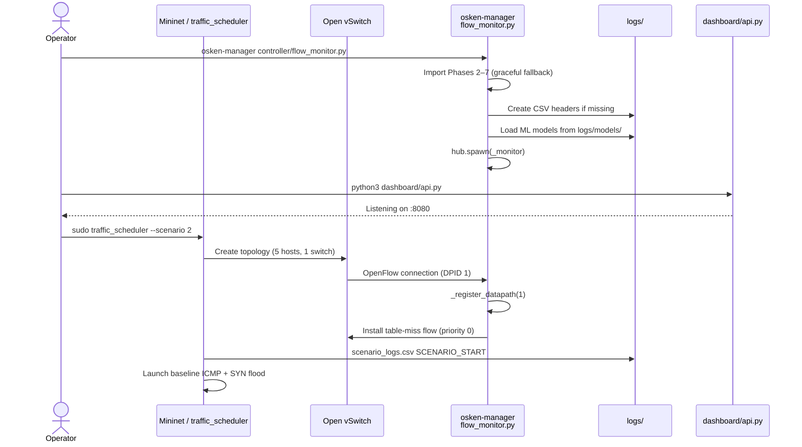

---

## 2. Normal Monitoring Cycle (No Attack)

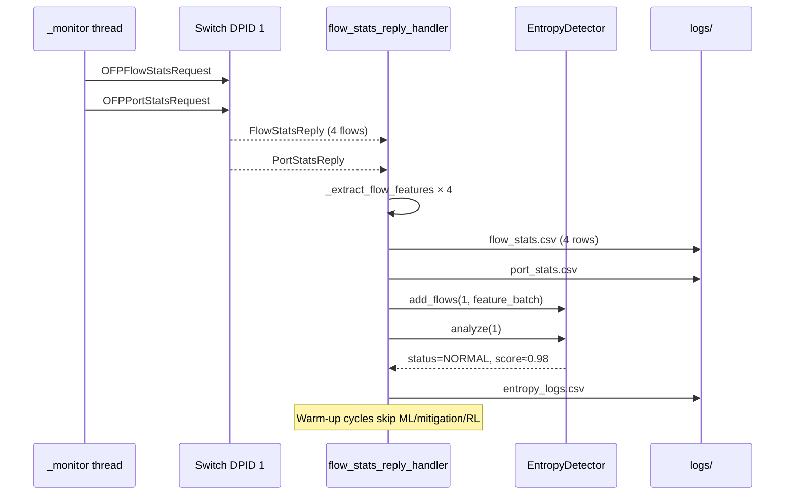

---

## 3. SYN Flood Detection and Mitigation Sequence

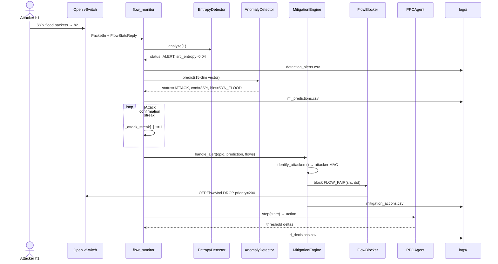

---

## 4. Packet Forwarding and Learning Sequence

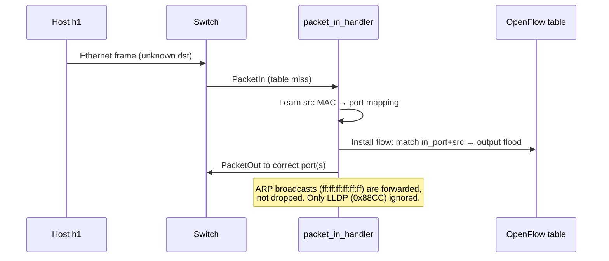

---

## 5. ADWIN Early-Warning Sequence

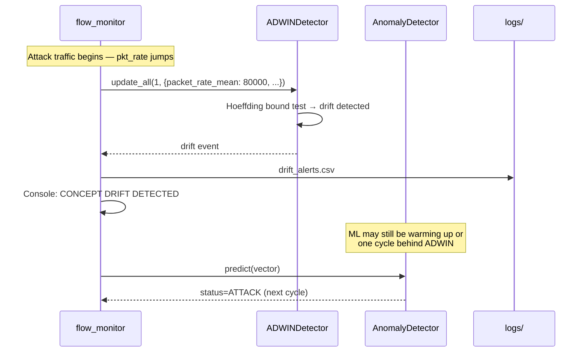

---

## 6. HDBSCAN Batch Clustering Sequence

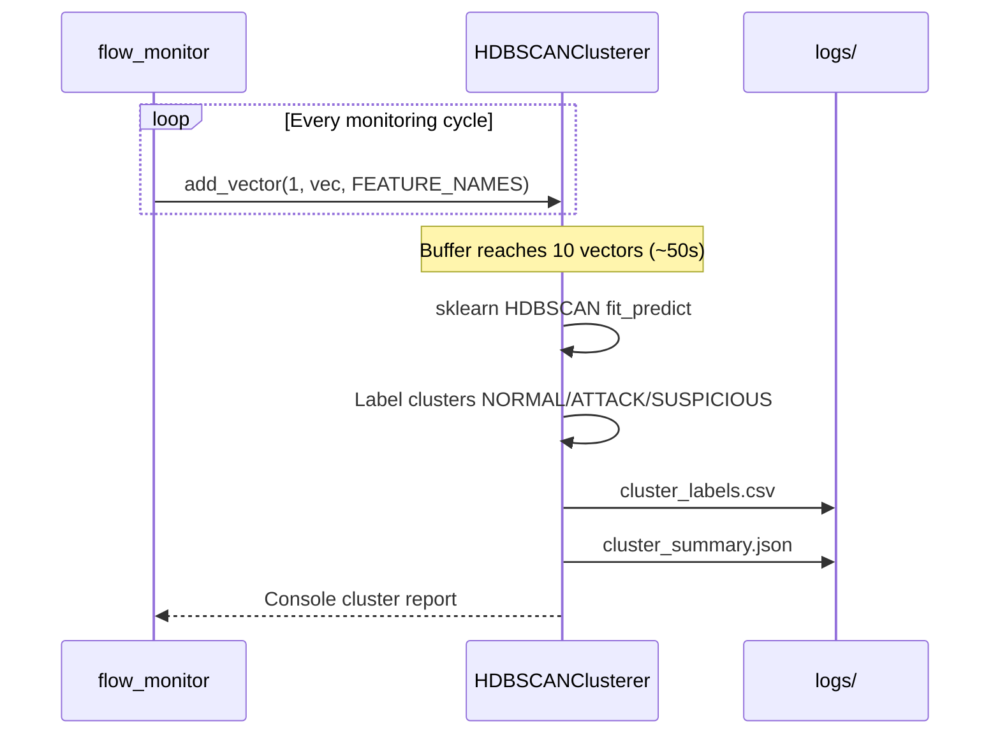

---

## 7. Master Control — Restart Controller Sequence

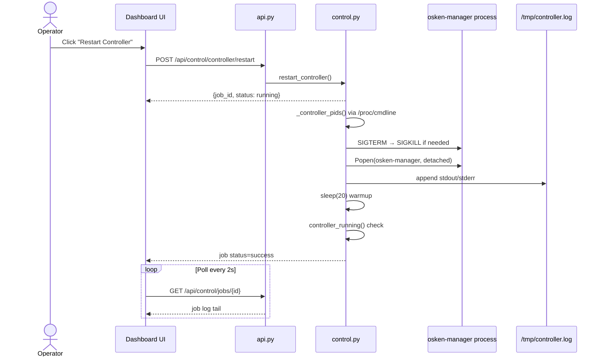

---

## 8. Master Control — Batch Experiment Sequence

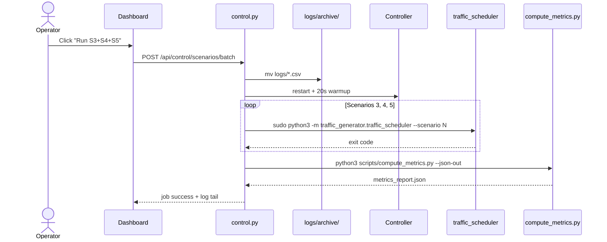

---

## 9. Dashboard Live Polling Sequence

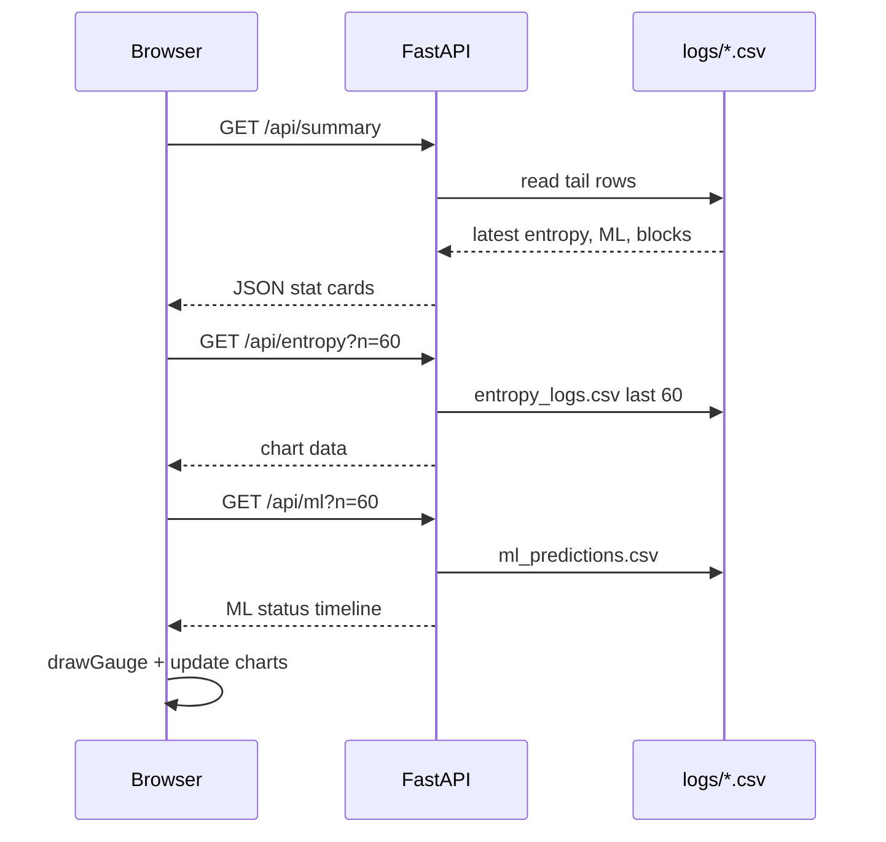

---

## 10. Block Expiry Sequence

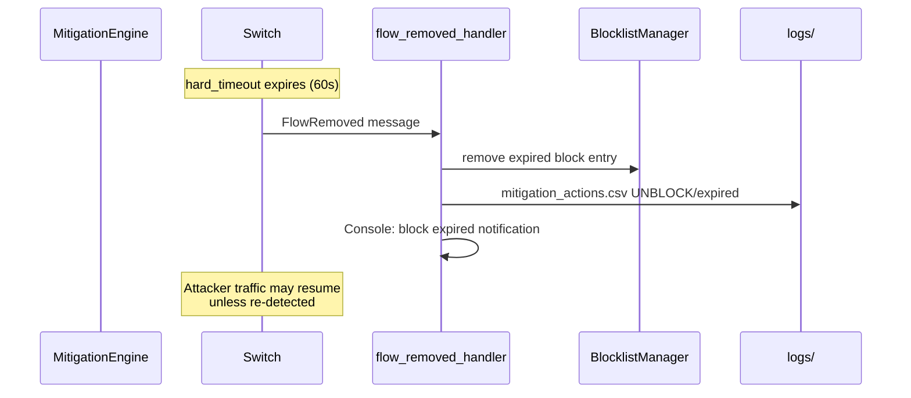

---

## 11. Scenario Ground-Truth vs Detection Sequence (S2 SYN Flood)

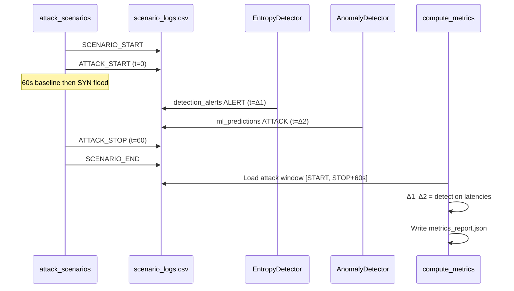
