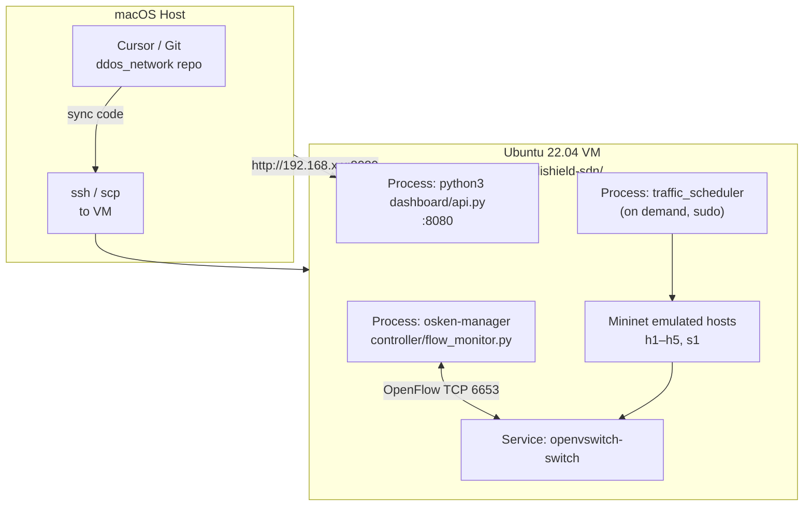
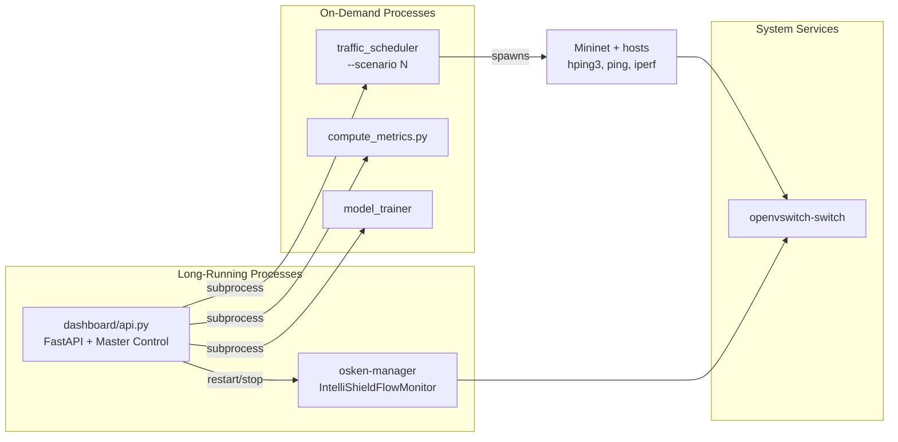
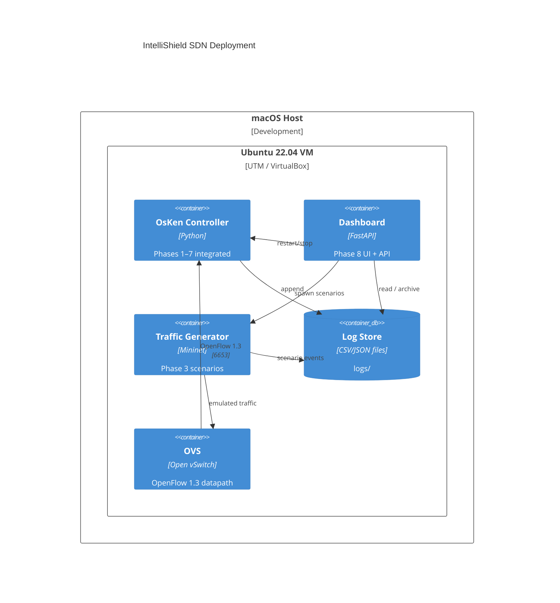
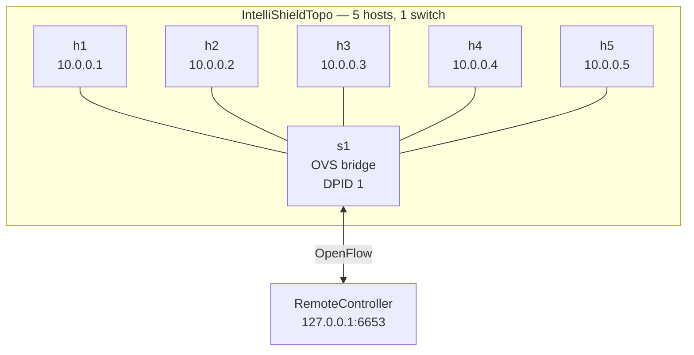
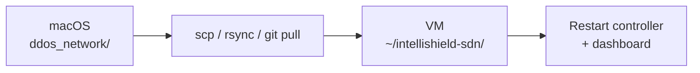

# Deployment Architecture

## 1. Physical Deployment Topology

IntelliShield SDN runs on a **macOS development host** with an **Ubuntu 22.04 LTS virtual machine** hosting all SDN runtime components.



---

## 2. Network Ports and Protocols

| Service | Port | Protocol | Bind Address | Notes |
|---------|------|----------|--------------|-------|
| OpenFlow controller | 6653 | TCP | 0.0.0.0 (OsKen default) | OVS connects as client |
| Dashboard API + UI | 8080 | HTTP | 0.0.0.0 | FastAPI uvicorn |
| Mininet data plane | — | Ethernet (virtual) | 10.0.0.0/8 | Emulated L2/L3 |
| SSH | 22 | TCP | VM IP | Remote administration |

---

## 3. Process Architecture on VM



**Typical demo session:**

1. Terminal A: `osken-manager controller/flow_monitor.py`
2. Terminal B: `python3 dashboard/api.py`
3. Browser: `http://<VM-IP>:8080`
4. Master Control UI or Terminal C: run scenario

---

## 4. Directory Layout on VM

```text
~/intellishield-sdn/
├── controller/
│   └── flow_monitor.py          # OsKen application entry point
├── entropy_engine/
├── ml_models/
├── mitigation/
├── advanced_analytics/
├── rl_engine/
├── traffic_generator/
├── dashboard/
│   ├── api.py                   # HTTP :8080
│   ├── control.py               # Master Control job runner
│   ├── static/index.html
│   └── requirements.txt
├── scripts/
│   └── compute_metrics.py
├── logs/                        # Runtime-generated (not in git)
│   ├── *.csv
│   ├── *.json
│   ├── models/*.pkl
│   ├── ppo_weights.pkl
│   └── archive/<timestamp>/
└── verify_phase7.py
```

---

## 5. Deployment Diagram (C4 Container Level)



---

## 6. Mininet Topology



| Host | Typical Role |
|------|--------------|
| h1 | Attacker (SYN/UDP flood via hping3) |
| h2 | Victim / iperf server |
| h3–h5 | Background normal traffic |

---

## 7. Software Dependencies

| Component | Package / Tool | Install |
|-----------|----------------|---------|
| SDN framework | `python3-os-ken` | `sudo apt install python3-os-ken` |
| Emulation | `mininet` | `sudo apt install mininet` |
| Switch | `openvswitch-switch` | `sudo apt install openvswitch-switch` |
| ML | `scikit-learn`, `numpy` | `pip3 install scikit-learn numpy` |
| Dashboard | `fastapi`, `uvicorn` | `pip3 install -r dashboard/requirements.txt` |
| Attack tools | `hping3`, `iperf` | `sudo apt install hping3 iperf` |

---

## 8. Environment Configuration

| Variable / Setting | Purpose |
|--------------------|---------|
| `INTELLISHIELD_SUDO_PASS` | Dashboard Master Control sudo password for scenarios |
| `/etc/sudoers.d/intellishield` | Passwordless `traffic_scheduler` for dashboard |
| `timedatectl set-timezone Asia/Kolkata` | VM local time for log timestamps |
| `sys.path` insert in `flow_monitor.py` | Import sibling packages from project root |

**Sudoers entry (recommended for UI scenarios):**

```bash
echo 'akshay ALL=(ALL) NOPASSWD: /usr/bin/python3 -m traffic_generator.traffic_scheduler *' \
  | sudo tee /etc/sudoers.d/intellishield
sudo chmod 440 /etc/sudoers.d/intellishield
```

---

## 9. Startup Commands Reference

```bash
# Terminal 1 — Controller
cd ~/intellishield-sdn
osken-manager controller/flow_monitor.py

# Terminal 2 — Dashboard
cd ~/intellishield-sdn
pip3 install -r dashboard/requirements.txt   # first time only
python3 dashboard/api.py

# Terminal 3 — Scenario (manual)
cd ~/intellishield-sdn
sudo python3 -m traffic_generator.traffic_scheduler --scenario 2

# Metrics (manual or via UI)
python3 scripts/compute_metrics.py --json-out logs/metrics_report.json
```

---

## 10. Sync from Development Host



After code sync, restart the controller to load Python changes. Dashboard auto-reloads only if started with `--reload` (not default).

---

## 11. Scaling and Production Notes

This deployment is **research/lab-oriented**, not production-hardened:

| Aspect | Current Design | Production Consideration |
|--------|----------------|-------------------------|
| High availability | Single controller process | Controller clustering (e.g., ONOS, Ryu HA) |
| Log storage | Local CSV files | Time-series DB (InfluxDB, Elasticsearch) |
| Security | HTTP dashboard on :8080 | TLS, authentication, network ACLs |
| Topology | Single-switch Mininet | Multi-switch physical/fabric deployment |
| RL training | Online during monitoring | Offline training pipeline |

For IEEE experiments and viva demonstration, the single-VM Mininet deployment is the intended and validated configuration.
