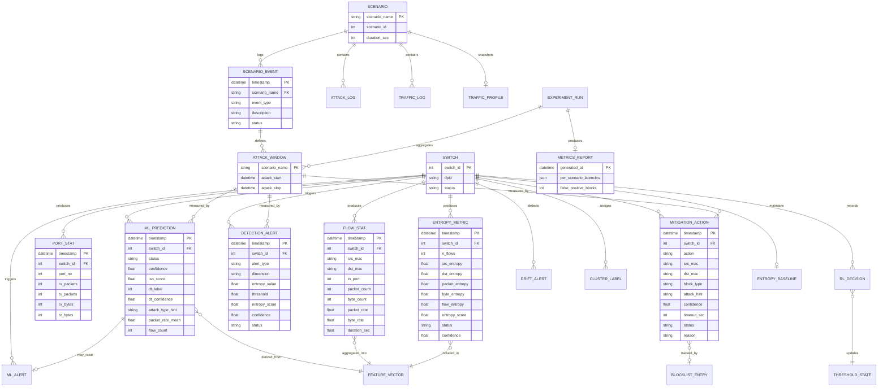
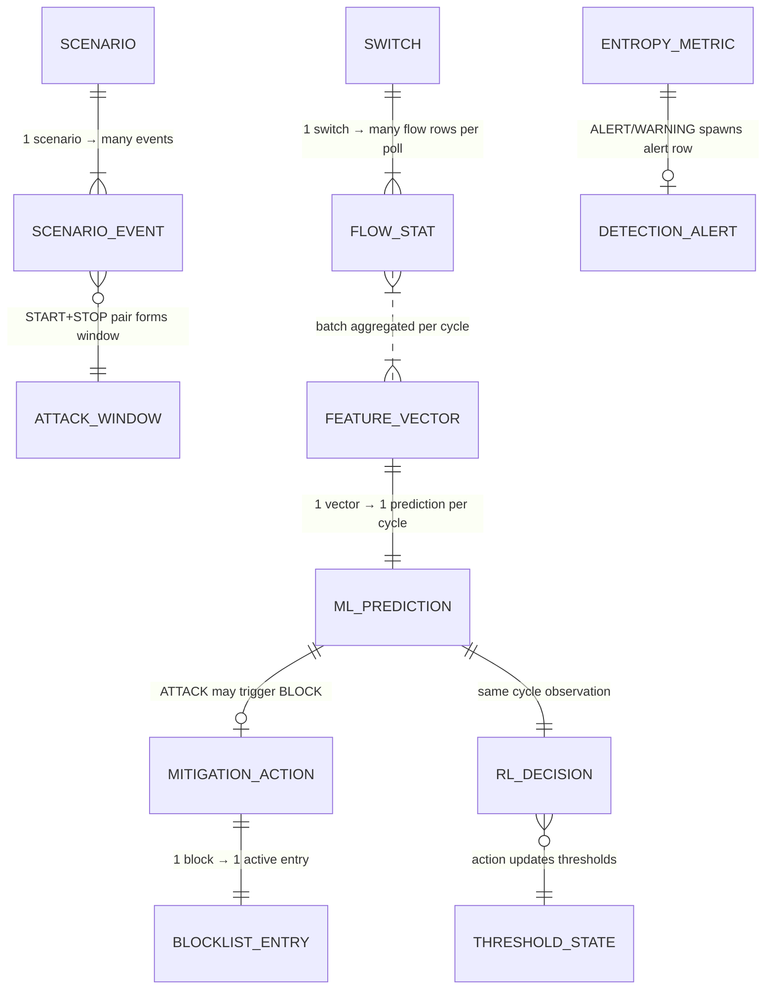
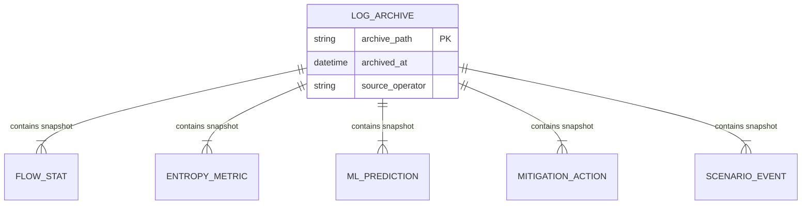
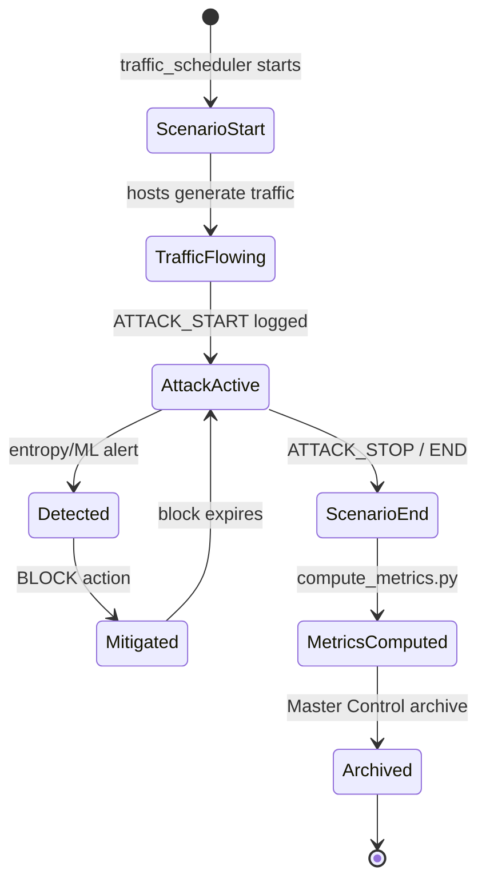

# ER Diagram — Logical Data Model

## 1. Overview

IntelliShield SDN does not use a relational database. Persistence is **file-based** (CSV + JSON). This document defines the **logical entity-relationship model** implied by log schemas, in-memory state, and cross-file joins used by `compute_metrics.py` and the dashboard.

Entities are grouped by **producing module**. Relationships use `switch_id` (OpenFlow DPID), `timestamp`, and `scenario_name` as join keys.

---

## 2. Core Entity Relationship Diagram



---

## 3. Entity Catalog by Log File

### 3.1 Phase 1 — Controller Telemetry

| Entity | File | Primary Key | Foreign Keys |
|--------|------|-------------|--------------|
| `FLOW_STAT` | `flow_stats.csv` | timestamp + switch_id + src_mac + dst_mac | switch_id |
| `PORT_STAT` | `port_stats.csv` | timestamp + switch_id + port_no | switch_id |

### 3.2 Phase 2 — Entropy Engine

| Entity | File | Primary Key | Foreign Keys |
|--------|------|-------------|--------------|
| `ENTROPY_METRIC` | `entropy_logs.csv` | timestamp + switch_id | switch_id |
| `DETECTION_ALERT` | `detection_alerts.csv` | timestamp + switch_id + alert_type | switch_id |
| `ENTROPY_BASELINE` | `entropy_baselines.json` | switch_id + dimension | switch_id |

### 3.3 Phase 3 — Traffic Generator

| Entity | File | Primary Key | Foreign Keys |
|--------|------|-------------|--------------|
| `TRAFFIC_LOG` | `traffic_logs.csv` | timestamp + source_host | scenario (implicit) |
| `ATTACK_LOG` | `attack_logs.csv` | timestamp + attack_type | scenario (implicit) |
| `SCENARIO_EVENT` | `scenario_logs.csv` | timestamp + event_type | scenario_name |
| `TRAFFIC_PROFILE` | `traffic_profiles.json` | session timestamp | — |

### 3.4 Phase 4 — ML Models

| Entity | File | Primary Key | Foreign Keys |
|--------|------|-------------|--------------|
| `ML_PREDICTION` | `ml_predictions.csv` | timestamp + switch_id | switch_id |
| `ML_ALERT` | `ml_alerts.csv` | timestamp + switch_id | switch_id, ML_PREDICTION |
| `ML_SUMMARY` | `ml_summary.json` | session | switch_id |
| `ML_MODEL` | `logs/models/*.pkl` | model_type | — |

### 3.5 Phase 5 — Mitigation

| Entity | File | Primary Key | Foreign Keys |
|--------|------|-------------|--------------|
| `MITIGATION_ACTION` | `mitigation_actions.csv` | timestamp + action + src_mac | switch_id |
| `MITIGATION_SUMMARY` | `mitigation_summary.json` | session | switch_id |
| `BLOCKLIST_ENTRY` | in-memory (`BlocklistManager`) | switch_id + src_mac | switch_id |

### 3.6 Phase 6 — Advanced Analytics

| Entity | File | Primary Key | Foreign Keys |
|--------|------|-------------|--------------|
| `DRIFT_ALERT` | `drift_alerts.csv` | timestamp + metric | switch_id |
| `CLUSTER_LABEL` | `cluster_labels.csv` | timestamp + vector_index | switch_id, cluster_id |
| `CLUSTER_SUMMARY` | `cluster_summary.json` | run_id | switch_id |

### 3.7 Phase 7 — RL Engine

| Entity | File | Primary Key | Foreign Keys |
|--------|------|-------------|--------------|
| `RL_DECISION` | `rl_decisions.csv` | timestamp + switch_id | switch_id |
| `RL_TRAINING` | `rl_training.csv` | update_timestamp | — |
| `THRESHOLD_STATE` | in-memory (`ThresholdAdapter`) | — | — |
| `PPO_WEIGHTS` | `ppo_weights.pkl` | — | — |

### 3.8 Evaluation

| Entity | File | Primary Key | Foreign Keys |
|--------|------|-------------|--------------|
| `ATTACK_WINDOW` | derived from `scenario_logs.csv` | scenario_name + attack_start | scenario_name |
| `METRICS_REPORT` | `metrics_report.json` | generated_at | ATTACK_WINDOW |

---

## 4. Attribute Schemas (Detailed)

### FLOW_STAT (`flow_stats.csv`)

```text
timestamp, switch_id, src_mac, dst_mac, in_port, priority,
packet_count, byte_count, packet_rate, byte_rate, duration_sec
```

### ENTROPY_METRIC (`entropy_logs.csv`)

```text
timestamp, switch_id, n_flows, src_entropy, dst_entropy,
packet_entropy, byte_entropy, flow_entropy, entropy_score, status, confidence
```

### ML_PREDICTION (`ml_predictions.csv`)

```text
timestamp, switch_id, status, confidence, iso_score,
dt_label, dt_confidence, attack_type_hint, src_entropy,
dst_entropy, entropy_score, packet_rate_mean, flow_count
```

### MITIGATION_ACTION (`mitigation_actions.csv`)

```text
timestamp, action, dpid, src_mac, dst_mac, block_type,
attack_hint, confidence, timeout_sec, status, reason
```

### SCENARIO_EVENT (`scenario_logs.csv`)

```text
timestamp, scenario_name, event_type, description, status
```

**`event_type` values:** `SCENARIO_START`, `ATTACK_START`, `ATTACK_STOP`, `ATTACK1_START`, `ATTACK1_STOP`, `ATTACK2_START`, `ATTACK2_STOP`, `END`

### RL_DECISION (`rl_decisions.csv`)

```text
timestamp, switch_id, packet_rate, byte_rate, entropy_score,
flow_count, ml_label, ml_confidence, pkt_threshold, byte_threshold,
conf_threshold, action_0, action_1, action_2, reward
```

---

## 5. Relationship Cardinality Details



---

## 6. Join Keys for Metrics Computation

`scripts/compute_metrics.py` performs these logical joins:

| Join | Left Entity | Right Entity | Key | Purpose |
|------|-------------|--------------|-----|---------|
| J1 | `ATTACK_WINDOW` | `DETECTION_ALERT` | timestamp ∈ window | Entropy detection latency |
| J2 | `ATTACK_WINDOW` | `ML_PREDICTION` | timestamp ∈ window, status=ATTACK | ML detection latency |
| J3 | `ATTACK_WINDOW` | `MITIGATION_ACTION` | timestamp ∈ window, action=BLOCK | Mitigation latency |
| J4 | complement(windows) | `MITIGATION_ACTION` | timestamp ∉ attack windows | False-positive blocks |

---

## 7. In-Memory Entities (Not Persisted to CSV)

| Entity | Module | Attributes | Lifecycle |
|--------|--------|------------|-----------|
| `BLOCKLIST_ENTRY` | `blocklist_manager.py` | src_mac, dpid, expires_at, attack_hint | Until timeout or manual unblock |
| `THRESHOLD_STATE` | `threshold_adapter.py` | pkt_threshold, byte_threshold, conf_threshold | Session-long; checkpointed via RL logs |
| `ENTROPY_WINDOW` | `entropy_detector.py` | deque of flow features per switch | Sliding window per DPID |
| `PPO_REPLAY_BUFFER` | `ppo_agent.py` | state, action, reward transitions | Rolling buffer for policy updates |
| `HDBSCAN_BUFFER` | `hdbscan_clusterer.py` | last N feature vectors | Cleared after clustering run |

---

## 8. Archive Entity



**Path pattern:** `logs/archive/YYYYMMDD_HHMMSS/*.csv`

Archives preserve experiment isolation so `compute_metrics.py` does not cross-contaminate detection timestamps across runs.

---

## 9. Entity Lifecycle Summary



This logical model supports IEEE-style evaluation queries (detection latency, false positives, per-scenario breakdown) without requiring a SQL database — joins are performed in Python over CSV files at analysis time.
