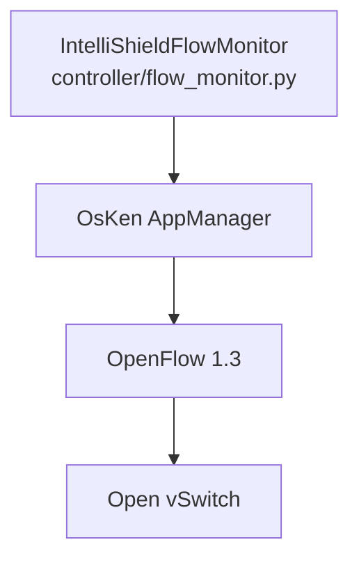
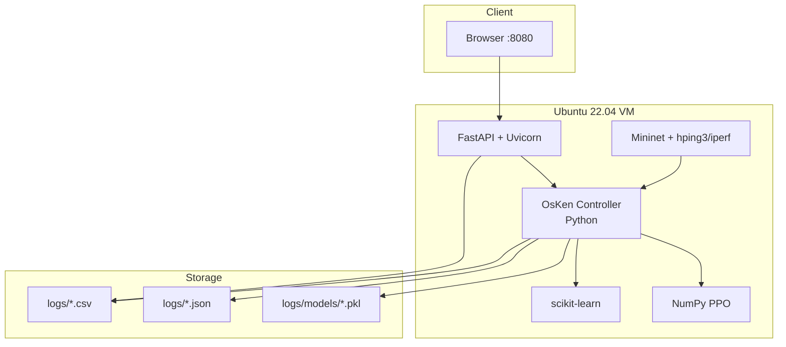

# Technology Stack

## 1. Overview

IntelliShield SDN is a **Python-centric SDN research prototype** running on an **Ubuntu 22.04 LTS VM** with Mininet emulation. There is no microservices stack, no container orchestration, and no relational database in the current implementation.

---

## 2. Core Platform

| Layer | Technology | Version / Notes |
|-------|------------|-----------------|
| Host OS (dev) | macOS | Source development |
| Runtime OS | Ubuntu 22.04 LTS | Primary execution environment |
| Language | Python | 3.10+ (VM verified) |
| SDN controller framework | **OsKen** (`python3-os-ken`) | OpenFlow 1.3 application host |
| Network emulation | **Mininet** | Virtual hosts + OVS switch |
| Data plane | **Open vSwitch** (`openvswitch-switch`) | OpenFlow 1.3 datapath |

---

## 3. Python Dependencies

### 3.1 Dashboard (`dashboard/requirements.txt`)

```text
fastapi>=0.100.0
uvicorn>=0.23.0
```

### 3.2 ML and analytics (installed on VM via pip/apt)

| Package | Used by |
|---------|---------|
| `numpy` | PPO agent, RL env, flow_monitor, feature math |
| `scikit-learn` | IsolationForest, DecisionTree, StandardScaler, HDBSCAN |
| `pydantic` | FastAPI request models (`BatchScenarioRequest`) |

### 3.3 SDN and emulation (system packages)

| Package | Used by |
|---------|---------|
| `python3-os-ken` | `osken-manager`, OpenFlow event handling |
| `mininet` | `traffic_scheduler`, topology creation |
| `openvswitch-switch` | Virtual switch datapath |

### 3.4 Attack / traffic tools (VM binaries)

| Tool | Used by |
|------|---------|
| `hping3` | SYN/UDP/ICMP flood in `attack_generator.py` |
| `iperf` | TCP/UDP traffic in `normal_traffic.py` |
| `ping` | ICMP baseline in `normal_traffic.py` |
| `wget` / `python3 -m http.server` | HTTP traffic simulation |

### 3.5 Explicitly not used

| Technology | Status |
|------------|--------|
| PyTorch / TensorFlow | Not used — custom NumPy PPO |
| `river` (ADWIN) | Not used — custom pure-Python ADWIN |
| Docker / Kubernetes | Not implemented |
| PostgreSQL / MySQL / MongoDB / Redis | Not implemented |
| Celery / RabbitMQ | Not implemented — `threading` for background jobs |

---

## 4. SDN Protocol Stack



| OpenFlow message | Direction | Purpose |
|------------------|-----------|---------|
| `OFPPacketIn` | Switch → Controller | L2 learning, forwarding |
| `OFPFlowStatsRequest/Reply` | Both | Per-flow telemetry (Phase 1) |
| `OFPPortStatsRequest/Reply` | Both | Port counters |
| `OFPFlowMod` | Controller → Switch | Forwarding rules + DROP mitigation |
| `OFPFlowRemoved` | Switch → Controller | Block expiry notification |
| `OFPSwitchFeatures` | Switch → Controller | Table-miss install |

**Controller connection:** `127.0.0.1:6653` (Mininet `RemoteController`)

---

## 5. Web Stack (Phase 8)

| Component | Technology |
|-----------|------------|
| HTTP server | Uvicorn ASGI |
| API framework | FastAPI |
| Frontend | Vanilla HTML / CSS / JavaScript (`dashboard/static/index.html`) |
| CORS | `CORSMiddleware` — `allow_origins=["*"]` |
| Bind address | `0.0.0.0:8080` |

No React, Vue, or WebSocket — dashboard polls REST endpoints on a timer.

---

## 6. Process Model

| Process | Command | Role |
|---------|---------|------|
| Controller | `osken-manager controller/flow_monitor.py` | Long-running SDN app |
| Dashboard | `python3 dashboard/api.py` | HTTP API + static UI |
| Scenarios | `sudo python3 -m traffic_generator.traffic_scheduler --scenario N` | On-demand Mininet experiments |
| Metrics | `python3 scripts/compute_metrics.py` | Offline/batch analysis |
| ML training | `python3 -m ml_models.model_trainer` | Model fitting |

All processes run as **plain OS processes** on the VM — not containerised.

---

## 7. File Formats

| Format | Usage |
|--------|-------|
| `.py` | All application logic |
| `.csv` | Append-only telemetry and event logs |
| `.json` | Session summaries, baselines, metrics reports |
| `.pkl` | ML models (pickle), PPO weights |
| `.md` | Documentation |

---

## 8. Development Tools

| Tool | Purpose |
|------|---------|
| `verify_phase7.py` | Automated RL/PPO unit verification |
| `test_phase7.sh` | Shell wrapper for Phase 7 tests |
| `python3 -m py_compile` | Syntax validation per module |
| `git` | Version control |
| `ssh` / `scp` | Mac → VM sync |

---

## 9. Technology Stack Diagram


