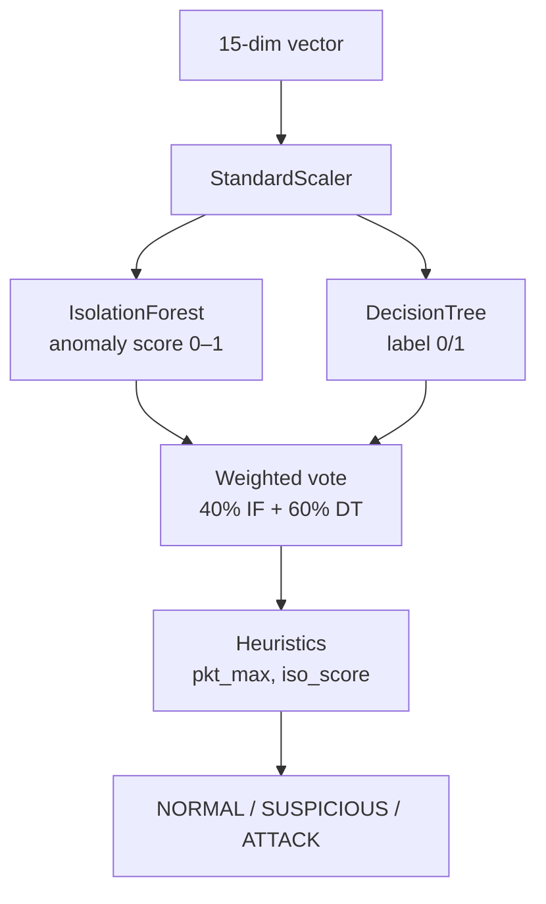
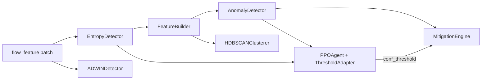

# AI Components

## 1. Overview

IntelliShield implements **five AI/analytics components** integrated into `controller/flow_monitor.py`. All run **online** during the 5-second monitoring cycle (except HDBSCAN, which batches every 10 cycles).

| Component | Type | Package | Phase |
|-----------|------|---------|-------|
| Shannon entropy detector | Rule-based + information theory | `entropy_engine/` | 2 |
| Isolation Forest | Unsupervised ML | `ml_models/anomaly_detector.py` | 4 |
| Decision Tree | Supervised ML | `ml_models/anomaly_detector.py` | 4 |
| ADWIN | Online drift detection | `advanced_analytics/adwin_detector.py` | 6 |
| HDBSCAN | Density clustering | `advanced_analytics/hdbscan_clusterer.py` | 6 |
| PPO (Proximal Policy Optimization) | Reinforcement learning | `rl_engine/ppo_agent.py` | 7 |

There is **no deep learning** (no neural networks beyond the small NumPy MLP inside PPO).

---

## 2. Phase 2 — Entropy Engine

### 2.1 Algorithm

**Shannon entropy** on five traffic dimensions, normalised to [0, 1]:

```
H(X) = -Σ p(x_i) · log2(p(x_i))
H_norm = H(X) / log2(n)
```

### 2.2 Implementation files

| File | Role |
|------|------|
| `entropy_utils.py` | `shannon_entropy`, `normalised_entropy`, distribution helpers |
| `entropy_calculator.py` | `calculate_all_entropy()` — src, dst, packet, byte, flow |
| `entropy_detector.py` | `EntropyDetector` — sliding window, thresholds, status |
| `entropy_logger.py` | CSV + JSON persistence |

### 2.3 Key parameters (`entropy_detector.py`)

| Parameter | Value |
|-----------|-------|
| `WINDOW_SIZE` | 100 flow dicts per switch |
| `HISTORY_SIZE` | 50 entropy scores for baseline |
| `MIN_FLOWS_FOR_ANALYSIS` | 3 |
| `SRC_ENTROPY_THRESHOLD` | 0.30 |
| `DST_ENTROPY_THRESHOLD` | 0.30 |
| `PACKET_ENTROPY_THRESHOLD` | 0.20 |
| `BYTE_ENTROPY_THRESHOLD` | 0.20 |
| `FLOW_ENTROPY_THRESHOLD` | 0.30 |
| `COMPOSITE_SCORE_THRESHOLD` | 0.40 |

**Composite weights (`DIM_WEIGHTS`):** src 0.30, dst 0.30, packet 0.15, byte 0.15, flow 0.10.

**Output status:** `NORMAL` | `WARNING` | `ALERT`

---

## 3. Phase 4 — Hybrid ML Ensemble

### 3.1 Models

| Model | sklearn class | Training data | Role |
|-------|---------------|---------------|------|
| **Isolation Forest** | `sklearn.ensemble.IsolationForest` | 300 normal samples (synthetic) | Unsupervised anomaly score |
| **Decision Tree** | `sklearn.tree.DecisionTreeClassifier` | 300 normal + 200 attack (synthetic) | Supervised class label |
| **StandardScaler** | `sklearn.preprocessing.StandardScaler` | Fitted on training features | Feature normalisation |

**Saved to:** `logs/models/isolation_forest.pkl`, `decision_tree.pkl`, `scaler.pkl`

### 3.2 Feature vector (15 dimensions)

Built by `FeatureBuilder.build()` in `feature_builder.py`:

```python
FEATURE_NAMES = [
    "packet_rate_mean", "packet_rate_max", "byte_rate_mean", "byte_rate_max",
    "flow_count", "duration_mean", "unique_src_count", "unique_dst_count",
    "src_entropy", "dst_entropy", "packet_entropy", "byte_entropy",
    "flow_entropy", "entropy_score", "flow_concentration",
]
```

### 3.3 Ensemble logic (`anomaly_detector.py`)



| Parameter | Value |
|-----------|-------|
| `ISO_CONTAMINATION` | 0.1 (10%) |
| `NORMAL_THRESHOLD` | 0.3 |
| `ATTACK_THRESHOLD` | 0.65 |

**Special rules:** quiet baseline (`iso_score > 0.75` and `pkt_max < 100`) → `NORMAL`; elevated non-flood → `SUSPICIOUS`.

### 3.4 Explainability (`explainer.py`)

- `Explainer.explain(vec, prediction)` — feature narrative, attack type hint
- `FEATURE_DESCRIPTIONS` — human-readable feature meanings
- `NORMAL_RANGES` — threshold comparisons for anomaly highlighting
- Attack hints: `SYN_FLOOD`, `UDP_FLOOD`, `ICMP_FLOOD`, `VOLUMETRIC_FLOOD`, `UNKNOWN_ANOMALY`

### 3.5 Training pipeline (`model_trainer.py`)

```bash
python3 -m ml_models.model_trainer --synthetic    # Bootstrap from generated data
python3 -m ml_models.model_trainer --from-csv       # Retrain from logs/ml_features.csv
```

| Parameter | Value |
|-----------|-------|
| `MIN_LABELLED_SAMPLES` | 20 |
| `MIN_ATTACK_SAMPLES` | 5 |
| `MIN_NORMAL_SAMPLES` | 10 |

Controller auto-trains synthetic models on startup if models missing (`AUTO_TRAIN_SYNTHETIC_ML` env, default `1`).

### 3.6 Label inference (`label_inference.py`)

Infers NORMAL/ATTACK labels from archived logs for `--from-csv` training.

---

## 4. Phase 6 — ADWIN Drift Detection

### 4.1 Algorithm

Pure-Python **ADWIN2** (Bifet & Gavaldà, 2007) in `adwin_detector.py`:

```
ε_cut = sqrt((1 / (2·m)) · ln(4·n·(ln n)² / δ))
```

If `|mean(W_old) - mean(W_new)| ≥ ε_cut` → drift detected; older window dropped.

### 4.2 Parameters

| Parameter | Default |
|-----------|---------|
| `delta` | 0.002 |
| `max_window` | 150–200 per metric |

### 4.3 Tracked metrics (per switch)

- `packet_rate_mean`
- `flow_count`
- `entropy_score`
- `byte_rate_mean`

**Output:** `logs/drift_alerts.csv`

---

## 5. Phase 6 — HDBSCAN Clustering

### 5.1 Algorithm

`sklearn.cluster.HDBSCAN` on buffered 15-dim feature vectors in `hdbscan_clusterer.py`.

### 5.2 Behaviour

| Setting | Value |
|---------|-------|
| Batch trigger | Every 10 monitoring cycles (~50 s) |
| Buffer size | Last N vectors per switch |
| `min_cluster_size` | 5 (configurable) |

### 5.3 Cluster labels (heuristic)

| Label | Condition |
|-------|-----------|
| `NORMAL` | entropy ≥ 0.6 and pkt_rate ≤ 500 |
| `ATTACK` | entropy < 0.3 or pkt_rate > 5000 |
| `SUSPICIOUS` | between thresholds |
| `NOISE` | HDBSCAN label -1 |

**Output:** `logs/cluster_labels.csv`, `logs/cluster_summary.json`

---

## 6. Phase 7 — PPO Reinforcement Learning

### 6.1 Architecture (`ppo_agent.py`)

Custom **NumPy-only** implementation:

```
Input (10-dim state)
    → Shared MLP (64 hidden, He init)
        → Actor head: Gaussian policy (3-dim action, mean + learned log_std)
        → Critic head: scalar value V(s)
```

### 6.2 Hyperparameters

| Parameter | Value |
|-----------|-------|
| `STATE_DIM` | 10 |
| `ACTION_DIM` | 3 |
| `HIDDEN` | 64 |
| `GAMMA` | 0.99 |
| `GAE_LAMBDA` | 0.95 |
| `CLIP_EPS` | 0.2 |
| `PPO_EPOCHS` | 4 |
| `UPDATE_EVERY` | 20 transitions |
| `ACTOR_LR` | 3e-4 |
| `CRITIC_LR` | 1e-4 |

### 6.3 State vector (`rl_env.py` — `SDNEnvironment.build_state`)

Normalised observations: packet_rate_mean, byte_rate_mean, entropy_score, flow_count, ml_confidence, three current thresholds, recent_attack_count, recent_fp_count.

### 6.4 Action vector (`threshold_adapter.py`)

Three continuous actions ∈ [-1, 1] adjust:

| Action index | Threshold | Scale |
|--------------|-----------|-------|
| 0 | `pkt_threshold` | ±100 pkt/s |
| 1 | `byte_threshold` | ±100,000 B/s |
| 2 | `conf_threshold` | ±0.03 |

**Bounds:** pkt [250, 5000], byte [300K, 5M], conf [0.65, 0.92].

### 6.5 Reward function (`threshold_adapter.compute_reward`)

Rewards true positives, penalises false positives and ML false negatives during flood-like entropy collapse, credits entropy-only detection when ML is blind.

### 6.6 Persistence

- Weights: `logs/ppo_weights.pkl` (pickle)
- Decisions: `logs/rl_decisions.csv`
- Training log: `logs/rl_training.csv`

---

## 7. AI Component Integration in Controller



**Warm-up gate:** ML, mitigation, HDBSCAN, and PPO are skipped for the first `_warmup_threshold` cycles (entropy window fill).

**Attack confirmation:** ML requires `_attack_confirm` consecutive ATTACK/SUSPICIOUS cycles before blocking.

---

## 8. Verification

| Component | Test artifact |
|-----------|---------------|
| PPO + RL | `verify_phase7.py` (40+ checks) |
| ADWIN | `python3 advanced_analytics/adwin_detector.py` |
| HDBSCAN | `python3 advanced_analytics/hdbscan_clusterer.py` |
| Entropy math | Documented in `IMPLEMENTED/PHASE2.md` |
| ML sanity | `IMPLEMENTED/PHASE4.md` — 6/6 samples correct |
