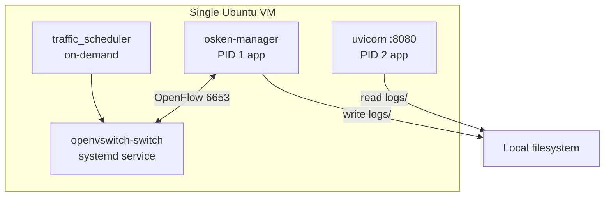

# Kubernetes

## Status: Not Implemented

**Kubernetes, Docker, Helm, and any container orchestration are not part of the IntelliShield SDN implementation.** A full repository search confirms no `Dockerfile`, `docker-compose.yml`, Kubernetes manifests (`deployment.yaml`, `service.yaml`), or container-related deployment scripts exist.

This document records that fact explicitly so implementation documentation stays accurate.

---

## Actual Deployment Model

IntelliShield runs as **native OS processes** on a single Ubuntu 22.04 VM:

| Process | Launcher |
|---------|----------|
| SDN controller | `osken-manager controller/flow_monitor.py` |
| Dashboard API | `python3 dashboard/api.py` (Uvicorn on :8080) |
| Traffic scenarios | `sudo python3 -m traffic_generator.traffic_scheduler` |
| Metrics / training | `python3 scripts/...` (on demand) |

There is no pod scheduling, service mesh, ingress controller, or horizontal pod autoscaling.

---

## Process Architecture (What Exists Instead)

**Master Control** (`dashboard/control.py`) manages controller lifecycle via `subprocess.Popen`, `pgrep`, and `/proc/<pid>/cmdline` — not via Kubernetes API.

---

## Why Kubernetes Is Out of Scope

Per project scope (`PROJECT_DOCS/01_Project_Overview/04_Scope.md`):

- Research prototype for academic demonstration
- Single-switch Mininet lab environment
- No production multi-node deployment requirement

---

## If Containerisation Were Added (Future — Not Current Code)

The following would be needed but **does not exist today**:

| Artifact | Purpose |
|----------|---------|
| `Dockerfile` (controller) | OsKen + Python deps |
| `Dockerfile` (dashboard) | FastAPI + static files |
| `docker-compose.yml` | Local multi-service dev |
| K8s Deployment + Service | Controller, dashboard pods |
| PersistentVolume | `logs/` and `logs/models/` |
| `hostNetwork` or privileged | Mininet requires kernel namespaces |

These are documented as **future scope** in `PROJECT_DOCS/06_Results/05_Future_Scope.md` only.

---

## Summary

| Question | Answer |
|----------|--------|
| Is Kubernetes used? | **No** |
| Is Docker used? | **No** |
| How is the system deployed? | Ubuntu VM + systemd/OVS + manual or UI-triggered processes |
| How are services discovered? | Localhost ports (6653 OpenFlow, 8080 HTTP) |
| How is configuration managed? | Python constants + environment variables |

Refer to [10_Deployment.md](10_Deployment.md) for the actual deployment procedure.
