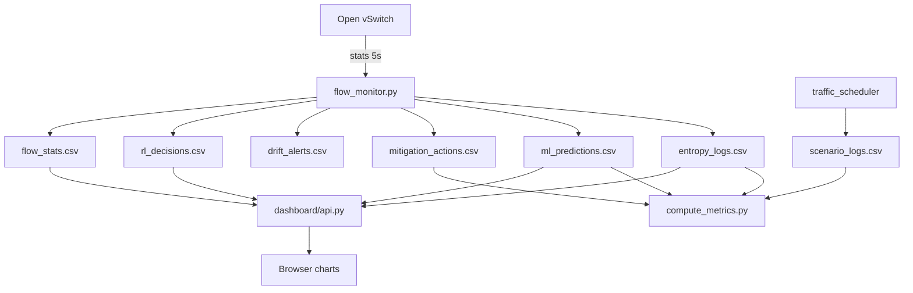

# Monitoring

## 1. Overview

IntelliShield monitoring is **built into the SDN controller** and **persisted to log files** consumed by the dashboard and metrics script. There is no Prometheus, Grafana, Elasticsearch, or commercial APM integration in the current codebase.

Monitoring spans three layers:

1. **Data plane telemetry** — OpenFlow flow and port statistics (Phase 1)
2. **Detection analytics** — Entropy, ML, ADWIN, HDBSCAN (Phases 2, 4, 6)
3. **Operational visibility** — CSV logs, dashboard API, console output

---

## 2. Controller Telemetry (Phase 1)

### 2.1 Implementation

**File:** `controller/flow_monitor.py`  
**Class:** `IntelliShieldFlowMonitor`

| Mechanism | Interval | OpenFlow message |
|-----------|----------|------------------|
| Flow stats poll | 5 s (`MONITOR_INTERVAL`) | `OFPFlowStatsRequest` → `OFPFlowStatsReply` |
| Port stats poll | 5 s | `OFPPortStatsRequest` → `OFPPortStatsReply` |
| Packet-in events | Real-time | `OFPPacketIn` (L2 learning) |

Background thread `_monitor()` spawned via `hub.spawn()` requests stats from all registered datapaths.

### 2.2 Flow feature schema

Each active flow produces:

```python
{
    "timestamp", "switch_id", "src_mac", "dst_mac", "in_port", "priority",
    "packet_count", "byte_count", "packet_rate", "byte_rate", "duration_sec",
}
```

### 2.3 Threshold warnings

| Constant | Default | Trigger |
|----------|---------|---------|
| `PACKET_RATE_WARN_THRESHOLD` | 500 pkt/s | Per-flow console warning |
| `BYTE_RATE_WARN_THRESHOLD` | 500000 B/s | Per-flow console warning |
| `FLOW_COUNT_WARN_THRESHOLD` | 50 | Per-switch flow count warning |

RL-adaptive thresholds (`ThresholdAdapter`) override static values when Phase 7 is active.

### 2.4 Log outputs

| File | Content |
|------|---------|
| `logs/flow_stats.csv` | Per-flow per-poll rows |
| `logs/port_stats.csv` | Per-port rx/tx counters |

---

## 3. Detection Monitoring (Phases 2, 4, 6)

### 3.1 Entropy monitoring

**Cycle:** every stats reply (5 s)  
**Output:** `logs/entropy_logs.csv` (time series), `logs/detection_alerts.csv` (events)

| Field | Meaning |
|-------|---------|
| `entropy_score` | Composite [0, 1] |
| `status` | NORMAL / WARNING / ALERT |
| `confidence` | Alert confidence % |

### 3.2 ML monitoring

**Cycle:** every stats reply after warm-up  
**Output:** `logs/ml_predictions.csv`, `logs/ml_alerts.csv` (ATTACK only)

| Field | Meaning |
|-------|---------|
| `status` | NORMAL / SUSPICIOUS / ATTACK |
| `confidence` | Ensemble confidence % |
| `iso_score` | Isolation Forest anomaly score |
| `attack_type_hint` | Explainer label |

### 3.3 ADWIN drift monitoring

**Cycle:** every stats reply (including warm-up)  
**Output:** `logs/drift_alerts.csv`

Tracks distribution shifts in `packet_rate_mean`, `flow_count`, `entropy_score`, `byte_rate_mean`.

### 3.4 HDBSCAN profiling

**Cycle:** every 10 monitoring cycles (~50 s)  
**Output:** `logs/cluster_labels.csv`, `logs/cluster_summary.json`

---

## 4. Mitigation Monitoring (Phase 5)

| File | Events |
|------|--------|
| `logs/mitigation_actions.csv` | BLOCK, UNBLOCK, SKIPPED, FAILED |
| `logs/mitigation_summary.json` | Session totals, active blocks |

**In-memory:** `BlocklistManager` tracks active blocks with expiry times.

**OpenFlow:** `flow_removed_handler` detects `hard_timeout` expiry on priority-200 rules.

---

## 5. RL Monitoring (Phase 7)

| File | Content |
|------|---------|
| `logs/rl_decisions.csv` | Per-cycle thresholds, reward, ML label |
| `logs/rl_training.csv` | PPO loss values per weight update |
| `logs/ppo_weights.pkl` | Policy checkpoint |

---

## 6. Experiment Ground Truth (Phase 3)

| File | Content |
|------|---------|
| `logs/scenario_logs.csv` | SCENARIO_START, ATTACK_START/STOP, END |
| `logs/attack_logs.csv` | Attack launch events |
| `logs/traffic_logs.csv` | Normal traffic events |

Used by `scripts/compute_metrics.py` to measure detection and mitigation latency.

---

## 7. Metrics Script

**File:** `scripts/compute_metrics.py`

Joins scenario attack windows with detection and mitigation timestamps:

| Metric | Source join |
|--------|-------------|
| Entropy detection latency | `entropy_logs` ALERT/WARNING in window |
| ML detection latency | `ml_predictions` ATTACK in window |
| Mitigation latency | `mitigation_actions` BLOCK SUCCESS in window |
| False-positive blocks | BLOCK outside attack windows |

**Output:** stdout table + optional `logs/metrics_report.json`

---

## 8. Dashboard Monitoring

### 8.1 Phase health (`GET /api/status`)

Infers phase activity from log file modification time (< 300 s = active):

| Key | Detection method |
|-----|------------------|
| `phase1_flow_monitor` | `flow_stats.csv` or `port_stats.csv` fresh |
| `phase2_entropy` | `entropy_logs.csv` fresh |
| `phase4_ml` | `ml_predictions.csv` fresh |
| `phase5_mitigation` | `mitigation_actions.csv` exists |
| `phase6_adwin` | `drift_alerts.csv` exists |
| `phase7_rl` | `ppo_weights.pkl` exists |
| `controller_running` | port/flow stats fresh |

### 8.2 Live charts

Frontend polls every **5 s** (`INTERVAL = 5000` in `index.html`):

- Traffic rates (`/api/traffic`)
- Entropy dimensions (`/api/entropy`)
- ML predictions (`/api/ml`)
- RL thresholds (`/api/rl`)
- Summary cards (`/api/summary`)

Control status polls every **3 s** (`/api/control/status`).

---

## 9. Console Monitoring

All phases print formatted banners to the controller terminal:

| Phase | Console output |
|-------|----------------|
| 1 | Flow/port statistics tables |
| 2 | Entropy report + ALERT banners |
| 4 | ML status + explanation blocks |
| 5 | BLOCK success/failure lines |
| 6 | ADWIN drift + HDBSCAN cluster tables |
| 7 | RL threshold + reward per cycle |

Controller stdout/stderr from Master Control restarts append to `/tmp/controller.log`.

---

## 10. Monitoring Architecture



---

## 11. What Is Not Monitored

| Capability | Status |
|------------|--------|
| Prometheus metrics export | Not implemented |
| Grafana dashboards | Not implemented |
| Email/SMS alerting | Not implemented |
| Centralised log aggregation (ELK) | Not implemented |
| Per-process CPU/memory metrics | Not implemented |
| Multi-switch aggregated view | Not implemented (single DPID validated) |
