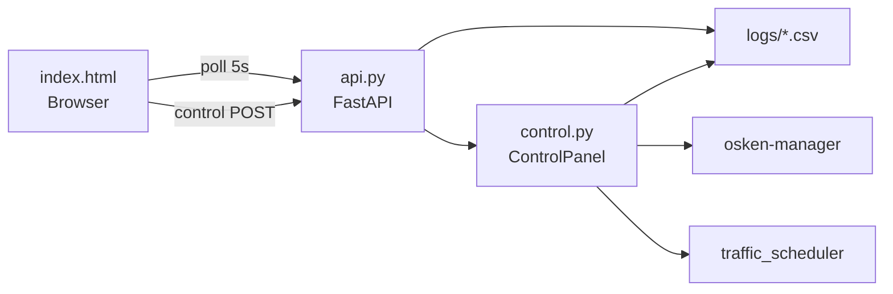

# Dashboard

## 1. Overview

Phase 8 provides a **browser-based live monitoring UI** with a **Master Control panel** for experiment orchestration. Implementation is entirely in `dashboard/` — no separate frontend build step.

| File | Role |
|------|------|
| `api.py` | FastAPI application, REST endpoints, Uvicorn launcher |
| `control.py` | Background job runner for lab operations |
| `static/index.html` | Single-page dashboard UI (HTML/CSS/JS) |
| `requirements.txt` | `fastapi`, `uvicorn` |

---

## 2. Startup

```bash
cd ~/intellishield-sdn
pip3 install -r dashboard/requirements.txt   # once
python3 dashboard/api.py
```

Opens on **`http://<VM-IP>:8080`** (bind `0.0.0.0:8080`).

---

## 3. Frontend (`static/index.html`)

### 3.1 Technology

- Vanilla JavaScript (no npm/webpack)
- `fetch()` for API calls
- Canvas/SVG for entropy gauge and charts
- No WebSocket — polling only

### 3.2 Refresh intervals

| Timer | Interval | Endpoint(s) |
|-------|----------|-------------|
| `refresh()` | 5 s | `/api/summary`, `/api/traffic`, `/api/entropy`, `/api/ml`, `/api/rl`, `/api/alerts`, `/api/blocklist`, `/api/drift` |
| `pollControlStatus()` | 3 s | `/api/control/status` |
| Job poll (on active job) | 2 s | `/api/control/jobs/{id}` |

### 3.3 UI panels

| Panel | Data source |
|-------|-------------|
| Entropy gauge | `/api/entropy` latest score + status |
| Traffic chart | `/api/traffic` packet/byte rates |
| Entropy chart | `/api/entropy` 5 dimensions |
| ML panel | `/api/ml` status, confidence, hint |
| RL panel | `/api/rl` thresholds, reward |
| Alerts list | `/api/alerts` |
| Blocklist | `/api/blocklist` |
| Drift events | `/api/drift` |
| Stat cards | `/api/summary` |
| Master Control | `/api/control/*` |

### 3.4 Master Control Panel

Collapsible panel with buttons for:

| Button | API action |
|--------|------------|
| Restart Controller | `POST /api/control/controller/restart` |
| Stop Controller | `POST /api/control/controller/stop` |
| Archive Logs | `POST /api/control/archive` |
| S1–S5 | `POST /api/control/scenario/{id}` |
| Run S3+S4+S5 | `POST /api/control/scenarios/batch` |
| Compute Metrics | `POST /api/control/metrics` |
| Retrain ML | `POST /api/control/train` |

Job output streams to `#control-log` div via job polling.

---

## 4. Backend (`api.py`)

### 4.1 Path resolution

```python
_ROOT = dashboard/../          # project root
_LOGS = _ROOT / "logs"
_STATIC = dashboard/static/
```

### 4.2 CSV reading

`read_csv_tail(path, n)` — reads last N rows safely; returns `[]` on missing file.

`read_json_safe(path)` — returns `{}` on failure.

### 4.3 CORS

```python
CORSMiddleware(allow_origins=["*"], allow_methods=["*"], allow_headers=["*"])
```

### 4.4 Traffic aggregation

`/api/traffic` aggregates `flow_stats.csv` rows by timestamp (sums packet_rate, byte_rate per poll cycle).

---

## 5. Master Control (`control.py`)

### 5.1 Class: `ControlPanel`

Singleton: `panel = ControlPanel()` imported by `api.py`.

### 5.2 Job model

```python
@dataclass
class Job:
    id: str           # uuid hex[:10]
    name: str
    command: str
    status: str       # running | success | failed
    started_at: str
    ended_at: Optional[str]
    exit_code: Optional[int]
    log: List[str]    # max 500 lines retained
```

Jobs run in **daemon threads**; last 30 jobs kept in memory.

### 5.3 Controller lifecycle

| Method | Implementation |
|--------|----------------|
| `controller_running()` | `pgrep -f osken-manager` + `/proc/pid/cmdline` match |
| `_stop_controller_processes()` | SIGTERM → sleep → SIGKILL |
| `_start_controller_process()` | `Popen(osken-manager, detached, log=/tmp/controller.log)` |
| `restart_controller()` | Stop → start → 20 s warmup → verify |

### 5.4 Scenario execution

```python
sudo python3 -m traffic_generator.traffic_scheduler --scenario {id}
```

- `_scenario_lock` prevents concurrent scenarios
- Sudo via `sudo -n` or `sudo -S` with `INTELLISHIELD_SUDO_PASS`

### 5.5 Batch orchestration

`run_scenario_batch()` sequence:

1. Optional `archive_logs()`
2. Optional controller restart + 20 s warmup
3. Run scenarios sequentially (600 s timeout each)
4. Run `compute_metrics.py --json-out logs/metrics_report.json`

### 5.6 Archive

Moves these files to `logs/archive/<YYYYMMDD_HHMMSS>/`:

- `scenario_logs.csv`
- `entropy_logs.csv`
- `ml_predictions.csv`
- `mitigation_actions.csv`
- `detection_alerts.csv`
- `rl_decisions.csv`

---

## 6. Dashboard Architecture



---

## 7. Sudo Configuration

Scenarios require root (Mininet). Two supported modes:

**Passwordless (recommended):**

```bash
echo 'akshay ALL=(ALL) NOPASSWD: /usr/bin/python3 -m traffic_generator.traffic_scheduler *' \
  | sudo tee /etc/sudoers.d/intellishield
```

**Password via environment:**

```bash
export INTELLISHIELD_SUDO_PASS=yourpassword
python3 dashboard/api.py
```

`control.status()` reports `sudo_password_set: true/false`.

---

## 8. Limitations (Actual Implementation)

| Limitation | Detail |
|------------|--------|
| No authentication | Anyone on network can access :8080 |
| No HTTPS | Plain HTTP only |
| No WebSocket | 5 s polling latency for UI updates |
| Single user | No multi-tenant or role-based access |
| VM timezone | Displays log timestamps as written (VM local time) |
