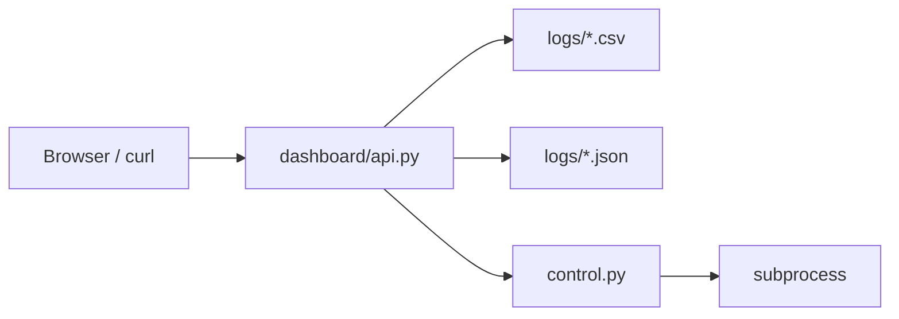

# APIs

## 1. Overview

IntelliShield exposes a **REST HTTP API** via FastAPI in `dashboard/api.py`. There is no GraphQL, gRPC, or northbound OpenFlow API for external orchestration.

| Property | Value |
|----------|-------|
| Base URL | `http://<host>:8080` |
| Framework | FastAPI 0.100+ |
| Server | Uvicorn |
| Auth | **None** |
| Content type | `application/json` (API); `text/html` (UI) |

---

## 2. Read-Only Monitoring Endpoints

### `GET /`

Serves `dashboard/static/index.html`.

---

### `GET /api/status`

Phase health indicators based on log file freshness.

**Response example:**

```json
{
  "phase1_flow_monitor": true,
  "phase2_entropy": true,
  "phase4_ml": true,
  "phase5_mitigation": true,
  "phase6_adwin": true,
  "phase7_rl": true,
  "controller_running": true,
  "server_time": "2026-07-06 20:15:00"
}
```

---

### `GET /api/summary`

Aggregated stat cards for dashboard header.

**Response fields:**

| Field | Source |
|-------|--------|
| `total_alerts` | Row count in `detection_alerts.csv` |
| `total_attacks` | ATTACK rows in recent `ml_predictions.csv` |
| `total_blocks` | `mitigation_summary.json` sessions |
| `active_blocks` | `mitigation_summary.json` |
| `entropy_score` | Latest `entropy_logs.csv` |
| `entropy_status` | Latest entropy status |
| `pkt_threshold` | Latest `rl_decisions.csv` |
| `byte_threshold` | Latest `rl_decisions.csv` |
| `cluster_count` | `cluster_summary.json` |
| `server_time` | Server clock |

---

### `GET /api/traffic?n=60`

Aggregated per-timestamp traffic from `flow_stats.csv`.

**Query params:** `n` (default 60) — number of poll-cycle points.

**Response:**

```json
{
  "points": [
    {
      "timestamp": "2026-07-06 20:10:00",
      "packet_rate": 125.4,
      "byte_rate": 10240.0,
      "flow_count": 4
    }
  ],
  "total_rows": 500
}
```

---

### `GET /api/entropy?n=60`

Last `n` rows from `entropy_logs.csv`.

**Response:**

```json
{
  "points": [
    {
      "timestamp": "...",
      "src_entropy": 1.0,
      "dst_entropy": 0.95,
      "packet_entropy": 1.0,
      "byte_entropy": 1.0,
      "flow_entropy": 1.0,
      "entropy_score": 0.984,
      "status": "NORMAL",
      "confidence": 0.0
    }
  ],
  "latest": { }
}
```

---

### `GET /api/alerts?n=20`

Recent entropy detection alerts (newest first).

**Response:**

```json
{
  "alerts": [
    {
      "timestamp": "...",
      "switch_id": "1",
      "alert_type": "SRC_MAC_ENTROPY_COLLAPSE",
      "dimension": "src",
      "value": 0.04,
      "threshold": 0.3,
      "score": 0.18,
      "confidence": 86.7,
      "status": "ALERT"
    }
  ],
  "total": 1
}
```

---

### `GET /api/ml?n=60`

ML prediction history from `ml_predictions.csv`.

**Response fields per point:** `timestamp`, `switch_id`, `status`, `confidence`, `iso_score`, `dt_label`, `attack_hint`, `entropy_score`, `packet_rate`.

---

### `GET /api/blocklist?n=20`

Mitigation actions from `mitigation_actions.csv` + `mitigation_summary.json`.

**Response:**

```json
{
  "blocks": [
    {
      "timestamp": "...",
      "action": "BLOCK",
      "dpid": "1",
      "src_mac": "02:e4:b2:3a:4e:5f",
      "dst_mac": "00:00:00:00:00:02",
      "block_type": "FLOW_PAIR",
      "attack_hint": "SYN_FLOOD",
      "confidence": 85.2,
      "timeout_sec": 60,
      "status": "SUCCESS"
    }
  ],
  "summary": { }
}
```

---

### `GET /api/rl?n=60`

RL threshold history from `rl_decisions.csv`.

**Response fields:** `pkt_threshold`, `byte_threshold`, `conf_threshold`, `reward`, `ml_label`, `pkt_rate_mean`.

---

### `GET /api/drift?n=20`

ADWIN drift events from `drift_alerts.csv`.

---

### `GET /api/metrics`

Returns `logs/metrics_report.json` if present; otherwise calls `compute_metrics.build_report()` inline.

**Response:** per-scenario latency and false-positive statistics.

---

## 3. Master Control Endpoints

### `GET /api/control/status`

```json
{
  "controller_running": true,
  "scenario_running": false,
  "sudo_password_set": false,
  "project_root": "/home/akshay/intellishield-sdn",
  "running_jobs": [],
  "scenarios": {
    "1": "Normal baseline (60s)",
    "2": "SYN flood h1→h2",
    "3": "UDP flood h1→h2",
    "4": "Burst attack",
    "5": "Mixed SYN + UDP"
  }
}
```

---

### `GET /api/control/jobs`

Returns last 20 jobs summary.

---

### `GET /api/control/jobs/{job_id}`

Returns job detail with `log_tail` (200 lines). **404** if job not found.

---

### `POST /api/control/archive`

Archives experiment CSVs to `logs/archive/<timestamp>/`.

**Response:**

```json
{
  "archived_to": "logs/archive/20260706_201500",
  "files": ["entropy_logs.csv", "ml_predictions.csv", ...]
}
```

---

### `POST /api/control/controller/restart`

Starts async restart job (stop → start → 20 s warmup).

**Response:**

```json
{
  "ok": true,
  "job": {
    "id": "a1b2c3d4e5",
    "name": "Restart controller",
    "status": "running",
    ...
  }
}
```

---

### `POST /api/control/controller/stop`

Stops controller processes immediately.

**Response:** `{"ok": true, "message": "Controller stop signalled"}`

---

### `POST /api/control/scenario/{scenario_id}`

Runs scenario 1–5. **400** invalid ID; **409** if another scenario is running.

---

### `POST /api/control/scenarios/batch`

**Request body:**

```json
{
  "scenario_ids": ["3", "4", "5"],
  "archive_first": true,
  "restart_controller": true
}
```

Runs batch orchestration job.

---

### `POST /api/control/metrics`

Runs `compute_metrics.py --json-out logs/metrics_report.json` as background job.

---

### `POST /api/control/train`

Runs `python3 -m ml_models.model_trainer --from-csv` as background job.

---

## 4. Error Responses

| Code | When |
|------|------|
| 404 | Job ID not found |
| 400 | Invalid scenario ID |
| 409 | Scenario already running |

FastAPI default 422 for malformed JSON bodies.

---

## 5. API Architecture



---

## 6. Example curl Commands

```bash
# Phase health
curl http://192.168.64.5:8080/api/status

# Latest entropy
curl "http://192.168.64.5:8080/api/entropy?n=10"

# Restart controller
curl -X POST http://192.168.64.5:8080/api/control/controller/restart

# Run SYN flood scenario
curl -X POST http://192.168.64.5:8080/api/control/scenario/2

# Poll job
curl http://192.168.64.5:8080/api/control/jobs/{job_id}
```

---

## 7. Non-HTTP Interfaces

| Interface | Protocol | Location |
|-----------|----------|----------|
| OpenFlow | TCP 6653 | Controller ↔ OVS |
| CLI — scenarios | argparse | `traffic_scheduler --scenario N` |
| CLI — metrics | argparse | `compute_metrics.py --logs-dir` |
| CLI — training | argparse | `model_trainer --synthetic` |
| Python imports | in-process | Phase hooks in `flow_monitor.py` |

There is no public Python SDK or OpenAPI client generation beyond FastAPI's auto-docs at `/docs` (if enabled by default).
