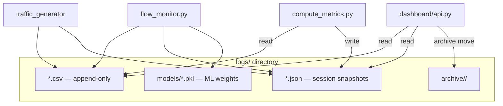

# Database (Persistence Layer)

## Status: No Relational Database

IntelliShield SDN **does not use** PostgreSQL, MySQL, SQLite, MongoDB, Redis, or any other database server. All persistence is **file-based** on the local filesystem under `logs/`.

This document describes the **actual persistence implementation** — treating CSV/JSON/pickle files as the system's data store.

---

## 1. Persistence Architecture

---

## 2. CSV Files (Primary Time-Series Store)

Append-only comma-separated files. Headers created on first write by each logger's `init_*` function.

### Phase 1 — Controller

| File | Writer | Key columns |
|------|--------|-------------|
| `flow_stats.csv` | `flow_monitor.py` | timestamp, switch_id, src_mac, dst_mac, packet_rate, byte_rate, ... |
| `port_stats.csv` | `flow_monitor.py` | timestamp, switch_id, port_no, rx_packets, tx_packets, ... |

### Phase 2 — Entropy

| File | Writer | Key columns |
|------|--------|-------------|
| `entropy_logs.csv` | `entropy_logger.py` | timestamp, switch_id, n_flows, src_entropy, ..., entropy_score, status, confidence |
| `detection_alerts.csv` | `entropy_logger.py` | timestamp, alert_type, dimension, entropy_value, threshold, ... |

### Phase 3 — Traffic

| File | Writer | Key columns |
|------|--------|-------------|
| `scenario_logs.csv` | `traffic_logger.py` | timestamp, scenario_name, event_type, description, status |
| `attack_logs.csv` | `traffic_logger.py` | timestamp, attack_type, source_host, target_host, attack_rate, ... |
| `traffic_logs.csv` | `traffic_logger.py` | timestamp, traffic_type, source_host, protocol, packet_rate, ... |

### Phase 4 — ML

| File | Writer | Key columns |
|------|--------|-------------|
| `ml_predictions.csv` | `ml_logger.py` | timestamp, switch_id, status, confidence, iso_score, attack_type_hint, ... |
| `ml_alerts.csv` | `ml_logger.py` | High-confidence ATTACK events only |
| `ml_features.csv` | `feature_builder.py` | Per-cycle 15-dim feature vectors + labels |

### Phase 5 — Mitigation

| File | Writer | Key columns |
|------|--------|-------------|
| `mitigation_actions.csv` | `mitigation_logger.py` | timestamp, action, dpid, src_mac, dst_mac, block_type, attack_hint, confidence, timeout_sec, status |

### Phase 6 — Analytics

| File | Writer | Key columns |
|------|--------|-------------|
| `drift_alerts.csv` | `adwin_detector.py` | timestamp, metric_name, switch_id, old_mean, new_mean, delta_mean, ... |
| `cluster_labels.csv` | `hdbscan_clusterer.py` | timestamp, cluster_id, label, pkt_rate, entropy, confidence |

### Phase 7 — RL

| File | Writer | Key columns |
|------|--------|-------------|
| `rl_decisions.csv` | `rl_logger.py` | timestamp, switch_id, pkt_threshold, byte_threshold, conf_threshold, reward, ml_label, ... |
| `rl_training.csv` | `rl_logger.py` | PPO loss per update |

---

## 3. JSON Files (Session / Summary Store)

| File | Writer | Content |
|------|--------|---------|
| `entropy_baselines.json` | `entropy_logger.py` | Per-switch per-dimension mean/std/min/max |
| `ml_summary.json` | `ml_logger.py` | ML session statistics |
| `mitigation_summary.json` | `mitigation_logger.py` | Block counts, active blocks array |
| `cluster_summary.json` | `hdbscan_clusterer.py` | HDBSCAN run history |
| `traffic_profiles.json` | `traffic_logger.py` | Scenario profile snapshots |
| `metrics_report.json` | `compute_metrics.py` | Evaluation latencies per scenario |

---

## 4. Pickle Files (Model Store)

| Path | Content | Writer |
|------|---------|--------|
| `logs/models/isolation_forest.pkl` | sklearn IsolationForest | `anomaly_detector.py` / `model_trainer.py` |
| `logs/models/decision_tree.pkl` | sklearn DecisionTreeClassifier | same |
| `logs/models/scaler.pkl` | sklearn StandardScaler | same |
| `logs/ppo_weights.pkl` | PPO ActorCritic weights | `ppo_agent.py` |

**Format:** Python `pickle` — not portable across sklearn major versions.

---

## 5. Archive Store

**Path pattern:** `logs/archive/YYYYMMDD_HHMMSS/`

Created by `ControlPanel.archive_logs()` — moves active experiment CSVs out of `logs/` root to prevent cross-run metric contamination.

---

## 6. In-Memory State (Not Persisted)

| Structure | Module | Purpose |
|-----------|--------|---------|
| `EntropyDetector._windows` | entropy_detector | Sliding flow deque per switch |
| `BlocklistManager._blocks` | blocklist_manager | Active block expiry tracking |
| `ThresholdAdapter` thresholds | threshold_adapter | Current RL gates |
| `PPOAgent` replay buffer | ppo_agent | Transition storage before update |
| `HDBSCANClusterer` vector buffer | hdbscan_clusterer | Pending feature vectors |
| `ControlPanel.jobs` | control.py | Last 30 background jobs |

Lost on controller restart except where checkpointed to pickle/CSV.

---

## 7. Data Access Patterns

| Consumer | Pattern |
|----------|---------|
| Dashboard API | `read_csv_tail(path, n)` — last N rows |
| `compute_metrics.py` | Full file read + timestamp window join |
| `model_trainer --from-csv` | Reads `ml_features.csv` |
| Controller startup | Loads pickle models if paths exist |

**No ORM, no SQL, no connection pool.**

---

## 8. Header Recovery

`compute_metrics.py` defines `_KNOWN_HEADERS` for:

- `entropy_logs.csv`
- `ml_predictions.csv`
- `mitigation_actions.csv`
- `detection_alerts.csv`

If CSV header row is missing (e.g., archived mid-write), DictReader falls back to known schema.

---

## 9. Timestamp Format

All CSV timestamps: **`YYYY-MM-DD HH:%M:%S`** (VM local time via `datetime.now()`).

Join key for metrics: parsed with `strptime(..., "%Y-%m-%d %H:%M:%S")`.

---

## 10. Comparison: What "Database" Means Here

| Traditional DB feature | IntelliShield equivalent |
|------------------------|-------------------------|
| Tables | CSV files with header rows |
| Rows | CSV lines (append) |
| Indexes | None — full scan / tail read |
| Transactions | None — single writer assumed |
| Queries | Python scripts / API tail reads |
| Migrations | Manual header constants in code |
| Backup | `archive_logs()` copy/move |

---

## 11. Storage Locations

| Environment | Path |
|-------------|------|
| VM (canonical) | `~/intellishield-sdn/logs/` |
| Repo (dev) | `ddos_network/logs/` (partial/sample files may exist) |

Controller resolves log paths relative to project root via `os.path.dirname(__file__)` chain in each logger module.
