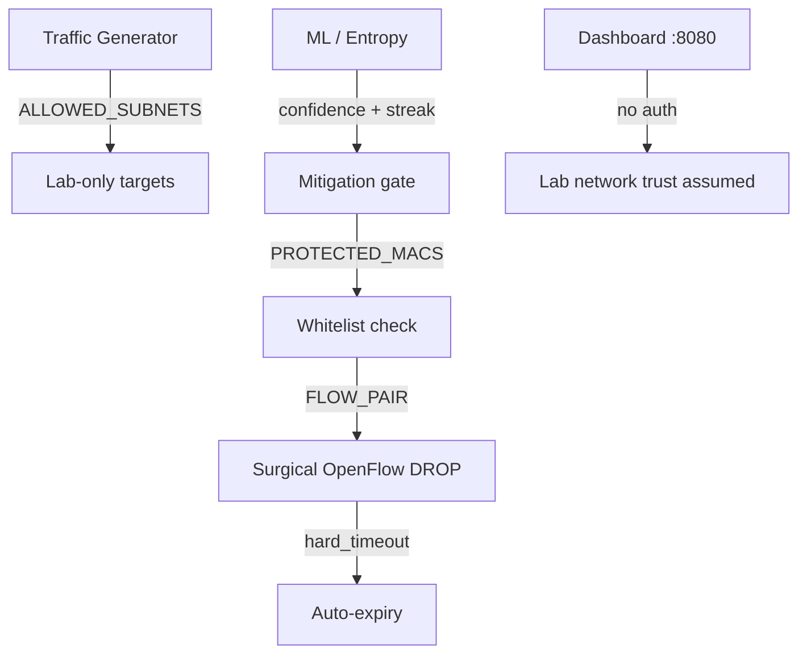

# Security

## 1. Overview

IntelliShield implements **lab-oriented security controls** focused on safe attack simulation and cautious automated blocking. It is **not hardened** for production or internet exposure.

Security measures exist in three areas:

1. **Traffic generation safety** — prevent attacks leaving the lab subnet
2. **Mitigation safety** — whitelist, confidence gates, surgical blocks
3. **Operational exposure** — dashboard and sudo (minimal controls)

---

## 2. Traffic Generation Safety

**File:** `traffic_generator/attack_generator.py`

### Subnet allowlist

```python
ALLOWED_SUBNETS = ["10.0.0.", "10.0.1.", "10.0.2.", "192.168.0."]
```

Any target IP not matching these prefixes is **rejected** with `[SAFETY] BLOCKED` log message.

### Process cleanup

- All attack PIDs tracked in `AttackGenerator`
- `stop_attack()` / `stop_all_attacks()` kill background processes
- `pkill -f hping3` blanket cleanup on scenario end

---

## 3. Mitigation Safety

### 3.1 Protected MAC whitelist

**File:** `mitigation/flow_blocker.py`

```python
PROTECTED_MACS = {
    "ff:ff:ff:ff:ff:ff",   # broadcast
    "33:33:00:00:00:02",   # IPv6 multicast
    "01:80:c2:00:00:0e",   # LLDP
}
```

`BlocklistManager` extends this set — these MACs are **never blocked**.

### 3.2 Confidence gate

| Layer | Threshold | Source |
|-------|-----------|--------|
| Static minimum | 60% | `MIN_CONFIDENCE_TO_BLOCK` in `mitigation_engine.py` |
| RL-adaptive gate | 65–92% (default 80%) | `ThresholdAdapter.conf_threshold` |

Mitigation uses RL gate when `set_threshold_adapter()` is wired (default in integrated controller).

### 3.3 Attack confirmation streak

**File:** `controller/flow_monitor.py`

ML `ATTACK` must occur for `_attack_confirm` **consecutive cycles** before `handle_alert()` installs a block — reduces single-cycle false positives.

Entropy `ALERT` path requires `_entropy_attack_streak` consecutive ALERTs (dual-trigger, 2 cycles).

### 3.4 Surgical blocking

| Strategy | When used |
|----------|-----------|
| `FLOW_PAIR` | SYN_FLOOD, UDP_FLOOD, ICMP_FLOOD, BURST — blocks src+dst only |
| `SRC_MAC` | VOLUMETRIC_FLOOD — blocks all traffic from source MAC |

`MAX_BLOCKS_PER_ALERT = 1` — one DROP rule per alert cycle.

### 3.5 OpenFlow rule safety

| Property | Value | Purpose |
|----------|-------|---------|
| `BLOCK_PRIORITY` | 200 | Above normal forwarding (priority 1) |
| `hard_timeout` | 30–120 s | Auto-expiry — no permanent orphan blocks |
| `MAX_BLOCK_TIMEOUT` | 300 s | Hard cap on block duration |

### 3.6 Skip conditions

`MitigationEngine` skips block when:

- Confidence below gate
- MAC whitelisted
- MAC already blocked (duplicate)
- No attacker identified above `ATTACK_RATE_THRESHOLD` (1000 pkt/s)
- Flow priority already ≥ `BLOCK_PRIORITY`

Skipped actions logged via `log_skipped()` to CSV.

---

## 4. Controller Packet Handling

**File:** `controller/flow_monitor.py`

### ARP preservation

- **Forwarding path:** only LLDP (`0x88CC`) dropped via `IGNORED_ETHTYPE`
- **ARP broadcasts** (`ff:ff:ff:ff:ff:ff`) forwarded — required for Mininet ping
- **Stats path:** broadcast MACs filtered from CSV via `IGNORED_STATS_MACS` only

Prevents silent ARP drop that caused "Destination Host Unreachable" during early development.

### Flow removal handling

`flow_removed_handler` cleans up blocklist entries when OpenFlow rules expire — prevents stale in-memory block state.

---

## 5. Dashboard Security

### Current state (actual implementation)

| Control | Status |
|---------|--------|
| Authentication | **Not implemented** |
| Authorisation / RBAC | **Not implemented** |
| HTTPS / TLS | **Not implemented** |
| CORS | `allow_origins=["*"]` — fully open |
| Rate limiting | **Not implemented** |
| Input validation | Pydantic on batch request body only |

**Risk:** Any host reaching `:8080` can read logs, restart controller, and run attack scenarios (if sudo configured).

### Sudo delegation

Master Control runs scenarios with elevated privileges:

```bash
sudo python3 -m traffic_generator.traffic_scheduler --scenario N
```

**Mitigations available:**

1. Passwordless sudo **only** for the specific traffic_scheduler command (`/etc/sudoers.d/intellishield`)
2. `INTELLISHIELD_SUDO_PASS` environment variable (password in process env — weak)

### Recommended lab practice

- Bind dashboard to VM internal IP only
- Do not port-forward :8080 to public internet
- Use firewall rules on VM host

---

## 6. Data Security

| Topic | Status |
|-------|--------|
| Log encryption at rest | Not implemented |
| PII in logs | MAC addresses only (lab topology) |
| Secrets management | No vault; optional sudo password in env |
| Pickle model files | Trust local filesystem only |

---

## 7. ML Security Considerations

| Risk | Mitigation in code |
|------|-------------------|
| Adversarial feature evasion | Not addressed — research scope |
| Model poisoning via logs | Manual training only; no untrusted input path |
| Overfitting on synthetic data | Documented limitation; `--from-csv` for real data |

---

## 8. Security Architecture Summary



---

## 9. Security Controls Matrix

| Control | Implemented | Location |
|---------|-------------|----------|
| Subnet allowlist | ✅ | `attack_generator.py` |
| MAC whitelist | ✅ | `flow_blocker.py`, `blocklist_manager.py` |
| Confidence gate | ✅ | `mitigation_engine.py` + RL adapter |
| Attack streak confirmation | ✅ | `flow_monitor.py` |
| Auto-expiring blocks | ✅ | OpenFlow `hard_timeout` |
| Surgical FLOW_PAIR | ✅ | `mitigation_engine.py` |
| Dashboard authentication | ❌ | — |
| TLS | ❌ | — |
| Network segmentation | Manual | VM firewall (operator) |
