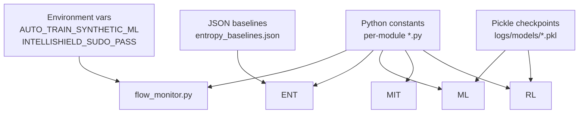

# Configuration

## 1. Overview

IntelliShield configuration is **code-first**: constants in Python modules plus a small set of **environment variables**. There is no `config.yaml`, `.env` file, or external configuration server.

---

## 2. Environment Variables

| Variable | Default | Module | Purpose |
|----------|---------|--------|---------|
| `AUTO_TRAIN_SYNTHETIC_ML` | `"1"` | `flow_monitor.py` | Auto-train ML on startup if models missing |
| `INTELLISHIELD_SUDO_PASS` | unset | `control.py` | Sudo password for dashboard scenario runs |

**Example:**

```bash
export INTELLISHIELD_SUDO_PASS=mypassword
export AUTO_TRAIN_SYNTHETIC_ML=0
python3 dashboard/api.py
```

---

## 3. Controller (`controller/flow_monitor.py`)

| Constant | Default | Description |
|----------|---------|-------------|
| `MONITOR_INTERVAL` | `5` | Stats poll period (seconds) |
| `PACKET_RATE_WARN_THRESHOLD` | `500` | Per-flow pkt/s warning |
| `BYTE_RATE_WARN_THRESHOLD` | `500000` | Per-flow B/s warning |
| `FLOW_COUNT_WARN_THRESHOLD` | `50` | Per-switch flow count warning |
| `_warmup_threshold` | `3` (typical) | Cycles before ML/mitigation/RL |
| `_attack_confirm` | `2` (typical) | Consecutive ATTACK cycles for block |

**Paths:**

| Constant | Resolves to |
|----------|-------------|
| `CSV_LOG_PATH` | `<project>/logs/flow_stats.csv` |
| `PORT_CSV_LOG_PATH` | `<project>/logs/port_stats.csv` |

**sys.path:** `_PROJECT_ROOT` inserted for sibling package imports.

---

## 4. Entropy Engine (`entropy_engine/entropy_detector.py`)

| Constant | Default |
|----------|---------|
| `WINDOW_SIZE` | `100` |
| `HISTORY_SIZE` | `50` |
| `MIN_FLOWS_FOR_ANALYSIS` | `3` |
| `SRC_ENTROPY_THRESHOLD` | `0.30` |
| `DST_ENTROPY_THRESHOLD` | `0.30` |
| `PACKET_ENTROPY_THRESHOLD` | `0.20` |
| `BYTE_ENTROPY_THRESHOLD` | `0.20` |
| `FLOW_ENTROPY_THRESHOLD` | `0.30` |
| `COMPOSITE_SCORE_THRESHOLD` | `0.40` |

**Weights (`DIM_WEIGHTS`):** src 0.30, dst 0.30, packet 0.15, byte 0.15, flow 0.10.

---

## 5. ML Models (`ml_models/`)

### `anomaly_detector.py`

| Constant | Default |
|----------|---------|
| `ISO_CONTAMINATION` | `0.1` |
| `NORMAL_THRESHOLD` | `0.3` |
| `ATTACK_THRESHOLD` | `0.65` |
| `ISO_MODEL_PATH` | `logs/models/isolation_forest.pkl` |
| `DT_MODEL_PATH` | `logs/models/decision_tree.pkl` |
| `SCALER_MODEL_PATH` | `logs/models/scaler.pkl` |

### `model_trainer.py`

| Constant | Default |
|----------|---------|
| `MIN_LABELLED_SAMPLES` | `20` |
| `MIN_ATTACK_SAMPLES` | `5` |
| `MIN_NORMAL_SAMPLES` | `10` |

---

## 6. Mitigation (`mitigation/`)

### `mitigation_engine.py`

| Constant | Default |
|----------|---------|
| `MIN_CONFIDENCE_TO_BLOCK` | `60.0` (%) |
| `HIGH_CONFIDENCE` | `90.0` → 120 s timeout |
| `MED_CONFIDENCE` | `75.0` → 60 s timeout |
| `LOW_CONFIDENCE` | `60.0` → 30 s timeout |
| `ATTACK_RATE_THRESHOLD` | `1000.0` pkt/s |
| `RATE_DOMINANCE_RATIO` | `5.0` |
| `MAX_BLOCKS_PER_ALERT` | `1` |

### `flow_blocker.py`

| Constant | Default |
|----------|---------|
| `BLOCK_PRIORITY` | `200` |
| `DEFAULT_BLOCK_TIMEOUT` | `60` s |
| `MAX_BLOCK_TIMEOUT` | `300` s |

---

## 7. Advanced Analytics (`advanced_analytics/`)

### `adwin_detector.py`

| Parameter | Typical default |
|-----------|-----------------|
| `delta` | `0.002` |
| `max_window` | `150`–`200` |

### `hdbscan_clusterer.py`

| Parameter | Typical default |
|-----------|-----------------|
| `min_cluster_size` | `5` |
| Batch interval | Every 10 controller cycles |

---

## 8. RL Engine (`rl_engine/`)

### `ppo_agent.py`

| Constant | Value |
|----------|-------|
| `STATE_DIM` | `10` |
| `ACTION_DIM` | `3` |
| `HIDDEN` | `64` |
| `GAMMA` | `0.99` |
| `GAE_LAMBDA` | `0.95` |
| `CLIP_EPS` | `0.2` |
| `PPO_EPOCHS` | `4` |
| `UPDATE_EVERY` | `20` |
| `ACTOR_LR` | `3e-4` |
| `CRITIC_LR` | `1e-4` |

### `threshold_adapter.py`

| Constant | Value |
|----------|-------|
| `DEFAULT_PKT_THRESHOLD` | `500` |
| `DEFAULT_BYTE_THRESHOLD` | `500_000` |
| `DEFAULT_CONF_THRESHOLD` | `0.80` |
| `MIN_PKT` / `MAX_PKT` | `250` / `5000` |
| `MIN_BYTE` / `MAX_BYTE` | `300000` / `5000000` |
| `MIN_CONF` / `MAX_CONF` | `0.65` / `0.92` |
| `PKT_SCALE` | `100` |
| `BYTE_SCALE` | `100_000` |
| `CONF_SCALE` | `0.03` |

**PPO weights path:** `logs/ppo_weights.pkl`

---

## 9. Traffic Generator (`traffic_generator/`)

### `traffic_profiles.py`

| Constant | Value |
|----------|-------|
| `CONTROLLER_HOST` | `127.0.0.1` |
| `CONTROLLER_PORT` | `6653` |
| `DEFAULT_SYN_RATE` | `10000` pkt/s |
| `DEFAULT_ATTACK_DURATION` | `30` s |
| `DEFAULT_UDP_FLOOD_BW` | `"10M"` |

### `attack_generator.py`

| Constant | Value |
|----------|-------|
| `ALLOWED_SUBNETS` | `10.0.0.`, `10.0.1.`, `10.0.2.`, `192.168.0.` |

### `traffic_scheduler.py` CLI

```bash
sudo python3 -m traffic_generator.traffic_scheduler \
  --scenario {1-5} \
  [--hosts 5] \
  [--cli] \
  [--all]
```

---

## 10. Dashboard (`dashboard/`)

| Setting | Value | Location |
|---------|-------|----------|
| HTTP host | `0.0.0.0` | `api.py` uvicorn.run |
| HTTP port | `8080` | `api.py` |
| Controller warmup | `20` s | `control.py` restart_controller |
| Job log retention | `500` lines / `30` jobs | `control.py` |
| UI refresh | `5000` ms | `index.html` INTERVAL |
| Control poll | `3000` ms | `index.html` |

---

## 11. Metrics Script (`scripts/compute_metrics.py`)

| Setting | Default |
|---------|---------|
| `--logs-dir` | `~/intellishield-sdn/logs` or cwd |
| `--json-out` | optional path |
| `grace_sec` | `60` (attack window grace) |
| Timestamp format | `%Y-%m-%d %H:%M:%S` |

---

## 12. Configuration Diagram



---

## 13. Changing Configuration

| To change | Edit |
|-----------|------|
| Poll rate | `MONITOR_INTERVAL` in `flow_monitor.py` |
| Entropy sensitivity | thresholds in `entropy_detector.py` |
| Block confidence | `DEFAULT_CONF_THRESHOLD` or let RL adapt |
| Dashboard port | `uvicorn.run(port=...)` in `api.py` |
| Scenario duration | `attack_scenarios.py` / `traffic_profiles.py` |

**Restart required:** Controller must be restarted after Python constant changes. Dashboard restart after `api.py` changes.
