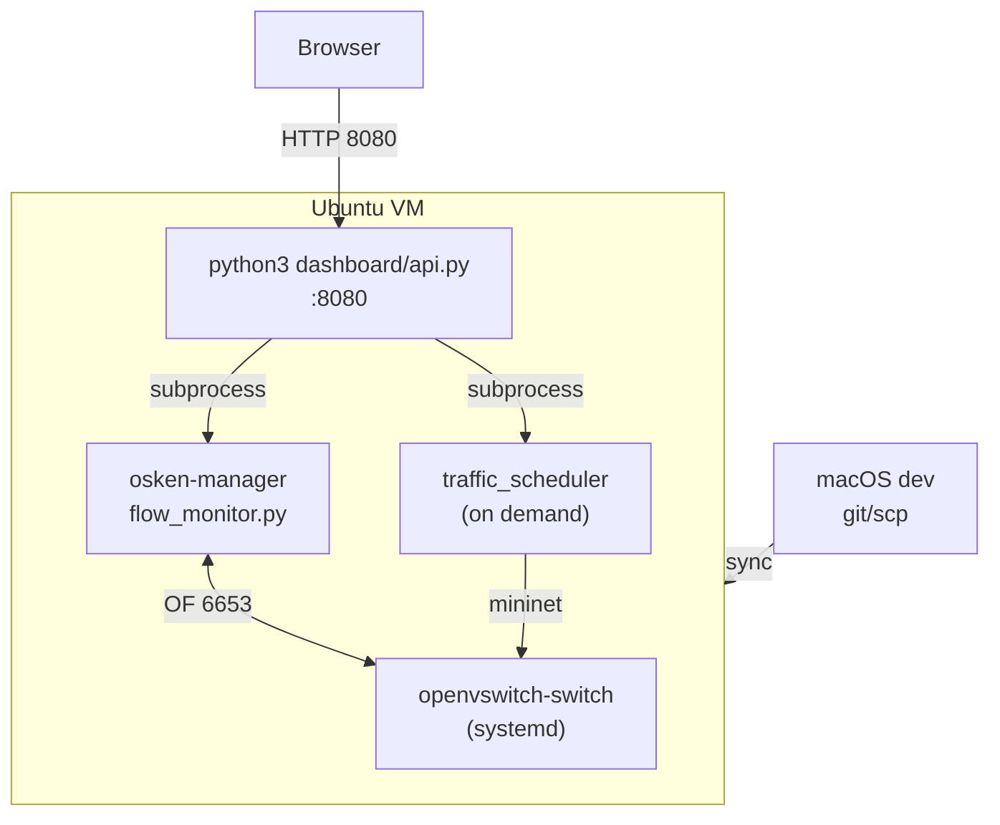

# Deployment

## 1. Overview

IntelliShield deploys as **native processes on an Ubuntu 22.04 VM** with Mininet and Open vSwitch. There is no container image, Kubernetes manifest, or cloud IaC in the repository.

**Canonical deployment path:** `~/intellishield-sdn/` on the VM.

---

## 2. Target Environment

| Component | Requirement |
|-----------|-------------|
| OS | Ubuntu 22.04 LTS |
| Python | 3.10+ |
| RAM | ≥ 2 GB (Mininet + ML) |
| Network | Host-only or NAT (e.g. `192.168.64.5`) |
| Privileges | sudo for Mininet scenarios |

---

## 3. Installation Steps

### 3.1 System packages

```bash
sudo apt update
sudo apt install -y git python3-pip mininet openvswitch-switch \
  python3-os-ken hping3 iperf wget build-essential
```

Verify:

```bash
python3 --version
osken-manager --version
sudo ovs-vsctl show
```

### 3.2 Python packages

```bash
cd ~/intellishield-sdn
pip3 install numpy scikit-learn
pip3 install -r dashboard/requirements.txt
```

### 3.3 Project layout

```bash
mkdir -p ~/intellishield-sdn
# sync repo via git clone or scp from dev machine
cd ~/intellishield-sdn
mkdir -p logs logs/models logs/archive
```

Expected structure matches `controller/`, `entropy_engine/`, `ml_models/`, etc. at project root.

### 3.4 Sudoers (for dashboard scenarios)

```bash
echo 'akshay ALL=(ALL) NOPASSWD: /usr/bin/python3 -m traffic_generator.traffic_scheduler *' \
  | sudo tee /etc/sudoers.d/intellishield
sudo chmod 440 /etc/sudoers.d/intellishield
```

### 3.5 Optional timezone

```bash
sudo timedatectl set-timezone Asia/Kolkata
```

Log timestamps use VM local time.

---

## 4. Runtime Deployment

### 4.1 Three-terminal layout (manual)

**Terminal 1 — Controller:**

```bash
cd ~/intellishield-sdn
osken-manager controller/flow_monitor.py
```

**Terminal 2 — Dashboard:**

```bash
cd ~/intellishield-sdn
python3 dashboard/api.py
```

**Terminal 3 — Experiment:**

```bash
cd ~/intellishield-sdn
sudo python3 -m traffic_generator.traffic_scheduler --scenario 2
```

### 4.2 Browser access

```
http://<VM-IP>:8080
```

### 4.3 UI-only deployment (Master Control)

With controller and dashboard running, all operations can be triggered from the Master Control panel without SSH.

---

## 5. Process Diagram



---

## 6. Network Ports

| Port | Service | Bind |
|------|---------|------|
| 6653 | OpenFlow (OsKen) | 0.0.0.0 |
| 8080 | Dashboard HTTP | 0.0.0.0 |
| 22 | SSH (admin) | VM |

Mininet uses virtual interfaces — no additional host ports.

---

## 7. Initial ML Model Bootstrap

On first controller start, if `logs/models/*.pkl` missing and `AUTO_TRAIN_SYNTHETIC_ML=1`:

```bash
python3 -m ml_models.model_trainer --synthetic
```

Or train manually before starting controller.

---

## 8. Deployment from macOS Dev Host

```bash
# Sync code to VM
scp -r /path/to/ddos_network/* akshay@192.168.64.5:~/intellishield-sdn/

# SSH and restart services
ssh akshay@192.168.64.5
cd ~/intellishield-sdn
osken-manager controller/flow_monitor.py &
python3 dashboard/api.py &
```

---

## 9. Experiment Deployment Workflow


Automated via Master Control **Run S3+S4+S5** batch button.

---

## 10. Log and Model Paths

| Path | Created by |
|------|------------|
| `logs/` | First controller/traffic run |
| `logs/models/` | `model_trainer` |
| `logs/archive/` | `archive_logs()` |
| `/tmp/controller.log` | Master Control restart |

---

## 11. Verification After Deploy

```bash
# Compile check
python3 -m py_compile controller/flow_monitor.py
python3 -m py_compile entropy_engine/*.py ml_models/*.py

# Phase 7 tests
python3 verify_phase7.py

# API health
curl http://localhost:8080/api/status
```

---

## 12. Stopping Services

| Service | Command |
|---------|---------|
| Controller | Master Control **Stop** or `pkill -f "osken-manager.*flow_monitor"` |
| Dashboard | Ctrl+C in dashboard terminal |
| Mininet | Scenario ends automatically; `mn -c` if needed |

---

## 13. What Deployment Does Not Include

| Item | Status |
|------|--------|
| Docker / docker-compose | Not in repo |
| Kubernetes / Helm | Not in repo |
| systemd unit files | Not in repo (manual start) |
| nginx reverse proxy | Not in repo |
| TLS certificates | Not in repo |
| Terraform / Ansible | Not in repo |

Operators may add systemd services or nginx manually for production-like demos — not part of current implementation.

---

## 14. Reference

Detailed VM setup steps also appear in `initial_setup_done.md` at repository root.
