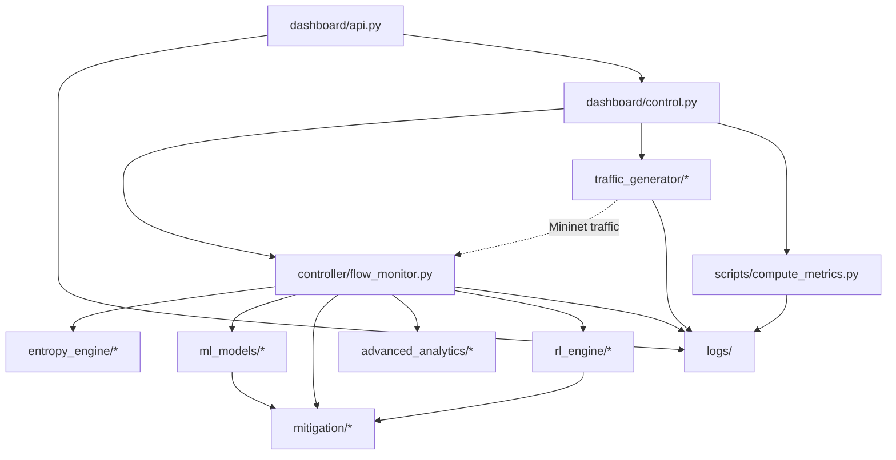

# Module Reference

Complete reference for **every implemented Python module** in IntelliShield SDN. Auxiliary scripts (`attack.py`, `verify_phase7.py`) are listed at the end.

---

## 1. controller/

### `controller/flow_monitor.py`

| Property | Value |
|----------|-------|
| **Phase** | 1 (integrates 2–7) |
| **Entry point** | `osken-manager controller/flow_monitor.py` |
| **Class** | `IntelliShieldFlowMonitor(app_manager.OSKenApp)` |

**Responsibilities:**

- L2 MAC learning switch (OpenFlow 1.3)
- Poll flow/port stats every `MONITOR_INTERVAL` (5 s)
- Extract per-flow feature dicts
- Orchestrate entropy → ML → mitigation → ADWIN → HDBSCAN → PPO hooks
- Write `flow_stats.csv`, `port_stats.csv`

**Key methods:**

| Method | Role |
|--------|------|
| `packet_in_handler` | Learn MACs, forward packets (ARP-safe) |
| `switch_features_handler` | Install table-miss flow |
| `_monitor` | Background stats polling loop |
| `_extract_flow_features` | Build Phase 1 feature dict |
| `_flow_stats_reply_handler` | Main hook pipeline per poll |
| `_map_entropy_attack_hint` | Entropy-derived attack labels |
| `_register_datapath` / `_unregister_datapath` | Switch registry |

**Optional imports:** Each phase wrapped in `try/except ImportError` with `_PHASE_AVAILABLE` flag.

### `controller/__init__.py`

Package marker (empty/minimal).

---

## 2. entropy_engine/

### `entropy_engine/entropy_utils.py`

Math primitives: Shannon entropy, normalised entropy, distribution building, `clamp`, `compute_mean`, `compute_std`.

### `entropy_engine/entropy_calculator.py`

| Function | Role |
|----------|------|
| `calculate_src_entropy` | Source MAC diversity |
| `calculate_dst_entropy` | Destination concentration |
| `calculate_packet_entropy` | Packet load distribution |
| `calculate_byte_entropy` | Byte load distribution |
| `calculate_flow_entropy` | Per-source flow balance |
| `calculate_all_entropy` | All five dimensions + composite |

### `entropy_engine/entropy_detector.py`

| Class | Role |
|-------|------|
| `EntropyDetector` | Sliding window per switch, threshold comparison, status |

| Method | Role |
|--------|------|
| `add_flows(dpid, features)` | Append to window |
| `analyze(dpid)` | Compute entropy, log, return result dict |

**Outputs:** NORMAL / WARNING / ALERT with confidence.

### `entropy_engine/entropy_logger.py`

| Function | Output file |
|----------|-------------|
| `init_log_files()` | Create CSV headers |
| `log_entropy_metrics()` | `entropy_logs.csv` |
| `log_alert()` | `detection_alerts.csv` |
| `update_baseline()` | `entropy_baselines.json` |
| `print_entropy_report()` | Console |

### `entropy_engine/__init__.py`

Exports `EntropyDetector` public API.

---

## 3. traffic_generator/

### `traffic_generator/traffic_profiles.py`

Dataclasses and constants for normal/attack profiles:

- `PROFILE_NORMAL_LIGHT`, `PROFILE_NORMAL_MEDIUM`, `PROFILE_NORMAL_HEAVY`
- `PROFILE_SYN_FLOOD_LOW`, `PROFILE_SYN_FLOOD_HIGH`, `PROFILE_UDP_FLOOD`, etc.
- `SCENARIO_TEMPLATES` — timed event definitions
- `CONTROLLER_HOST`, `CONTROLLER_PORT`, `DEFAULT_SYN_RATE`

### `traffic_generator/normal_traffic.py`

| Class / Function | Role |
|------------------|------|
| `NormalTrafficGenerator` | ICMP, TCP iperf, UDP, HTTP, mixed traffic |
| `generate_continuous_icmp` | Background ping for baseline |
| `generate_mixed_traffic` | Parallel normal protocols |

### `traffic_generator/attack_generator.py`

| Class / Function | Role |
|------------------|------|
| `AttackGenerator` | hping3 SYN/UDP/ICMP flood orchestration |
| `ALLOWED_SUBNETS` | Safety allowlist |
| `launch_syn_flood`, `launch_udp_flood`, `launch_burst_attack` | Attack entry points |
| `stop_attack`, `stop_all_attacks` | PID cleanup |

### `traffic_generator/attack_scenarios.py`

| Function | Scenario |
|----------|----------|
| `scenario_1_normal_only` | S1 — ICMP light baseline (60 s) |
| `scenario_2_syn_flood` | S2 — SYN flood |
| `scenario_3_udp_flood` | S3 — UDP flood |
| `scenario_4_burst_attack` | S4 — Short burst |
| `scenario_5_mixed_attacks` | S5 — SYN + UDP sequential |

`SCENARIO_REGISTRY` maps IDs to functions. Logs `scenario_logs.csv` lifecycle events.

### `traffic_generator/traffic_logger.py`

Logs to `traffic_logs.csv`, `attack_logs.csv`, `scenario_logs.csv`, `traffic_profiles.json`.

### `traffic_generator/traffic_scheduler.py`

| Class | Role |
|-------|------|
| `TrafficScheduler` | Mininet topo creation, scenario execution |

**CLI:**

```bash
sudo python3 -m traffic_generator.traffic_scheduler --scenario N
```

Creates `IntelliShieldTopo` (5 hosts, 1 switch), connects to remote OsKen controller.

### `traffic_generator/__init__.py`

Public exports for scheduler and scenario registry.

---

## 4. ml_models/

### `ml_models/feature_builder.py`

| Class | Role |
|-------|------|
| `FeatureBuilder` | Aggregate flow batch + entropy → 15-dim vector |

| Constant | Value |
|----------|-------|
| `FEATURE_NAMES` | 15 feature column names |
| `FEATURES_CSV_PATH` | `logs/ml_features.csv` |

| Method | Role |
|--------|------|
| `build(flow_features, entropy_metrics, switch_id)` | Returns `(vec, meta)` |

### `ml_models/anomaly_detector.py`

| Class | Role |
|-------|------|
| `AnomalyDetector` | Load/train IF + DT, ensemble predict |

| Method | Role |
|--------|------|
| `predict(vec)` | Returns status, confidence, iso_score, dt_label |
| `train_synthetic()` | Bootstrap from generated data |
| `load_models()` / `_save_model()` | Pickle persistence |

### `ml_models/explainer.py`

| Class | Role |
|-------|------|
| `Explainer` | Feature narrative, attack type hints |

| Method | Role |
|--------|------|
| `explain(vec, prediction)` | Returns explanation dict |
| `_guess_attack_type` | Heuristic SYN/UDP/volumetric labels |
| `print_explanation` | Console output |

### `ml_models/model_trainer.py`

CLI training pipeline:

```bash
python3 -m ml_models.model_trainer --synthetic
python3 -m ml_models.model_trainer --from-csv
```

Reads `ml_features.csv`, fits models, saves to `logs/models/`.

### `ml_models/ml_logger.py`

| Function | Output |
|----------|--------|
| `init_ml_logs()` | Create CSV headers |
| `log_prediction()` | `ml_predictions.csv` |
| `log_ml_alert()` | `ml_alerts.csv` |
| `print_ml_result()` | Console |

### `ml_models/ml_utils.py`

`clamp`, `LABEL_MAP`, `LABEL_REVERSE` helpers.

### `ml_models/label_inference.py`

Infers NORMAL/ATTACK labels from log context for CSV training. Delegates window parsing to `evaluation.experiment_windows`.

### `evaluation/experiment_windows.py`

| Function | Role |
|----------|------|
| `load_experiment_windows()` | Canonical merged windows (scenario + attack logs) |
| `load_attack_windows()` | Backward-compat tuple API |
| `AttackWindow.contains()` | Timestamp membership with optional pad |
| `parse_ts()` | Shared `%Y-%m-%d %H:%M:%S` parser |

Single source of truth for attack start/stop/duration used by `label_inference.py` and `compute_metrics.py`.

### `evaluation/experiment_bundle.py`

| Function | Role |
|----------|------|
| `create_bundle()` | Copy artifacts + write `experiment_manifest.json` |
| `build_manifest()` | Assemble manifest (git, checksums, config, scenarios) |
| `collect_dataset_checksums()` | SHA-256 per log/model file |

Reproducible experiment bundles under `logs/experiments/<id>/`.

### `evaluation/ieee_metrics.py`

| Function | Role |
|----------|------|
| `enrich_report()` | Add classification + system metrics to base report |
| `compute_classification_metrics()` | Accuracy, precision, recall, F1, FPR, FNR |
| `compute_system_metrics()` | Throughput, packet loss, CPU, memory |

### `evaluation/report_export.py`

| Function | Role |
|----------|------|
| `export_all()` | Write JSON + CSV + `paper_tables.md` |
| `export_paper_tables_md()` | IEEE-ready Markdown tables |

### `scripts/bundle_experiment.py`

CLI for `create_bundle()` — `python3 scripts/bundle_experiment.py --with-metrics`.

### `ml_models/__init__.py`

Package exports.

---

## 5. mitigation/

### `mitigation/flow_blocker.py`

| Function | Role |
|----------|------|
| `block_src_mac(dpid, mac, timeout)` | OpenFlow DROP on eth_src |
| `block_flow_pair(dpid, src, dst, timeout)` | DROP on src+dst pair |
| `unblock_src_mac`, `unblock_all` | Remove rules |
| `PROTECTED_MACS` | Whitelist set |
| `BLOCK_PRIORITY` | `200` |

### `mitigation/blocklist_manager.py`

| Class | Role |
|-------|------|
| `BlocklistManager` | In-memory block state, expiry, whitelist |

| Method | Role |
|--------|------|
| `should_block(dpid, mac)` | Whitelist + duplicate check |
| `record_block(dpid, mac, timeout, ...)` | Track active block |
| `remove_block(dpid, mac)` | On FlowRemoved |
| `get_session_stats()` | Stats for RL / summary |

### `mitigation/mitigation_engine.py`

| Class | Role |
|-------|------|
| `MitigationEngine` | Alert → identify → block orchestrator |

| Method | Role |
|--------|------|
| `handle_alert(dpid, prediction, explanation, flow_features)` | Main entry |
| `identify_attackers(flow_features)` | Top pkt-rate MAC |
| `_calculate_timeout(confidence)` | 30/60/120 s tiers |
| `_select_block_strategy(hint, dst_mac)` | FLOW_PAIR (targeted floods) vs SRC_MAC (volumetric / no victim MAC) |
| `set_threshold_adapter(adapter)` | Wire RL confidence gate |

### `mitigation/mitigation_logger.py`

Logs to `mitigation_actions.csv`, `mitigation_summary.json`.

### `mitigation/__init__.py`

Exports `MitigationEngine`, `BLOCK_PRIORITY`, etc.

---

## 6. advanced_analytics/

### `advanced_analytics/adwin_detector.py`

| Class | Role |
|-------|------|
| `ADWINDetector` | Single-metric online drift detection |
| `ADWINManager` | One detector per metric per switch |

| Method | Role |
|--------|------|
| `update(value)` | Append + test Hoeffding cut |
| `update_all(dpid, metrics_dict)` | Update 4 metrics, log drifts |

**Output:** `drift_alerts.csv`  
**Self-test:** `python3 advanced_analytics/adwin_detector.py`

### `advanced_analytics/hdbscan_clusterer.py`

| Class | Role |
|-------|------|
| `HDBSCANClusterer` | Buffer vectors, batch cluster |

| Method | Role |
|--------|------|
| `add_vector(vec, feature_names)` | Buffer ML features |
| `run_clustering(feature_names)` | sklearn HDBSCAN fit |
| `_label_cluster(centroid_stats)` | NORMAL/ATTACK/SUSPICIOUS heuristic |

**Output:** `cluster_labels.csv`, `cluster_summary.json`

### `advanced_analytics/__init__.py`

Exports ADWIN and HDBSCAN classes.

---

## 7. rl_engine/

### `rl_engine/ppo_agent.py`

| Class | Role |
|-------|------|
| `PPOAgent` | Full PPO training loop |
| `_Linear` | Dense layer + Adam |
| `_ActorCritic` | Shared backbone + Gaussian policy + value head |

| Method | Role |
|--------|------|
| `step(state)` | Sample action, log_prob, value |
| `remember(...)` | Store transition |
| `update_if_ready()` | PPO clipped update every `UPDATE_EVERY` steps |
| `save()` / `load()` | `ppo_weights.pkl` |

### `rl_engine/threshold_adapter.py`

| Class | Role |
|-------|------|
| `ThresholdAdapter` | Maps RL actions to bounded thresholds |

| Method | Role |
|--------|------|
| `apply_action(action)` | Update pkt/byte/conf thresholds |
| `compute_reward(...)` | Reward signal for PPO |
| `recent_attack_count` / `recent_fp_count` | Rolling windows for state |

### `rl_engine/rl_env.py`

| Class | Role |
|-------|------|
| `SDNEnvironment` | Normalise 10-dim state vector |

| Method | Role |
|--------|------|
| `build_state(...)` | Encode network metrics → `np.ndarray(10,)` |

### `rl_engine/rl_logger.py`

| Class | Role |
|-------|------|
| `RLLogger` | Write `rl_decisions.csv`, `rl_training.csv` |

### `rl_engine/__init__.py`

Package exports.

---

## 8. dashboard/

### `dashboard/api.py`

FastAPI app — see [06_APIs.md](06_APIs.md).  
Uvicorn launcher on `0.0.0.0:8080`.

### `dashboard/control.py`

| Class | Role |
|-------|------|
| `ControlPanel` | Job runner, controller lifecycle, scenarios |
| `Job` | Background task with log tail |

Singleton: `panel = ControlPanel()`.

### `dashboard/static/index.html`

Single-page dashboard UI with charts, gauge, Master Control panel.

### `dashboard/requirements.txt`

`fastapi>=0.100.0`, `uvicorn>=0.23.0`

---

## 9. scripts/

### `scripts/compute_metrics.py`

| Function | Role |
|----------|------|
| `_load_scenario_windows()` | Thin wrapper over `evaluation.experiment_windows.load_experiment_windows()` |
| `analyse_run(window, logs_dir)` | Per-window latencies |
| `build_report(logs_dir)` | Full metrics dict |
| `main()` | CLI with `--logs-dir`, `--json-out`, `--csv-out`, `--paper-out`, `--bundle` |

---

## 10. Auxiliary Files

### `verify_phase7.py`

10-test suite for PPO, threshold adapter, RL env, logger, integration smoke.  
**Requires numpy.** Run: `python3 verify_phase7.py`

### `test_phase7.sh`

Shell wrapper calling `verify_phase7.py` + live test instructions.

### `attack.py`

Standalone Scapy MAC/IP spoof flood script — **not integrated** into main pipeline. Legacy/auxiliary tool requiring `scapy` and manual Mininet iface.

---

## 11. Module Dependency Graph



---

## 12. Module Count Summary

| Package | Files | Phase |
|---------|-------|-------|
| `controller/` | 2 | 1 + integration |
| `entropy_engine/` | 5 | 2 |
| `traffic_generator/` | 7 | 3 |
| `ml_models/` | 8 | 4 |
| `mitigation/` | 5 | 5 |
| `advanced_analytics/` | 3 | 6 |
| `rl_engine/` | 5 | 7 |
| `dashboard/` | 4 | 8 |
| `scripts/` | 1 | metrics |
| **Total** | **40** | 8 phases |

---

## 13. Log Output by Module

| Module | Files written |
|--------|---------------|
| `flow_monitor.py` | `flow_stats.csv`, `port_stats.csv` |
| `entropy_logger.py` | `entropy_logs.csv`, `detection_alerts.csv`, `entropy_baselines.json` |
| `traffic_logger.py` | `scenario_logs.csv`, `attack_logs.csv`, `traffic_logs.csv`, `traffic_profiles.json` |
| `feature_builder.py` | `ml_features.csv` |
| `ml_logger.py` | `ml_predictions.csv`, `ml_alerts.csv`, `ml_summary.json` |
| `anomaly_detector.py` | `logs/models/*.pkl` |
| `mitigation_logger.py` | `mitigation_actions.csv`, `mitigation_summary.json` |
| `adwin_detector.py` | `drift_alerts.csv` |
| `hdbscan_clusterer.py` | `cluster_labels.csv`, `cluster_summary.json` |
| `rl_logger.py` | `rl_decisions.csv`, `rl_training.csv` |
| `ppo_agent.py` | `ppo_weights.pkl` |
| `compute_metrics.py` | `metrics_report.json` |

---

## 14. Release 1.0 novelty packages

Phases 1–8 remain above. These packages were added for the collaborative pipeline. Full manuals: [`../02_Novelties/`](../02_Novelties/README.md).

| Package | Novelty | Persistence / API |
|---------|---------|-------------------|
| `shared_contracts/` | Foundation DTOs, enums, ops profile | Imported by all planes |
| `correlation/` | R4 advisory S·T·D·A·P | `logs/correlation_results.jsonl` |
| `fusion/` | R6 reliability-aware fusion | `logs/fused_decisions.jsonl` |
| `verification/` | R7 mitigation gate | `logs/verification_trace.jsonl` |
| `xai/` + `rca/` | R5 explain + RCA | `logs/root_cause_reports.jsonl` |
| `alerting/` | R8 policy alerts | `logs/alerts.jsonl` |
| `twin/` | R3 snapshot twin (read-only) | `logs/twin/` + GET `/api/digital-twin/*` |

