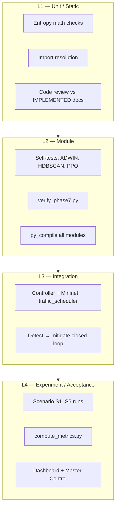
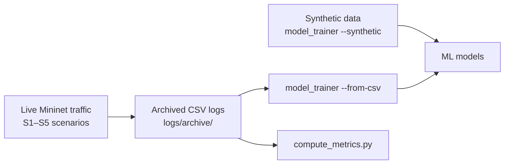
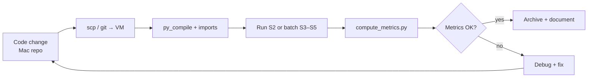

# Testing Strategy

## 1. Purpose

IntelliShield SDN is validated as a **research prototype** using a layered testing approach that combines static verification, module self-tests, integration smoke tests, and reproducible Mininet experiment scenarios. The goal is to demonstrate that each phase works in isolation, integrates correctly through `controller/flow_monitor.py`, and produces auditable logs suitable for IEEE-style evaluation.

## 2. Testing Pyramid

| Level | What is tested | Primary tools |
|-------|----------------|---------------|
| **L1 — Unit / static** | Functions, math, schemas, imports | `python3 -m py_compile`, inline assertions, `PROJECT_ANALYSIS.md` |
| **L2 — Module** | Single-package behaviour | `verify_phase7.py`, `__main__` self-tests in analytics/RL |
| **L3 — Integration** | Controller hooks, log pipeline | VM: `osken-manager` + Mininet + scenarios |
| **L4 — Experiment** | End-to-end detect/mitigate/metrics | S1–S5, `compute_metrics.py`, dashboard API |

## 3. Test Environments

| Environment | Role | Components |
|-------------|------|------------|
| **macOS dev host** | Source editing, static analysis | Git repo; limited runtime (no OsKen/Mininet by default) |
| **Ubuntu 22.04 VM** | Primary validation target | Mininet, OVS, OsKen, numpy, sklearn, hping3 |
| **Mininet emulated network** | Traffic + attack ground truth | 5 hosts, 1 switch, 10.0.0.0/8 subnet |
| **Log filesystem** | Post-run analysis | `logs/*.csv`, `logs/archive/` |

**Canonical VM path:** `~/intellishield-sdn/`  
**Dashboard URL:** `http://<VM-IP>:8080`

## 4. Testing Types

### 4.1 Static verification

- `python3 -m py_compile` on all phase modules
- Cross-reference `IMPLEMENTED/PHASE*.md` claims against source symbols
- Trace hook wiring in `controller/flow_monitor.py`
- Validate CSV header schemas against logger definitions

### 4.2 Unit and module tests

| Artifact | Scope |
|----------|-------|
| `verify_phase7.py` | PPO agent, threshold adapter, RL env, logger, weight persistence |
| `advanced_analytics/adwin_detector.py` | ADWIN drift on synthetic normal→attack stream |
| `advanced_analytics/hdbscan_clusterer.py` | HDBSCAN on 50 synthetic feature vectors |
| `rl_engine/ppo_agent.py` | Quick PPO forward/update self-test |
| Entropy math (manual / script) | H([0.5,0.5])=1.0, H([1.0])=0.0, 4-flow NORMAL score≈0.984 |

### 4.3 Integration tests

- Controller starts and connects to Mininet remote controller
- `pingall` → 0% packet loss (ARP/LLDP fix validated)
- Flow stats appear every 5 s in console and `flow_stats.csv`
- Entropy analysis fires on flow batches from live traffic
- ML predictions logged after warm-up period
- Mitigation installs OpenFlow DROP rules on confirmed ATTACK
- RL decisions appended to `rl_decisions.csv` each cycle

### 4.4 Scenario-based acceptance tests

Five predefined scenarios in `traffic_generator/attack_scenarios.py` serve as **acceptance test suites**:

| Scenario | Acceptance criterion |
|----------|---------------------|
| **S1** Normal baseline | Entropy score ≈ 1.0; ML status `NORMAL`; no false blocks |
| **S2** SYN flood | Entropy collapse; ML `ATTACK` + `SYN_FLOOD` hint; block installed |
| **S3** UDP flood | Destination/volume entropy collapse; detection + mitigation |
| **S4** Burst | Brief attack window detectable within poll granularity |
| **S5** Mixed | Two attack windows; recovery between phases |

### 4.5 Metrics and regression tests

`scripts/compute_metrics.py` provides **automated regression analysis**:

- Joins `scenario_logs.csv` attack windows with detection and mitigation timestamps
- Computes detection latency, mitigation latency, false-positive block count
- Supports `--json-out logs/metrics_report.json` for dashboard and paper tables
- Uses in-window matching with 60 s grace period to avoid cross-run contamination

## 5. Test Data Strategy

| Data source | Used for |
|-------------|----------|
| **Synthetic ML data** | Bootstrap models when no logs exist (300 normal + 200 attack samples) |
| **Live scenario logs** | Primary evaluation evidence; labelled training via `--from-csv` |
| **Archived runs** | Isolated experiment reproduction; prevents metric bleed |

## 6. Pre-Run and Post-Run Procedures

### Pre-experiment checklist

1. Archive prior logs (`Master Control → Archive` or manual `mv` to `logs/archive/`)
2. Restart controller (20 s warm-up)
3. Confirm ML models exist in `logs/models/` or allow auto-train on startup
4. Configure sudo for scenario runs if using Master Control UI

### Post-experiment checklist

1. Inspect `scenario_logs.csv`, `entropy_logs.csv`, `ml_predictions.csv`, `mitigation_actions.csv`
2. Run `python3 scripts/compute_metrics.py --json-out logs/metrics_report.json`
3. Verify dashboard `/api/summary` and `/api/metrics`
4. Archive successful runs for paper/viva evidence

## 7. Pass / Fail Criteria

| Category | Pass condition |
|----------|----------------|
| **Compile / import** | All modules compile; all phase imports resolve on VM |
| **Connectivity** | Mininet `pingall` 0% loss |
| **Detection** | Attack scenarios produce entropy `ALERT` and/or ML `ATTACK` within attack window |
| **Mitigation** | `mitigation_actions.csv` contains `BLOCK` with `status=SUCCESS` during attack |
| **Baseline** | S1 produces `NORMAL` ML labels without blocks |
| **Metrics** | `compute_metrics.py` returns finite latencies (not `None`) for completed scenarios |
| **Safety** | No blocks on whitelisted MACs; external IPs rejected by traffic generator |
| **RL unit tests** | `verify_phase7.py` reports all checks passed |

## 8. Known Testing Constraints

- **Poll-bound detection:** 5 s `MONITOR_INTERVAL` sets a floor on detection latency
- **Warm-up deferral:** ML, mitigation, and RL inactive for first N controller cycles
- **Attack confirmation:** Consecutive ATTACK/SUSPICIOUS cycles required before block
- **VM dependency:** Full L3/L4 tests require Ubuntu VM with sudo; not runnable on macOS host alone
- **Log hygiene:** Mixed runs without archival produce unreliable metrics (addressed by archive-first workflow)

## 9. Test Ownership by Phase

| Phase | Primary test artifacts |
|-------|---------------------|
| 1 | `flow_stats.csv`, `port_stats.csv`, `pingall` |
| 2 | Entropy math, `entropy_logs.csv`, `detection_alerts.csv` |
| 3 | Scenario CLI, safety guards, `scenario_logs.csv` |
| 4 | `model_trainer`, `ml_predictions.csv`, ensemble sanity checks |
| 5 | OpenFlow block verification, `mitigation_actions.csv` |
| 6 | ADWIN/HDBSCAN self-tests, `drift_alerts.csv`, `cluster_labels.csv` |
| 7 | `verify_phase7.py`, `rl_decisions.csv` |
| 8 | API endpoint smoke tests, Master Control job success |

## 10. Continuous Validation Workflow

This closed loop was used throughout integration bug fixes (duplicate entropy hook, warm-up scope, RL confidence gate, S1 baseline profile, metrics windowing).
