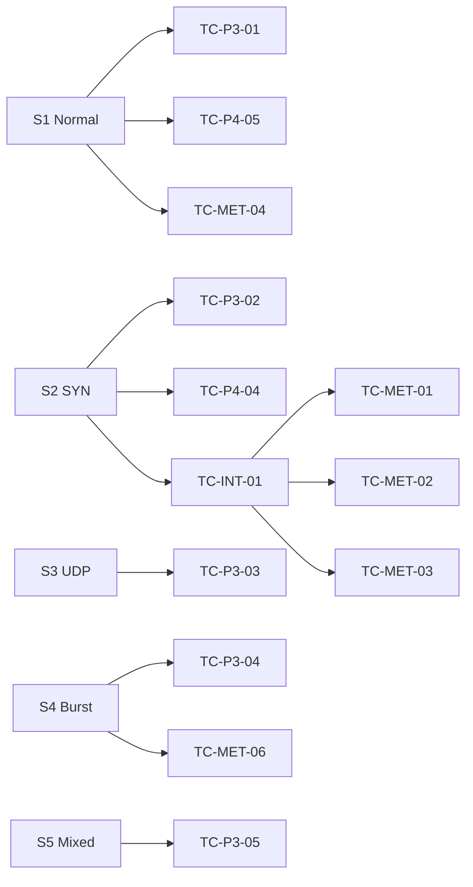

# Test Cases

## 1. Overview

This document lists structured test cases organised by phase, integration area, and acceptance scenario. Each case includes ID, objective, preconditions, steps, and expected result.

**Priority legend:** P0 = critical path | P1 = important | P2 = supplementary

---

## 2. Phase 1 — Flow Statistics Monitoring

| ID | Priority | Test case | Preconditions | Steps | Expected result |
|----|----------|-----------|---------------|-------|-----------------|
| TC-P1-01 | P0 | Controller startup | OsKen installed on VM | `osken-manager controller/flow_monitor.py` | Controller starts without crash; logs "Phase 1" active |
| TC-P1-02 | P0 | Mininet connectivity | Controller running | `sudo mn --controller=remote`; `pingall` | 0% packet loss |
| TC-P1-03 | P0 | Flow stats polling | Controller + Mininet traffic | Generate ping/iperf; wait 10 s | Console flow stats every 5 s |
| TC-P1-04 | P0 | CSV logging | Controller running | Inspect `logs/flow_stats.csv` | Rows with timestamp, src_mac, packet_rate, byte_rate |
| TC-P1-05 | P1 | Port stats logging | Controller running | Inspect `logs/port_stats.csv` | rx/tx packet and byte counters present |
| TC-P1-06 | P0 | ARP forwarding | Controller running | `h1 ping h2` | Ping succeeds; no "Destination Host Unreachable" |
| TC-P1-07 | P1 | Threshold warnings | High-rate traffic | iperf between hosts | Console warning when pkt/s exceeds threshold |
| TC-P1-08 | P1 | Compile check | Source on VM | `python3 -m py_compile controller/flow_monitor.py` | Exit code 0 |

---

## 3. Phase 2 — Entropy Detection

| ID | Priority | Test case | Preconditions | Steps | Expected result |
|----|----------|-----------|---------------|-------|-----------------|
| TC-P2-01 | P0 | Shannon math — max entropy | Python env | H([0.5, 0.5]) | ≈ 1.0000 |
| TC-P2-02 | P0 | Shannon math — min entropy | Python env | H([1.0]) | ≈ 0.0000 |
| TC-P2-03 | P0 | Normal 4-flow test | Entropy modules imported | 4 distinct src MACs, balanced counts | status=NORMAL, score≈0.984 |
| TC-P2-04 | P0 | SYN flood collapse | Controller + hping3 | `h1 hping3 -S --flood 10.0.0.2` | src_entropy→0; status=ALERT |
| TC-P2-05 | P0 | Entropy CSV log | Live monitoring | Check `entropy_logs.csv` | One row per cycle per switch |
| TC-P2-06 | P1 | Alert CSV log | During attack | Check `detection_alerts.csv` | ALERT rows with dimension, confidence |
| TC-P2-07 | P1 | Baseline JSON | After normal period | Check `entropy_baselines.json` | Per-switch mean/std updated |
| TC-P2-08 | P1 | Module compile | Source on VM | `py_compile entropy_engine/*.py` | All PASS |

---

## 4. Phase 3 — Traffic Generation

| ID | Priority | Test case | Preconditions | Steps | Expected result |
|----|----------|-----------|---------------|-------|-----------------|
| TC-P3-01 | P0 | Scenario 1 — normal | sudo, controller running | `traffic_scheduler --scenario 1` | SCENARIO_START/END in `scenario_logs.csv` |
| TC-P3-02 | P0 | Scenario 2 — SYN flood | sudo | `--scenario 2` | ATTACK_START/STOP logged; hping3 launched |
| TC-P3-03 | P0 | Scenario 3 — UDP flood | sudo | `--scenario 3` | UDP flood profile executed |
| TC-P3-04 | P1 | Scenario 4 — burst | sudo | `--scenario 4` | ATTACK_START/STOP logged; 8s attack window |
| TC-P3-05 | P1 | Scenario 5 — mixed | sudo | `--scenario 5` | Two attack windows (SYN + UDP) |
| TC-P3-06 | P0 | Safety — external IP | Attack generator | Target IP outside 10.0.0.0/8 | `[SAFETY] BLOCKED` message |
| TC-P3-07 | P1 | Attack stop cleanup | After flood | `stop_all_attacks()` | No orphan hping3 processes |
| TC-P3-08 | P1 | Profile counts | Static check | Import `traffic_profiles` | 3 normal + 5 attack profiles |
| TC-P3-09 | P1 | S1 light baseline | Scenario 1 run | Check traffic profile | ICMP-only light profile (not heavy iperf) |

---

## 5. Phase 4 — ML Anomaly Detection

| ID | Priority | Test case | Preconditions | Steps | Expected result |
|----|----------|-----------|---------------|-------|-----------------|
| TC-P4-01 | P0 | Synthetic training | sklearn installed | `model_trainer --synthetic` | Models saved to `logs/models/` |
| TC-P4-02 | P0 | Sanity — normal samples | Trained models | 3 normal feature vectors | All predict NORMAL (~77–80% conf) |
| TC-P4-03 | P0 | Sanity — attack samples | Trained models | 3 attack feature vectors | All predict ATTACK (~85% conf) |
| TC-P4-04 | P0 | Live SYN flood ML | Controller + S2 | Run scenario 2 | ML status=ATTACK; hint=SYN_FLOOD |
| TC-P4-05 | P0 | Live normal ML | Controller + S1 | Run scenario 1 | ML status=NORMAL |
| TC-P4-06 | P1 | CSV prediction log | Post warm-up | `ml_predictions.csv` | status, confidence, iso_score per cycle |
| TC-P4-07 | P1 | Explainer output | During ATTACK | Console / ml_alerts | Feature narrative + attack hint |
| TC-P4-08 | P1 | Train from logs | Archived logs | `model_trainer --from-csv` | Models retrained without error |
| TC-P4-09 | P1 | Ensemble quiet baseline | S1 light ICMP | Run S1 | iso_score high + pkt_max low → NORMAL |

---

## 6. Phase 5 — Mitigation

| ID | Priority | Test case | Preconditions | Steps | Expected result |
|----|----------|-----------|---------------|-------|-----------------|
| TC-P5-01 | P0 | Block on ATTACK | ML ATTACK confirmed | Run S2 with mitigation active | BLOCK row in `mitigation_actions.csv` |
| TC-P5-02 | P0 | OpenFlow DROP rule | Block installed | `ovs-ofctl dump-flows` | Priority 200 DROP matching attacker MAC |
| TC-P5-03 | P0 | Auto-expiry | Block with 60s timeout | Wait hard_timeout | FlowRemoved; block cleared |
| TC-P5-04 | P1 | Confidence gate | ML conf < threshold | Low-confidence prediction | No block; warning only |
| TC-P5-05 | P1 | Whitelist protection | Broadcast MAC | Attempt block on ff:ff:ff:ff:ff:ff | Skipped |
| TC-P5-06 | P1 | Duplicate block skip | Same MAC already blocked | Second ATTACK same MAC | No duplicate rule |
| TC-P5-07 | P1 | FLOW_PAIR block | High-confidence SYN flood | Inspect block_type | `FLOW_PAIR` when victim known |
| TC-P5-08 | P1 | Entropy-only path | ML blind, entropy ALERT×2 | Entropy collapse without ML ATTACK | Optional entropy-triggered block |

---

## 7. Phase 6 — ADWIN + HDBSCAN

| ID | Priority | Test case | Preconditions | Steps | Expected result |
|----|----------|-----------|---------------|-------|-----------------|
| TC-P6-01 | P0 | ADWIN self-test | Python env | `python3 advanced_analytics/adwin_detector.py` | Drift detected after attack stream onset |
| TC-P6-02 | P0 | HDBSCAN self-test | sklearn installed | `python3 advanced_analytics/hdbscan_clusterer.py` | NORMAL + ATTACK clusters found |
| TC-P6-03 | P1 | Live drift alert | Controller + attack | Run S2/S3 | Row in `drift_alerts.csv` |
| TC-P6-04 | P1 | Cluster batch run | 10+ ML cycles | Wait ~50 s during attack | `cluster_labels.csv` updated |
| TC-P6-05 | P2 | ADWIN sensitivity | Normal variance only | Extended S1 | May fire on noise (document delta tuning) |

---

## 8. Phase 7 — PPO Reinforcement Learning

| ID | Priority | Test case | Preconditions | Steps | Expected result |
|----|----------|-----------|---------------|-------|-----------------|
| TC-P7-01 | P0 | Full verification suite | numpy on VM | `python3 verify_phase7.py` | All checks PASS |
| TC-P7-02 | P0 | Linear layer shapes | verify_phase7 | Test 1 | Forward (8,4), backward (8,10) |
| TC-P7-03 | P0 | PPO 60-cycle training | verify_phase7 | Test 5 | 3 updates; finite losses |
| TC-P7-04 | P0 | Threshold bounds | verify_phase7 | Test 6 | pkt/byte/conf stay within MIN/MAX |
| TC-P7-05 | P0 | Weight persistence | verify_phase7 | Test 9 | Save→load produces identical action |
| TC-P7-06 | P1 | Integration smoke | verify_phase7 | Test 10 | Normal reward>0; attack reward≥+10 |
| TC-P7-07 | P1 | Live RL logging | Controller running | Check `rl_decisions.csv` | Thresholds + reward per cycle |
| TC-P7-08 | P1 | RL → mitigation gate | RL active | conf_threshold changes | Mitigation uses RL gate (not static 60%) |

---

## 9. Phase 8 — Dashboard

| ID | Priority | Test case | Preconditions | Steps | Expected result |
|----|----------|-----------|---------------|-------|-----------------|
| TC-P8-01 | P0 | API startup | pip deps installed | `python3 dashboard/api.py` | Server on :8080 |
| TC-P8-02 | P0 | Summary endpoint | Logs exist | `GET /api/summary` | JSON stat cards |
| TC-P8-03 | P0 | ML endpoint | ml_predictions.csv | `GET /api/ml?n=60` | Prediction history |
| TC-P8-04 | P1 | Metrics endpoint | metrics_report.json | `GET /api/metrics` | Latency JSON |
| TC-P8-05 | P1 | Restart controller | Master Control | POST `/api/control/controller/restart` | Job success; controller running |
| TC-P8-06 | P1 | Run scenario from UI | sudoers configured | POST `/api/control/scenario/2` | Scenario completes; logs updated |
| TC-P8-07 | P1 | Archive logs | Prior logs exist | POST `/api/control/archive` | CSVs moved to `logs/archive/` |
| TC-P8-08 | P1 | Batch eval | Controller + sudo | POST `/api/control/scenarios/batch` | S3+S4+S5 + metrics |

---

## 10. Integration Test Cases

| ID | Priority | Test case | Steps | Expected result |
|----|----------|-----------|-------|-----------------|
| TC-INT-01 | P0 | Full stack SYN flood | Archive → restart → S2 → metrics | Entropy ALERT + ML ATTACK + BLOCK; finite latencies |
| TC-INT-02 | P0 | False positive baseline | Archive → restart → S1 | ML NORMAL; 0 false-positive blocks |
| TC-INT-03 | P1 | Warm-up behaviour | Restart controller; observe first 3 cycles | ML/mitigation deferred; entropy/ADWIN active |
| TC-INT-04 | P1 | Attack streak gate | Single-cycle ATTACK spike | "pending confirmation" message; no immediate block |
| TC-INT-05 | P1 | Log archive isolation | Two runs without archive vs with archive | Archived runs produce clean metrics |
| TC-INT-06 | P1 | CSV header recovery | Archive while controller writing | `compute_metrics` reads via known headers |

---

## 11. Metrics Test Cases

| ID | Priority | Test case | Steps | Expected result |
|----|----------|-----------|-------|-----------------|
| TC-MET-01 | P0 | Detection latency | Run S2; `compute_metrics.py` | entropy_detection_latency: 5–15 s typical |
| TC-MET-02 | P0 | ML detection latency | Run S2 | ml_detection_latency within attack window |
| TC-MET-03 | P0 | Mitigation latency | Run S2 with blocks | mitigation_latency ≥ detection latency |
| TC-MET-04 | P0 | False positives | Run S1 | false_positive_blocks = 0 |
| TC-MET-05 | P1 | JSON export | `--json-out logs/metrics_report.json` | Valid JSON consumed by `/api/metrics` |
| TC-MET-06 | P1 | S4 burst window | Run S4 | ATTACK_STOP bounds 8s window; recovery labeled NORMAL |

---

## 12. Test Case Traceability Matrix

| Scenario | Primary test cases | Evaluation metrics |
|----------|-------------------|-------------------|
| S1 | TC-P3-09, TC-P4-05, TC-P4-09, TC-MET-04 | FP blocks = 0 |
| S2 | TC-P2-04, TC-P4-04, TC-P5-01, TC-INT-01 | Detection + mitigation latency |
| S3 | TC-P3-03, TC-P6-03 | UDP-specific entropy collapse |
| S4 | TC-P3-04, TC-MET-06 | Minimum detectable burst duration |
| S5 | TC-P3-05 | Multi-attack recovery |

---

## 13. Negative Test Cases

| ID | Test case | Expected result |
|----|-----------|-----------------|
| TC-NEG-01 | Run scenario without sudo | Permission denied; job fails gracefully |
| TC-NEG-02 | Dashboard restart when controller already stopped | Job reports failure; log shows diagnostic |
| TC-NEG-03 | Block below confidence threshold | No OpenFlow rule installed |
| TC-NEG-04 | Target external IP in attack generator | Safety block; no traffic sent |
| TC-NEG-05 | Metrics without scenario_logs | Empty windows; script handles gracefully |
