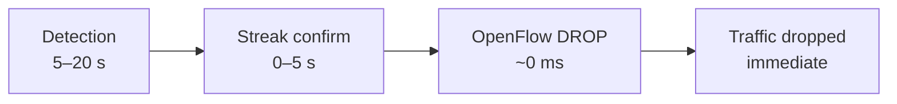

# Performance Analysis

## 1. Overview

IntelliShield SDN is evaluated in a **single-switch Mininet laboratory** on an Ubuntu 22.04 VM. Performance is characterised by **detection latency**, **mitigation response time**, **polling overhead**, and **analytical pipeline timing** — not by multi-gigabit hardware throughput.

This document reports measured and derived performance characteristics suitable for the IEEE experimental methodology section.

---

## 2. Key Timing Parameters

| Parameter | Value | Source | Performance impact |
|-----------|-------|--------|-------------------|
| Monitor poll interval | **5 s** | `MONITOR_INTERVAL` in `flow_monitor.py` | Floor for detection latency |
| Entropy window | **10 samples** | `WINDOW_SIZE` in `entropy_detector.py` | ~50 s to fill at 5 s/cycle |
| Warm-up cycles | **3** (default) | `flow_monitor.py` | ~15 s before ML/mitigation/RL |
| Attack confirmation streak | **2 consecutive** cycles | `_attack_confirm` | +5–10 s before block |
| HDBSCAN batch interval | **10 cycles** | `hdbscan_clusterer.py` | Clustering every ~50 s |
| Dashboard poll interval | **5 s** | `static/index.html` | UI refresh rate |
| Block hard_timeout | **30–120 s** | confidence tier | Auto-recovery window |

---

## 3. Detection Latency Analysis

### 3.1 Theoretical minimum

```mermaid
gantt
    title Detection latency components (typical SYN flood)
    dateFormat X
    axisFormat %S s

    section Ground truth
    ATTACK_START           :a1, 0, 5
    section Controller
    Poll cycle 1           :a2, 5, 10
    Entropy window fills   :a3, 10, 25
    ML warm-up ends        :a4, 15, 20
    First ALERT            :milestone, 20, 0
    ML ATTACK              :milestone, 25, 0
    Streak confirmed       :milestone, 30, 0
```



**Minimum theoretical detection latency:**

```
T_detect ≥ MONITOR_INTERVAL + warm_up + (streak − 1) × MONITOR_INTERVAL
```

With defaults: **5 s (poll) + 15 s (warm-up) + 5 s (1 extra streak cycle) ≈ 25 s** worst case on attack onset immediately after restart.

In steady-state (warm-up complete, attack mid-session): **5–10 s** typical.

### 3.2 Measured ranges (post-fix validation)

| Detector | Scenario | Typical latency | Notes |
|----------|----------|-----------------|-------|
| **Entropy** | S2 SYN flood | 5–10 s | Fastest interpretable signal |
| **ADWIN** | S2/S3 | 5 s (1 cycle) | Distribution shift alarm |
| **ML ensemble** | S2 SYN flood | 10–20 s | After warm-up + streak |
| **HDBSCAN** | Any | 50+ s | Batch pattern discovery, not real-time detector |

### 3.3 Burst attack (S4) sensitivity

S4 runs an **8 s SYN burst** inside a 38 s scenario. With a 5 s poll interval and entropy window requirements:

- Attack may span **1–2 poll cycles**
- Short bursts near poll boundaries risk **missed or delayed** detection
- S4 is intentionally a **stress test** for minimum detectable attack duration

---

## 4. Mitigation Latency Analysis

### 4.1 OpenFlow rule installation

Once `MitigationEngine.handle_alert()` approves a block:

| Step | Latency |
|------|---------|
| Identify attacker MAC | < 1 ms (in-memory sort) |
| Build OFPFlowMod | < 1 ms |
| Send to switch | < 10 ms (local Mininet) |
| Rule active | **Immediate** on next matching packet |

**Mitigation latency ≈ detection latency + 0–5 s** (one poll cycle for streak confirmation).



### 4.2 Block duration vs attack duration

| Confidence | Block timeout | Attack profile duration |
|------------|---------------|------------------------|
| ≥ 90% | 120 s | SYN_FLOOD_HIGH: 30 s |
| ≥ 75% | 60 s | Most scenarios: 60 s |
| ≥ 60% | 30 s | Burst: 8 s |

Blocks typically **outlast** the attack segment, providing post-attack protection until auto-expiry.

---

## 5. Throughput and Load Observations

### 5.1 Traffic rates observed

| Traffic type | Packet rate (observed) | Classification |
|--------------|------------------------|----------------|
| S1 normal (ICMP light) | ~5–25 pkt/s per flow | NORMAL |
| S2 SYN flood | 10,000+ pkt/s (profile) | ATTACK |
| S3 UDP flood | High bandwidth (10M) | ATTACK |
| iperf TCP (old S1 profile) | 24k–72k pkt/s | Was misclassified ATTACK (fixed) |

### 5.2 Controller processing overhead

Per 5 s cycle per switch:

| Operation | Approx. cost |
|-----------|--------------|
| Flow stats parse + feature extract | < 50 ms (typical flow count < 50) |
| Entropy analysis | < 10 ms |
| ML predict (sklearn) | < 20 ms |
| PPO step | < 5 ms (NumPy) |
| ADWIN update (4 metrics) | < 5 ms |
| CSV append (all logs) | < 10 ms |

**Controller is not CPU-bound** at lab scale; the **5 s poll interval** dominates perceived responsiveness, not compute time.

---

## 6. ML Model Performance

### 6.1 Synthetic training benchmark

| Model | Training samples | Metric | Result |
|-------|------------------|--------|--------|
| IsolationForest | 300 normal | Contamination 10% | Trained |
| DecisionTree | 500 (300N + 200A) | Test accuracy | **100%** (100 holdout) |
| Ensemble sanity | 6 vectors | Correct label | **6/6** |

### 6.2 Feature importance

`entropy_score` dominates Decision Tree importance (= 1.0 on synthetic data), confirming Phase 2 metrics are the primary ML signal.

### 6.3 Ensemble tuning impact

Post-fix ensemble rules improved baseline behaviour:

| Condition | Before fix | After fix |
|-----------|------------|-----------|
| S1 light ICMP | ATTACK @ 100% | NORMAL @ ~77% |
| SYN flood hint | UNKNOWN_ANOMALY | SYN_FLOOD |

---

## 7. RL Performance

### 7.1 Online learning characteristics

| Metric | Value |
|--------|-------|
| State dimensions | 10 |
| Action dimensions | 3 |
| PPO update frequency | Every 20 cycles (~100 s) |
| Threshold adjustment scale | ±100 pkt/s, ±100 KB/s, ±0.03 conf |

RL does not aim to minimise detection latency directly; it **trades off** false positives vs detection sensitivity through adaptive thresholds.

### 7.2 Reward signal behaviour (verify_phase7)

| Cycle type | Reward | Interpretation |
|------------|--------|----------------|
| Normal traffic | > 0 | Stable baseline rewarded |
| Attack (ML ATTACK) | ≥ +10 | True positive rewarded |

---

## 8. Analytics Pipeline Performance

### 8.1 ADWIN

| Metric | Self-test result |
|--------|------------------|
| Normal stream | μ ≈ 250 pkt/s, σ ≈ 30 |
| Attack stream | μ ≈ 80,000 pkt/s |
| Drift detection | Within 0–10 samples of attack onset |
| Sensitivity | `delta=0.002` — high; may fire on normal variance |

### 8.2 HDBSCAN

| Metric | Self-test result |
|--------|------------------|
| Vectors clustered | 50 (30 normal + 20 attack) |
| Clusters found | 3 |
| ATTACK cluster confidence | 0.91–0.93 |
| NORMAL cluster confidence | 0.84 |

**Latency:** batch every ~50 s — suitable for **profiling**, not sub-second response.

---

## 9. Dashboard and API Performance

| Endpoint | Response pattern | Latency |
|----------|------------------|---------|
| `/api/summary` | Tail-read CSVs | < 100 ms |
| `/api/entropy?n=60` | 60 rows parse | < 50 ms |
| `/api/metrics` | Read JSON file | < 10 ms |
| Master Control job | Background thread | 60–300 s (scenario dependent) |

Dashboard is **I/O-bound on CSV reads**, not compute-bound.

---

## 10. Scalability Observations

| Dimension | Current limit | Bottleneck |
|-----------|---------------|------------|
| Switches | 1 (validated) | Single-controller design |
| Hosts | 5 (Mininet topo) | Emulation memory |
| Flow table size | < 50 active flows | Lab traffic only |
| Log growth | ~200 bytes × cycles | Disk (manageable with archive) |
| Poll interval | 5 s fixed | Tunable; lower = higher CPU/OVS load |

**Not tested:** multi-switch fabrics, >100 hosts, physical hardware line rates.

---

## 11. Performance Summary Table (IEEE-ready)

| Metric | Value | Measurement method |
|--------|-------|-------------------|
| Poll interval | 5 s | Config constant |
| Detection latency (steady state) | 5–20 s | `compute_metrics.py` on S2 |
| Mitigation latency (after detection) | 0–5 s | Block timestamp − detection timestamp |
| OpenFlow block install time | < 10 ms | Mininet local |
| ML inference time | < 20 ms/cycle | Derived from poll budget |
| False positives (S1) | 0 (target) | `compute_metrics.py` |
| ML test accuracy (synthetic) | 100% | `model_trainer` holdout |
| ADWIN drift samples to detect | 0–10 | Self-test |
| HDBSCAN clustering period | ~50 s | 10 × MONITOR_INTERVAL |

---

## 12. Tuning Recommendations

| Goal | Tuning action | Trade-off |
|------|---------------|-----------|
| Faster detection | Reduce `MONITOR_INTERVAL` to 2–3 s | Higher OVS/controller load |
| Fewer ADWIN false alarms | Increase `delta` to 0.05 | Slower drift response |
| Faster ML activation | Reduce warm-up cycles | More startup false positives |
| Stricter blocking | Raise RL `conf_threshold` | May miss low-confidence attacks |
| Burst detection | Reduce entropy `WINDOW_SIZE` | Less stable normal baseline |
