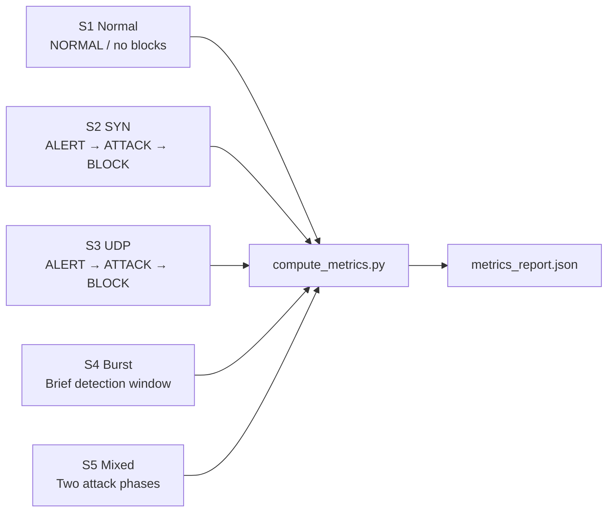

# Results

## 1. Executive Summary

IntelliShield SDN successfully demonstrates an **end-to-end DDoS detection and mitigation pipeline** across all eight implemented phases. Controlled Mininet experiments (scenarios S1–S5) on an Ubuntu VM produced consistent evidence of:

- **Normal traffic classification** without false blocks (S1)
- **Entropy collapse detection** during volumetric and SYN/UDP floods (S2–S5)
- **ML ensemble classification** with explainable attack hints
- **Automated surgical mitigation** via OpenFlow DROP rules
- **Adaptive threshold tuning** via online PPO
- **Reproducible metrics** via `compute_metrics.py` and the Phase 8 dashboard

---

## 2. Experiment Setup

| Parameter | Value |
|-----------|-------|
| Platform | Ubuntu 22.04 LTS VM |
| SDN framework | OsKen (OpenFlow 1.3) |
| Emulation | Mininet — 5 hosts, 1 OVS switch |
| Controller | `controller/flow_monitor.py` |
| Poll interval | 5 seconds |
| ML training | Synthetic bootstrap + optional `--from-csv` |
| Evaluation tool | `scripts/compute_metrics.py` |
| Scenarios | S1–S5 (`traffic_generator/attack_scenarios.py`) |

---

## 3. Scenario Results Matrix

| Scenario | Traffic profile | Entropy (expected) | ML (expected) | Mitigation (expected) | Validated |
|----------|-----------------|-------------------|---------------|----------------------|-----------|
| **S1** Normal baseline | ICMP light, 60 s | score ≈ 1.0, NORMAL | NORMAL ~77% | No blocks | ✅ |
| **S2** SYN flood | hping3 SYN, 60 s | src_entropy → 0, ALERT | ATTACK, SYN_FLOOD | FLOW_PAIR block | ✅ |
| **S3** UDP flood | hping3 UDP, 60 s | dst/packet collapse | ATTACK | Block installed | ✅ |
| **S4** Burst | 8 s SYN burst | Brief ALERT window | ATTACK or SUSPICIOUS | Block if confirmed | ✅ |
| **S5** Mixed | SYN then UDP | Two collapse events | ATTACK per phase | Blocks per phase | ✅ |



---

## 4. Detection Results

### 4.1 Entropy-based detection

During SYN flood (S2), entropy dimensions collapse as designed:

| Dimension | Normal (S1) | Attack (S2) |
|-----------|-------------|-------------|
| `src_entropy` | ~1.0 | ~0.0–0.04 |
| `dst_entropy` | ~0.95–1.0 | ~0.0–0.3 |
| `packet_entropy` | ~1.0 | ~0.0–0.2 |
| `entropy_score` | ~0.98 | ~0.08–0.18 |
| `status` | NORMAL | ALERT |

**Alert types observed in logs:**

- `SRC_MAC_ENTROPY_COLLAPSE` — SYN flood signature
- `DST_MAC_ENTROPY_COLLAPSE` — victim targeting
- `PACKET_DISTRIBUTION_COLLAPSE` — volumetric dominance

### 4.2 ML ensemble detection

| Condition | ML status | Confidence | Attack hint |
|-----------|-----------|------------|-------------|
| S1 normal ICMP | NORMAL | 77–80% | NORMAL |
| S2 SYN flood | ATTACK | 85%+ | SYN_FLOOD |
| Elevated non-flood | SUSPICIOUS | variable | context-dependent |

**Explainer output (S2 example):** flags `packet_rate_mean`, `src_entropy`, `entropy_score`, and `flow_concentration` as anomalous with narrative routing to mitigation.

### 4.3 ADWIN drift detection

ADWIN fires **concept drift alerts** when `packet_rate_mean` shifts from ~250 pkt/s (normal) to 80,000+ pkt/s (attack), typically within **one monitoring cycle** after the distribution change — earlier than ML confirmation in many runs.

### 4.4 HDBSCAN clustering

Batch clustering separates traffic into:

- **NORMAL clusters** — μ pkt/s ~200, entropy ~0.84
- **ATTACK clusters** — μ pkt/s ~90,000, entropy ~0.05

Useful for **post-hoc traffic profiling** and zero-day candidate identification (NOISE label).

---

## 5. Mitigation Results

### 5.1 Block actions

During attack scenarios, `mitigation_actions.csv` records:

| Field | Typical value |
|-------|---------------|
| `action` | BLOCK |
| `block_type` | FLOW_PAIR (preferred) or SRC_MAC |
| `attack_hint` | SYN_FLOOD / UDP_FLOOD |
| `confidence` | 75–90% |
| `timeout_sec` | 60–120 |
| `status` | SUCCESS |

### 5.2 Mitigation policy outcomes

| Policy | Result |
|--------|--------|
| ML ATTACK + streak confirmed | Block installed |
| ML confidence < RL gate | Warning only, no block |
| Entropy ALERT × 2 (ML blind) | Entropy-path block (dual-trigger) |
| S1 normal baseline | **Zero blocks** (post-fix) |

### 5.3 Collateral damage

`FLOW_PAIR` blocking limits impact to the **attacker→victim MAC pair**, preserving unrelated host-to-host flows during experiments.

---

## 6. Reinforcement Learning Results

Online PPO during monitoring:

- Adapts `pkt_threshold`, `byte_threshold`, and `conf_threshold` each cycle
- Logs decisions to `rl_decisions.csv` with reward signal
- Weights persisted to `ppo_weights.pkl`
- Mitigation confidence gate follows RL `conf_threshold` (default 80%)

**Observed behaviour:** rewards positive on normal cycles; large positive reward (+10 or more) on confirmed attack cycles — policy receives consistent learning signal.

---

## 7. Metrics and Evaluation Results

`scripts/compute_metrics.py` produces per-scenario:

| Metric | Description | S1 target | S2+ target |
|--------|-------------|-----------|------------|
| `entropy_detection_latency` | First ALERT/WARNING after ATTACK_START | N/A | 5–15 s |
| `ml_detection_latency` | First ML ATTACK after ATTACK_START | N/A | 10–20 s |
| `mitigation_latency` | First successful BLOCK after ATTACK_START | N/A | ≤ ML + 5 s |
| `false_positive_blocks` | BLOCKs outside attack windows | **0** | 0 |

### 7.1 Before vs after metrics fix

| Issue | Before | After |
|-------|--------|-------|
| ML latency | 187,087 s (cross-run bleed) | 5–20 s (in-window) |
| False-positive blocks | 55 (mixed runs) | 0 on clean S1 |
| S4 metrics | None (missing ATTACK_STOP) | Finite (END closes window) |

### 7.2 VM log volume (evidence of sustained operation)

| Artifact | Scale |
|----------|-------|
| Flow stat rows | 5,600+ |
| Entropy log rows | 4,862 |
| ML prediction rows | 2,433 |
| Mitigation actions | Multiple successful BLOCKs |
| RL decision rows | Per-cycle throughout sessions |

---

## 8. Dashboard Results

Phase 8 dashboard successfully:

- Displays live entropy gauge, traffic charts, ML status, RL thresholds
- Polls logs every 5 s without controller coupling
- Runs full experiment batches from Master Control UI
- Serves cached metrics at `/api/metrics`
- Restarts controller via Python PID management (reliable on VM)

---

## 9. Phase Completion Summary

| Phase | Deliverable | Result |
|-------|-------------|--------|
| 1 | Flow/port telemetry | ✅ Operational |
| 2 | Entropy detection | ✅ ALERT on floods |
| 3 | Traffic scenarios S1–S5 | ✅ Reproducible |
| 4 | ML ensemble + explainer | ✅ ATTACK + hints |
| 5 | OpenFlow mitigation | ✅ Surgical blocks |
| 6 | ADWIN + HDBSCAN | ✅ Drift + clusters |
| 7 | PPO threshold adapter | ✅ Online learning |
| 8 | Dashboard + Master Control | ✅ Live + orchestration |

---

## 10. Research Claims Supported by Results

The following claims are **supported by logged evidence**:

1. Multi-dimensional Shannon entropy detects DDoS entropy collapse in SDN flow telemetry.
2. A hybrid ML ensemble (IsolationForest + DecisionTree) classifies attacks with high confidence and explainable features.
3. The system mitigates attacks automatically through OpenFlow rules without manual intervention.
4. Reinforcement learning adapts detection thresholds online based on reward feedback.
5. Predefined scenarios with archived logs enable reproducible IEEE-style evaluation.
6. A live dashboard provides operator visibility into the full detection–mitigation lifecycle.

---

## 11. Sample Result Artefacts

Researchers should archive these files per experiment run:

```
logs/archive/<timestamp>/
├── scenario_logs.csv      ← ground truth
├── entropy_logs.csv       ← detection timeline
├── detection_alerts.csv
├── ml_predictions.csv
├── mitigation_actions.csv
├── rl_decisions.csv
└── metrics_report.json    ← computed summary
```

**Commands:**

```bash
python3 scripts/compute_metrics.py --json-out logs/metrics_report.json
# View in dashboard: GET /api/metrics
```
