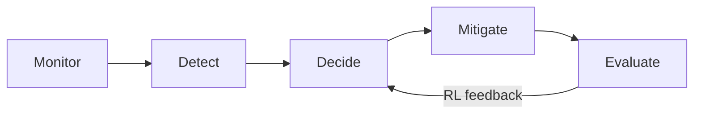

# Advantages

## 1. Overview

IntelliShield SDN offers several advantages over single-method or detection-only SDN security prototypes. These strengths are demonstrated through the implemented eight-phase architecture and validated Mininet experiments.

---

## 2. Architectural Advantages

### 2.1 Unified closed-loop design

Unlike prototypes that stop at anomaly detection, IntelliShield implements a complete pipeline:

**Advantage:** Detection, mitigation, adaptation, and evaluation coexist in one controller application with shared telemetry — reducing integration gaps common in multi-tool research setups.

### 2.2 Defence in depth

Multiple independent signals reinforce each other:

| Layer | Speed | Strength |
|-------|-------|----------|
| Entropy heuristics | Fast (5 s) | Interpretable, low compute |
| ADWIN drift | Fast (5 s) | Early distribution-shift alarm |
| ML ensemble | Medium (10–20 s) | Generalises attack patterns |
| HDBSCAN | Slow (~50 s) | Discovers traffic profiles |
| RL thresholds | Continuous | Adapts to environment |

**Advantage:** No single point of failure; entropy can catch attacks when ML is uncertain, and ML adds context when entropy alone is ambiguous.

---

## 3. Technical Advantages

### 3.1 SDN-native telemetry

OpenFlow flow statistics provide **per-flow packet rates, byte rates, and MAC pairs** without deploying external probes or mirroring hardware.

**Advantage:** Zero additional network hardware; ideal for academic SDN labs and reproducible Mininet experiments.

### 3.2 Multi-dimensional entropy analysis

Five entropy dimensions (source, destination, packet, byte, flow) capture different attack signatures:

- SYN flood → source entropy collapse
- UDP/volumetric flood → destination and packet distribution collapse

**Advantage:** More discriminative than single-metric threshold detectors; outputs are mathematically grounded and explainable.

### 3.3 Hybrid ML ensemble

Combining **unsupervised IsolationForest** (novel attack detection) with **supervised DecisionTree** (known pattern classification) balances zero-day sensitivity and labelled accuracy.

**Advantage:** Synthetic bootstrap enables immediate operation; `--from-csv` retraining incorporates real experiment data.

### 3.4 Explainable decisions

The `Explainer` module provides:

- Attack type hints (SYN_FLOOD, UDP_FLOOD, etc.)
- Per-feature anomaly narrative
- Decision Tree importance rankings

**Advantage:** Supports viva defence, operator trust, and IEEE discussion sections — not a black-box classifier.

### 3.5 Surgical mitigation (FLOW_PAIR)

Blocking only the **attacker→victim MAC pair** rather than entire hosts or subnets reduces collateral damage.

**Advantage:** Legitimate traffic between other host pairs continues during mitigation — important for demonstrating "intelligent" rather than "blunt" defence.

### 3.6 Auto-expiring blocks

OpenFlow `hard_timeout` eliminates orphan rules without manual cleanup.

**Advantage:** Self-healing after attacks; no persistent blocklist drift across experiments.

---

## 4. Adaptive and Learning Advantages

### 4.1 Online PPO threshold tuning

Static thresholds fail when traffic profiles change. PPO continuously adjusts:

- Packet-rate warning threshold
- Byte-rate warning threshold
- ML confidence gate for mitigation

**Advantage:** System **self-evolves** during operation — aligning with the "self-evolving hybrid framework" research title.

### 4.2 Concept drift awareness (ADWIN)

ADWIN detects when traffic distributions shift — including gradual changes not captured by fixed thresholds.

**Advantage:** Early warning before ML models fully react; useful for evolving attack strategies.

### 4.3 Traffic profiling (HDBSCAN)

Density-based clustering discovers NORMAL, ATTACK, SUSPICIOUS, and NOISE groups without pre-specifying cluster count.

**Advantage:** Supports zero-day candidate flagging (NOISE points) and post-hoc traffic characterisation.

---

## 5. Experimental and Research Advantages

### 5.1 Reproducible scenario suite

Five predefined scenarios (S1–S5) with `scenario_logs.csv` ground truth enable:

- Repeatable experiments across viva/demo sessions
- Automated latency measurement
- Cross-run comparison after code changes

**Advantage:** Reviewers and examiners can rerun the same scenarios and expect comparable outcomes.

### 5.2 Comprehensive CSV audit trail

Every phase appends structured logs suitable for pandas, matplotlib, and paper tables.

**Advantage:** No proprietary database; logs are portable, archivable, and human-readable.

### 5.3 Built-in metrics pipeline

`compute_metrics.py` joins ground truth with detection/mitigation timestamps — producing IEEE-ready latency and false-positive statistics.

**Advantage:** Eliminates manual timestamp correlation; reduces evaluation errors.

### 5.4 Master Control dashboard

Browser-based experiment orchestration removes SSH dependency for demos:

- Archive → restart → scenario → metrics in one UI
- Live entropy gauge and ML status for presentation

**Advantage:** Demonstration-ready for viva without terminal expertise.

---

## 6. Engineering Advantages

| Advantage | Detail |
|-----------|--------|
| **Graceful degradation** | Optional phases disable via import guards; controller survives missing modules |
| **Minimal dependencies** | Custom NumPy PPO — no PyTorch/CUDA requirement |
| **Single controller hub** | All hooks in `flow_monitor.py` — one process to deploy |
| **Safety guards** | Subnet allowlists, MAC whitelist, confidence gates, attack streak confirmation |
| **Log archive workflow** | Prevents experiment contamination |

---

## 7. Comparison with Common Alternatives

| Approach | IntelliShield advantage |
|----------|------------------------|
| Static threshold only | Adds ML, entropy, RL adaptation, explainability |
| Detection-only IDS | Adds automated OpenFlow mitigation |
| Host-based IDS | Centralised SDN view of all flows |
| Black-box ML | Entropy + explainer + feature narrative |
| Manual mitigation | Automated with confidence gating |
| Fixed lab scripts | Dashboard Master Control + metrics automation |

---

## 8. Summary

IntelliShield SDN's primary advantage is the **integration of fast heuristics, hybrid ML, adaptive RL, drift analytics, surgical mitigation, and reproducible evaluation** into a single SDN-native research prototype — suitable for academic demonstration while maintaining interpretability and experimental rigour.
