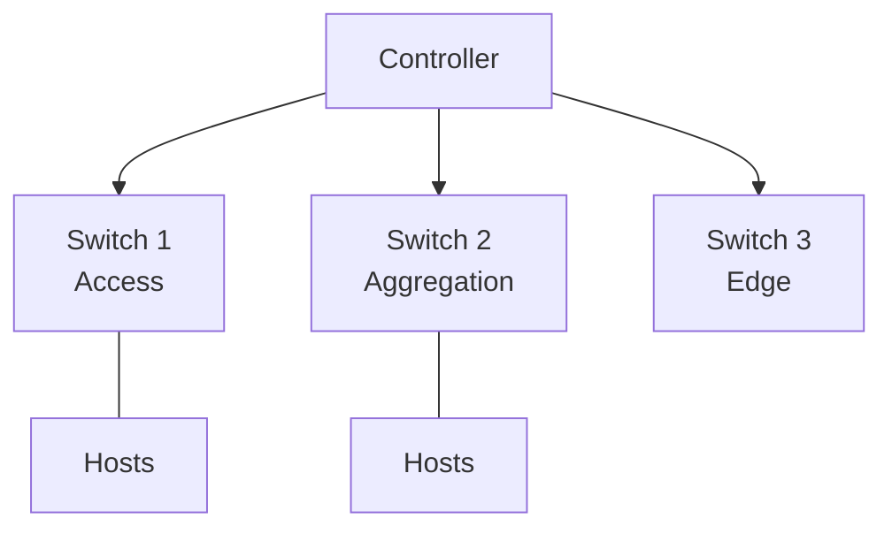
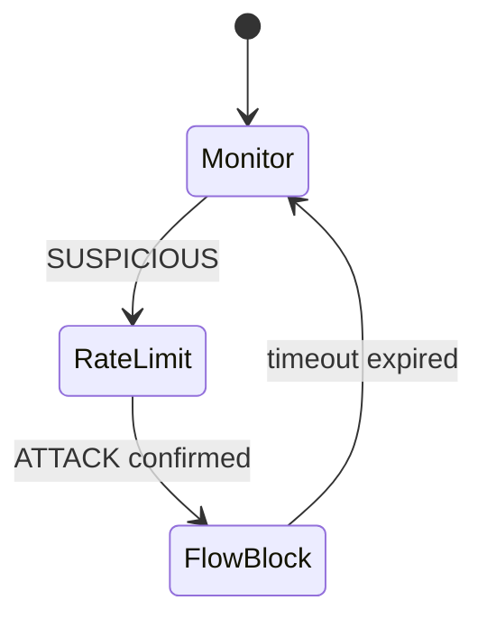
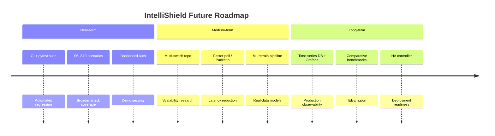

# Future Scope

## 1. Overview

This document outlines realistic extensions beyond the current eight-phase IntelliShield SDN prototype. Items are prioritised by research value, engineering effort, and alignment with the project's self-evolving SDN security vision.

---

## 2. Near-Term Enhancements (3–6 months)

### 2.1 Automated test and CI pipeline

| Enhancement | Benefit |
|-------------|---------|
| `pytest` suite for Phases 1–6 | Regression safety on every commit |
| GitHub Actions VM runner | Automated scenario smoke tests |
| Golden-file metrics comparison | Detect latency regressions |

**Target:** `tests/` directory with mock OpenFlow replies and entropy/ML fixture vectors.

### 2.2 Expanded attack scenario library

| Scenario | Purpose |
|----------|---------|
| DNS amplification simulation | Reflection attack coverage |
| HTTP slowloris | Application-layer low-rate attack |
| ICMP sweep + mixed botnet | Distributed source entropy test |
| IP spoofing (`--rand-source`) under monitoring | Evasion resistance evaluation |

**Target:** S6–S10 in `attack_scenarios.py` with corresponding metrics expectations.

### 2.3 ML pipeline maturity

- Train exclusively on **labelled real logs** (`--from-csv`)
- Add cross-validation and confusion matrix reporting
- Support XGBoost or Random Forest as ensemble members
- Online model versioning in `logs/models/`

### 2.4 Dashboard hardening

| Feature | Priority |
|---------|----------|
| Basic authentication (API key / login) | High |
| HTTPS via reverse proxy (nginx) | High |
| WebSocket push instead of CSV polling | Medium |
| Export PDF/PNG report from metrics | Medium |

---

## 3. Medium-Term Research Extensions (6–12 months)

### 3.1 Multi-switch topology

- Extend Mininet topo to tree/fat-tree (`depth=2, fanout=3`)
- Per-switch entropy and ML state
- Coordinated mitigation — block at edge closest to attacker
- Measure controller scalability vs switch count

### 3.2 Faster detection path

| Approach | Expected gain |
|----------|---------------|
| Reduce `MONITOR_INTERVAL` to 1–2 s | Sub-5 s detection |
| Event-driven `PacketIn` sampling for floods | Immediate spike detection |
| Parallel entropy on partial windows | Earlier ALERT before window full |

**Trade-off:** Higher CPU and OpenFlow message load — requires performance benchmarking.

### 3.3 Deep learning integration

- **LSTM / 1D-CNN** on time-series of flow features
- **Autoencoder** for unsupervised anomaly scoring replacing or augmenting IsolationForest
- GPU training offline; lightweight inference on controller

### 3.4 Federated or distributed analytics

- Edge switches pre-compute local entropy summaries
- Controller aggregates without raw flow export
- Privacy-preserving DDoS detection across domains

---

## 4. Advanced RL and Adaptation

### 4.1 Richer RL state and action space

| Current | Proposed |
|---------|----------|
| 10-dim state | Add cluster label, ADWIN drift count, port entropy |
| 3-dim action (thresholds) | Add block strategy selection (SRC_MAC vs FLOW_PAIR vs rate-limit) |
| Hand-crafted reward | Multi-objective: latency + FP rate + collateral damage |

### 4.2 Safe RL constraints

- Lagrangian constraints on false-positive rate
- Automatic rollback when FP rate exceeds bound
- Offline RL from archived `rl_decisions.csv` before online deployment

### 4.3 Multi-agent RL

- One PPO agent per switch in multi-switch topologies
- Coordinated mitigation without rule conflicts

---

## 5. Mitigation Evolution

### 5.1 Graduated response

- **Rate limiting** OpenFlow meters before hard DROP
- **Quarantine VLAN** redirect for suspicious hosts
- **DNS sinkhole** for amplification patterns

### 5.2 Cross-layer mitigation

- Integration with `iptables` on Mininet hosts
- REST API to upstream firewall appliances
- BGP FlowSpec rule export for ISP simulation

---

## 6. Data and Observability Platform

### 6.1 Time-series database migration

| Current | Future |
|---------|--------|
| CSV files | InfluxDB or TimescaleDB |
| Manual archive | Retention policies |
| `compute_metrics.py` | Grafana dashboards + alerts |

### 6.2 Real-time streaming

- Kafka / Redis stream between controller and analytics
- Separate detection service decoupled from OsKen event loop
- Horizontal scaling of ML inference

---

## 7. Comparative Evaluation Programme

To strengthen IEEE contribution:

| Study | Method |
|-------|--------|
| vs static threshold baseline | Disable ML/RL; measure FP and latency |
| vs entropy-only | Disable ML; measure hint accuracy |
| vs ML-only | Disable entropy path; measure SYN flood catch rate |
| vs published SDN-IDS | Reproduce comparable scenario on same Mininet topo |

**Deliverable:** Comparison tables and statistical significance tests (t-test across N runs).

---

## 8. Production-Oriented Roadmap (Long-Term)

| Milestone | Description |
|-----------|-------------|
| **P1** | Controller HA (ONOS/Ryu cluster or OsKen multi-instance) |
| **P2** | TLS + RBAC on dashboard and northbound API |
| **P3** | Physical OVS / hardware switch validation |
| **P4** | NETCONF/YANG integration for non-OpenFlow devices |
| **P5** | SOC integration (STIX/TAXII alert export) |
| **P6** | Kubernetes deployment for analytics microservices |

---

## 8b. Novelty-plane extensions (not in this release)

R4–R8 and Foundation are implemented on the live controller path. Remaining research items:

| Item | Honest status | Future work |
|------|---------------|-------------|
| R3 snapshot twin | COMPLETE (Level A) | Optional: live traffic-fidelity denser metrics; never twin-launched Mininet |
| R1 AutoML | Out of scope | Automated detector search — not started |
| R2 SSL zero-day | Not implemented | Encrypted-traffic detector |
| R9 Adaptive learning | Out of scope | Closed-loop retraining from verified incidents |
| R8 channels | Logging + JSONL only | Email/Slack adapters if a production lab is required |

Do **not** treat twin-driven OpenFlow or a second control plane as a near-term patch; R3 stays observational unless the architecture is explicitly re-authorised.

## 9. Academic and Publication Extensions

| Direction | Contribution angle |
|-----------|-------------------|
| Entropy + RL hybrid | Novel adaptive threshold policy for SDN security |
| FLOW_PAIR mitigation | Collateral damage comparison study |
| ADWIN + ML cascade | Two-stage detector latency/accuracy trade-off |
| Reproducibility package | Docker/VM image with one-command experiment reproduction |
| Survey paper | Taxonomy of ML-based SDN DDoS defence (use IntelliShield as case study) |

---

## 10. Prioritised Roadmap Summary

| Priority | Item | Effort | Impact |
|----------|------|--------|--------|
| **P0** | pytest + CI smoke tests | Low | High (quality) |
| **P0** | More attack scenarios | Medium | High (evaluation) |
| **P1** | Multi-switch Mininet | Medium | High (research) |
| **P1** | ML retrain from real logs | Low | High (accuracy) |
| **P2** | Dashboard auth/TLS | Low | Medium (demo safety) |
| **P2** | Sub-5 s detection tuning | Medium | High (performance) |
| **P3** | Deep learning models | High | Medium (novelty) |
| **P3** | Production HA deployment | High | Low (academic scope) |

---

## 11. Closing Note

The current IntelliShield SDN prototype establishes a **credible foundation** for future research. The highest-value next steps are **broader attack evaluation**, **automated testing**, and **comparative benchmarking** — these strengthen the IEEE submission without requiring a full production rewrite.

The long-term vision remains a **self-evolving, explainable, SDN-native security plane** that adapts to changing attack landscapes while minimising collateral damage to legitimate traffic.
