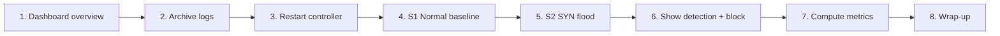

# Demo Script

**Duration:** 8–10 minutes  
**Environment:** Ubuntu VM — `~/intellishield-sdn/`  
**URL:** `http://<VM-IP>:8080`

---

## Pre-Demo Checklist (5 minutes before)

- [ ] VM is running and reachable (`ping <VM-IP>`)
- [ ] Controller running: `osken-manager controller/flow_monitor.py` (or will restart from UI)
- [ ] Dashboard running: `python3 dashboard/api.py`
- [ ] Browser tab open to dashboard; entropy gauge visible
- [ ] Sudoers configured for scenarios OR `INTELLISHIELD_SUDO_PASS` set
- [ ] Optional: second screen / projector showing dashboard

---

## Demo Flow Overview



---

## Step 1 — Dashboard Overview (1 min)

**Action:** Open `http://<VM-IP>:8080`

**Show:**

1. **Stat cards** — entropy score, alerts, blocks, ML attacks
2. **Entropy gauge** — should show NORMAL (green) if idle
3. **Phase status** — `/api/status` indicators (controller running)
4. **Master Control panel** — expand if collapsed

**Say:** *"This is our Phase 8 live dashboard. It polls CSV logs every five seconds — no database. Everything you see comes from the controller and experiment logs in real time."*

---

## Step 2 — Archive Logs (30 sec)

**Action:** Master Control → **Archive Logs**

**Show:** Control log confirms `Archived to logs/archive/<timestamp>/`

**Say:** *"Before each experiment we archive prior logs so metrics stay clean and reproducible."*

---

## Step 3 — Restart Controller (1 min)

**Action:** Master Control → **Restart Controller**

**Show:**

- Job status: `running` → `success`
- Log tail: "Controller is running" after ~20 s warmup
- Phase 1 indicator turns active

**Say:** *"The dashboard restarts the OsKen controller in the background — stop old process, start fresh, twenty-second warm-up for the entropy window."*

**Fallback (if UI fails):**

```bash
ssh akshay@<VM-IP>
cd ~/intellishield-sdn
osken-manager controller/flow_monitor.py
```

---

## Step 4 — Scenario 1: Normal Baseline (2 min)

**Action:** Master Control → **S1 Normal**

**Show while running (60 s):**

- Entropy gauge stays high (~0.95–1.0)
- ML panel: `NORMAL` ~77% confidence
- No new blocks in blocklist panel
- Traffic chart: low packet rates (~5–25 pkt/s)

**Say:** *"Scenario 1 generates light ICMP-only traffic — our corrected normal baseline. The system should stay NORMAL with zero false-positive blocks."*

**Point out:** This validates the system does not cry wolf on legitimate traffic.

---

## Step 5 — Scenario 2: SYN Flood (2 min)

**Action:** Master Control → **S2 SYN Flood** (or run immediately after S1 if time is short)

**Show during attack (~60 s after baseline period):**

1. **Entropy panel** — `src_entropy` collapses toward 0; status → `ALERT`
2. **Alerts list** — `SRC_MAC_ENTROPY_COLLAPSE`
3. **ML panel** — status → `ATTACK`, hint → `SYN_FLOOD`, confidence ~85%
4. **RL panel** — thresholds adjusting, reward spikes positive
5. **Blocklist** — `FLOW_PAIR` block with attacker MAC, 60 s timeout

**Say:** *"Watch the entropy score collapse — that's the Shannon entropy signature of a SYN flood. ML confirms ATTACK, and after two consecutive cycles the mitigation engine installs a surgical OpenFlow DROP rule on only the attacker-to-victim flow pair."*

**Optional — controller terminal:** Show console banners if SSH visible:

```
⚠️  ENTROPY ALERT DETECTED
🚨 [ML] ATTACK  conf= 85.2%  hint=SYN_FLOOD
🚫 [MITIGATION] BLOCK  |  Status: SUCCESS
```

---

## Step 6 — Verify Mitigation (1 min)

**Action:** Point to blocklist panel + entropy recovery after attack stops

**Show:**

- Block entry: `block_type: FLOW_PAIR`, `attack_hint: SYN_FLOOD`
- After timeout: block expires (hard_timeout on switch)
- Entropy recovers toward NORMAL

**Say:** *"Blocks auto-expire via OpenFlow hard_timeout — no manual cleanup. Legitimate traffic between other hosts was never affected because we block the flow pair, not the entire source host."*

---

## Step 7 — Compute Metrics (1 min)

**Action:** Master Control → **Compute Metrics**

**Show:** Job completes; open `/api/metrics` or refresh metrics section

**Highlight:**

- `entropy_detection_latency`: ~5–15 s
- `ml_detection_latency`: ~10–20 s
- `mitigation_latency`: finite, after detection
- `false_positive_blocks`: 0 (on clean S1 run)

**Say:** *"Our metrics script joins scenario ground-truth timestamps with detection and block events — IEEE-ready evaluation numbers."*

---

## Step 8 — Wrap-Up (30 sec)

**Action:** Return to summary stat cards

**Say:** *"In summary: eight phases, one controller, closed loop from telemetry to mitigation to metrics — all operable from this dashboard without SSH."*

---

## Quick Demo (3 min — time constrained)

If only 3 minutes available:

1. Show dashboard overview (30 s)
2. Archive + Restart (30 s)
3. Run **S2 only** (skip S1 if baseline already proven)
4. Point to entropy ALERT + ML ATTACK + BLOCK (90 s)
5. Show metrics (30 s)

---

## Batch Demo (evaluators / IEEE)

**Action:** Master Control → **Run S3+S4+S5**

Runs archive → restart → scenarios 3, 4, 5 → auto metrics.

**Duration:** ~5–8 minutes unattended; narrate while job log streams.

---

## Troubleshooting During Demo

| Problem | Fix |
|---------|-----|
| Restart controller failed | Check `/tmp/controller.log`; manual `osken-manager` |
| Scenario permission denied | Configure sudoers or set `INTELLISHIELD_SUDO_PASS` |
| Dashboard empty | Confirm controller running; check `logs/entropy_logs.csv` updating |
| ML shows ATTACK on S1 | Re-archive, restart, confirm S1 uses light ICMP profile |
| Metrics show `null` latencies | Archive first; ensure `scenario_logs.csv` has ATTACK_START/STOP |
| Gauge stuck | Hard refresh browser; check `/api/entropy` in new tab |

---

## Screenshots to Capture (for report)

1. Dashboard NORMAL state (S1)
2. Entropy gauge during ALERT (S2)
3. ML panel ATTACK + SYN_FLOOD hint
4. Blocklist FLOW_PAIR entry
5. Metrics JSON summary
6. Master Control job success log

---

## Post-Demo Commands (if asked)

```bash
# Show last entropy rows
tail -5 ~/intellishield-sdn/logs/entropy_logs.csv

# Show blocks
tail -5 ~/intellishield-sdn/logs/mitigation_actions.csv

# Full metrics
cat ~/intellishield-sdn/logs/metrics_report.json
```
