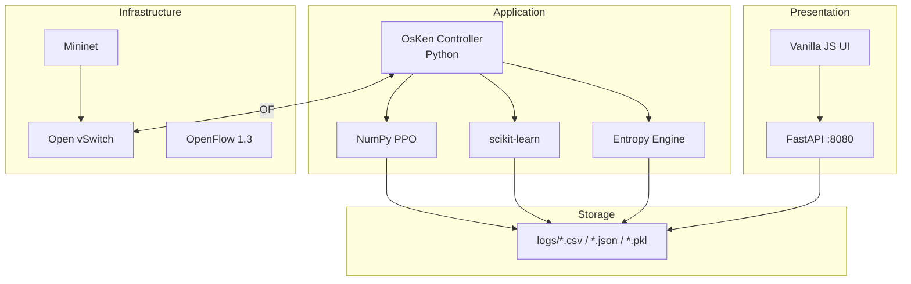

# Technology Explanation

Plain-language explanations of every technology in IntelliShield SDN — suitable for viva questions and slide footnotes.

---

## 1. Software Defined Networking (SDN)

**What it is:** A network architecture where the **control logic** (routing, policies, security) is separated from the **data plane** (switches that forward packets).

**Why we use it:** The controller has a **global view** of all flows. It can read statistics and install rules on every switch programmatically — ideal for DDoS detection and automated blocking.

**In our project:** OsKen controller + Open vSwitch + OpenFlow 1.3.

---

## 2. OpenFlow 1.3

**What it is:** A standard protocol between SDN controller and switches. The controller sends messages like "install this forwarding rule" or "give me flow statistics."

**Messages we use:**

| Message | Purpose |
|---------|---------|
| `PacketIn` | Switch sends unmatched packet to controller (learning) |
| `FlowStatsRequest/Reply` | Per-flow packet/byte counters |
| `PortStatsRequest/Reply` | Per-port counters |
| `FlowMod` | Install/modify/delete flow rules (including DROP) |
| `FlowRemoved` | Notify when rule expires |

---

## 3. OsKen

**What it is:** An open-source SDN controller framework (successor to Ryu) for building OpenFlow applications in Python.

**Our usage:** `osken-manager controller/flow_monitor.py` runs our `IntelliShieldFlowMonitor` application class.

---

## 4. Mininet

**What it is:** A network emulator that creates virtual hosts and switches on a single Linux machine using namespaces.

**Our topology:** 5 hosts (h1–h5), 1 Open vSwitch bridge, connected to remote OsKen controller.

**Why not physical hardware:** Reproducible, free, safe for attack simulation in a lab.

---

## 5. Open vSwitch (OVS)

**What it is:** A production-grade software switch implementing OpenFlow.

**Our usage:** Mininet uses OVS as the programmable switch datapath (`ovs,protocols=OpenFlow13`).

---

## 6. Python 3.10+

**What it is:** Primary implementation language for all eight phases.

**Why Python:** Rich ML ecosystem (sklearn), rapid prototyping, OsKen SDK, Mininet integration.

---

## 7. Shannon Entropy

**What it is:** Information-theoretic measure of **randomness/diversity** in a probability distribution.

**Formula:** H(X) = −Σ p(xᵢ) · log₂(p(xᵢ))

**Intuition for DDoS:**

| Traffic type | Entropy |
|--------------|---------|
| Normal — many sources, balanced | **High** (~1.0 normalised) |
| SYN flood — one source dominates | **Low** (~0.0) |

**Our implementation:** Five dimensions — source MAC, destination MAC, packet distribution, byte distribution, flow balance.

---

## 8. scikit-learn (sklearn)

**What it is:** Python machine learning library.

**Models we use:**

| Model | Type | Role |
|-------|------|------|
| `IsolationForest` | Unsupervised | Anomaly score — finds outliers without attack labels |
| `DecisionTreeClassifier` | Supervised | Class label — learns from labelled normal/attack |
| `StandardScaler` | Preprocessing | Normalise 15-dim feature vector |
| `HDBSCAN` | Clustering | Group traffic patterns without specifying k |

---

## 9. Isolation Forest — How to Explain

> "Isolation Forest builds random trees that isolate points. Anomalies are easier to isolate — they need fewer splits. We get an anomaly score from zero to one. High score on flood traffic triggers ATTACK status."

---

## 10. Decision Tree — How to Explain

> "Decision Tree learns if-then rules from labelled examples — normal versus attack. In our synthetic training, entropy_score was the most important feature. It provides the supervised vote in our ensemble."

---

## 11. ADWIN (Adaptive Windowing)

**What it is:** Online algorithm that detects when the **statistical mean** of a stream changes significantly.

**Why we use it:** Early warning — fires when packet rate jumps from ~250 pkt/s to 80,000 pkt/s, often one cycle before ML confirms.

**Implementation:** Pure Python in `adwin_detector.py` — no external `river` library.

---

## 12. HDBSCAN

**What it is:** Hierarchical Density-Based Spatial Clustering — finds clusters of varying density without pre-specifying the number of clusters.

**Our usage:** Batch every ~50 seconds on buffered ML feature vectors. Labels clusters NORMAL / ATTACK / SUSPICIOUS.

---

## 13. PPO (Proximal Policy Optimization)

**What it is:** A reinforcement learning algorithm that trains a policy to maximise cumulative reward while limiting how much the policy changes per update (clipped surrogate objective).

**Our implementation:** Custom NumPy — 64-neuron MLP, Gaussian policy, GAE advantage estimation.

**What it controls:** Three detection/mitigation thresholds adapted every 5-second cycle.

---

## 14. FastAPI + Uvicorn

**What it is:** Modern Python web framework (FastAPI) served by ASGI server (Uvicorn).

**Our usage:** Dashboard REST API on port 8080; reads CSV logs; serves static HTML UI.

---

## 15. hping3 / iperf / ping

| Tool | Role in project |
|------|-----------------|
| `ping` | Light ICMP baseline (S1, normal traffic) |
| `iperf` | TCP/UDP bandwidth tests in mixed profiles |
| `hping3` | SYN flood, UDP flood, ICMP flood, burst attacks |

---

## 16. CSV / JSON / Pickle Persistence

| Format | Stores |
|--------|--------|
| CSV | Time-series logs (entropy, ML, mitigation, etc.) |
| JSON | Session summaries, metrics reports, baselines |
| Pickle | ML models and PPO neural network weights |

**No SQL database** — deliberate simplicity for research auditability.

---

## 17. Technology Stack Diagram (for slides)

---

## 18. What We Do NOT Use (examiner clarity)

| Technology | Status |
|------------|--------|
| Kubernetes / Docker | Not implemented |
| PostgreSQL / MySQL / MongoDB | Not implemented |
| PyTorch / TensorFlow | Not implemented |
| Prometheus / Grafana | Not implemented |
| React / Angular | Not implemented |

---

## 19. One-Paragraph Technology Summary (read aloud)

> IntelliShield is built on **OpenFlow SDN** with an **OsKen Python controller** polling a **Mininet-emulated Open vSwitch** every five seconds. Detection combines **Shannon entropy**, **scikit-learn Isolation Forest and Decision Tree**, **ADWIN drift detection**, and **HDBSCAN clustering**. Adaptation uses a custom **NumPy PPO** agent. A **FastAPI dashboard** reads **CSV logs** for live visualisation. The entire stack runs on a single **Ubuntu VM** without containers or external databases.
