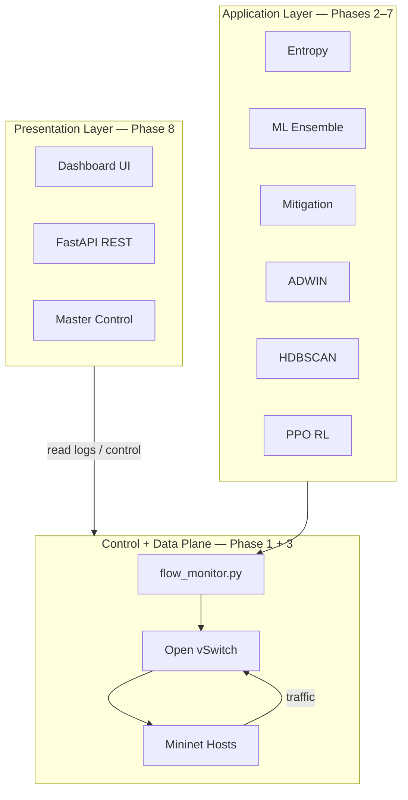
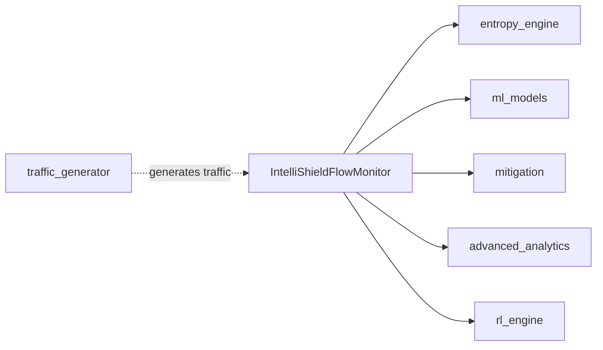
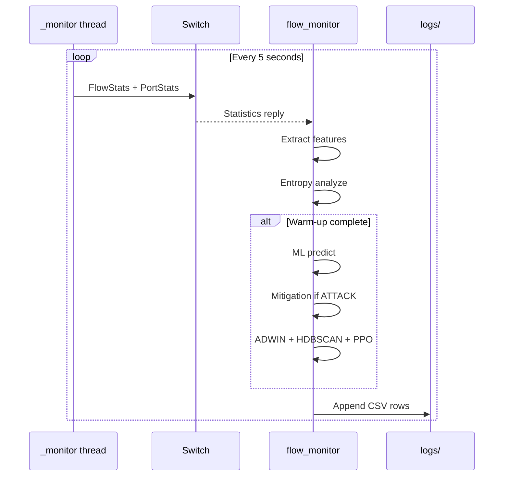
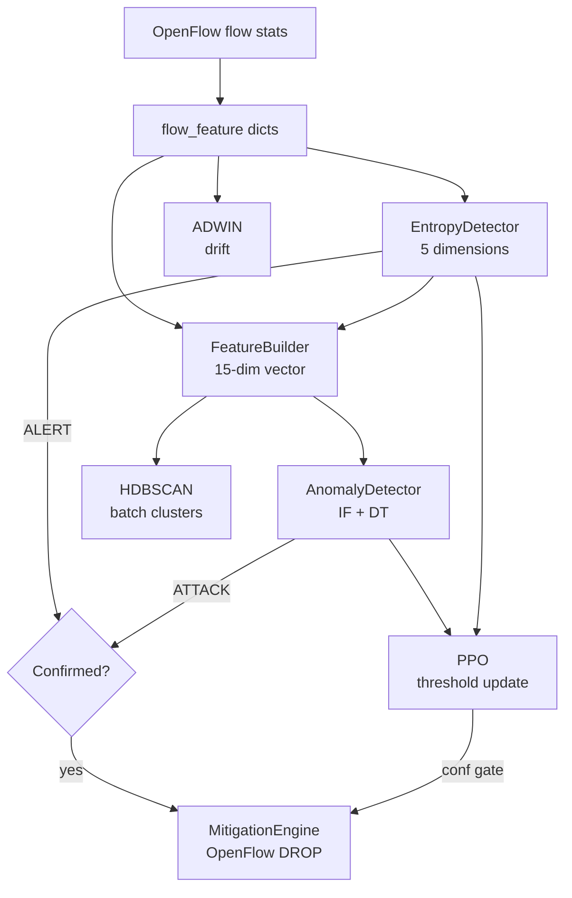
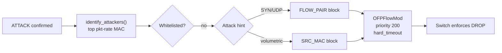
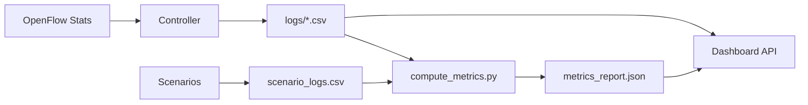
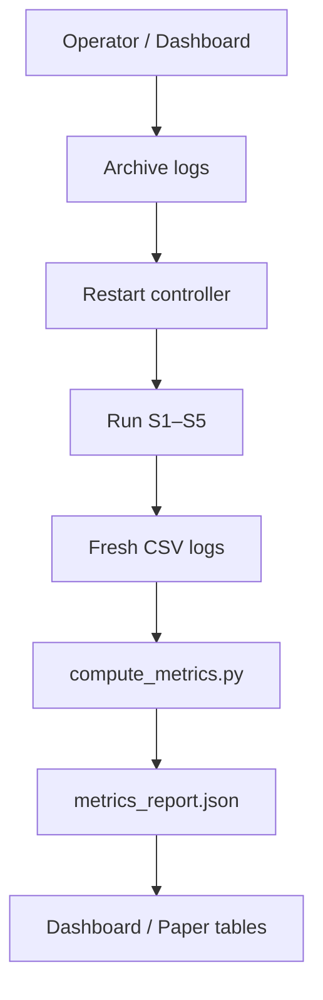
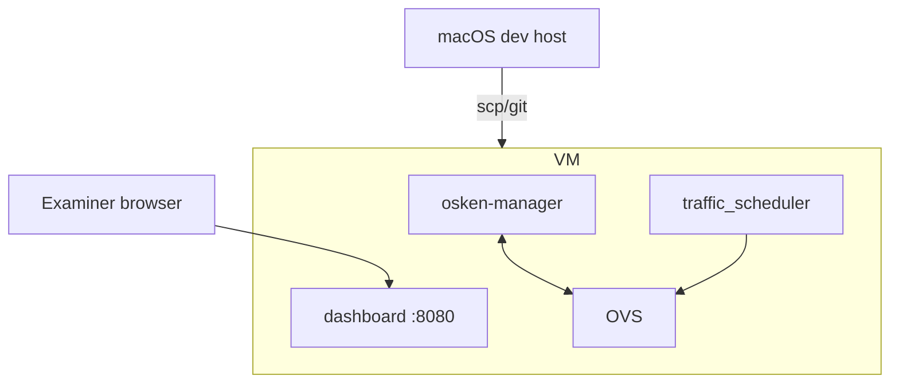

# Architecture Explanation

Presentation-ready architecture narrative with diagrams for slides and viva boards.

---

## 1. One-Sentence Architecture

> IntelliShield is a **layered, event-driven SDN application** where a single OsKen controller polls OpenFlow statistics, runs detection and mitigation hooks every five seconds, logs results to CSV, and exposes them through a FastAPI dashboard.

---

## 2. Three-Layer Model

| Layer | Responsibility | Key file |
|-------|----------------|----------|
| **Presentation** | Visualise, orchestrate experiments | `dashboard/api.py` |
| **Application** | Detect, classify, mitigate, adapt | Phase packages |
| **Control** | Telemetry, forwarding, OpenFlow | `flow_monitor.py` |
| **Data** | Packet forwarding | OVS + Mininet |

---

## 3. The Central Hub Pattern

**Design decision:** All phases integrate through **one controller class** — not microservices.

**Benefits for presentation:**

- Single process to deploy and debug
- Shared feature dict per poll cycle — no serialization overhead
- Graceful degradation if optional import fails

---

## 4. Five-Second Monitoring Cycle

**Key timing gates:**

| Gate | Effect |
|------|--------|
| Warm-up (~3 cycles) | ML, mitigation, RL deferred |
| Attack streak (2 cycles) | Block only after confirmation |
| RL conf gate (~80%) | Mitigation requires high confidence |

---

## 5. Detection Pipeline Architecture

**Defence in depth message:** No single detector is trusted alone — entropy provides fast interpretable signal; ML provides classification; ADWIN provides early warning; streak gates reduce false positives.

---

## 6. Mitigation Architecture

**Surgical mitigation message:** FLOW_PAIR preserves collateral traffic — only the attacker→victim Ethernet flow is dropped.

---

## 7. Data Flow Architecture

**Logs as system of record:** Dashboard never talks to controller directly for telemetry — it reads the same CSV files researchers analyse offline. Decoupled, auditable, simple.

---

## 8. Experiment Architecture

Ground truth in `scenario_logs.csv` (ATTACK_START/STOP) enables automated latency measurement.

---

## 9. Deployment Architecture

**Not shown:** Kubernetes, load balancers, database servers — because they do not exist in this implementation.

---

## 10. Architecture Talking Points

### For "Why monolithic controller?"

> Research prototype prioritising integration speed and reproducibility over distributed scalability. One poll cycle, one feature batch, one decision chain — no network latency between services.

### For "Why file-based logs?"

> IEEE experiments need auditable timestamps. CSV is human-readable, pandas-friendly, and requires zero infrastructure. Dashboard tail-reads last N rows — sufficient for lab scale.

### For "How does RL fit?"

> RL does not replace detectors — it **tunes their gates**. PPO adjusts how aggressive detection and mitigation are based on recent true/false positive feedback.

### For "What happens on controller crash?"

> OpenFlow rules expire via hard_timeout. Dashboard Master Control can restart controller. Logs on disk survive process crash.

---

## 11. Slide-Ready Architecture Bullets

- **Single controller hub** integrates 7 detection/mitigation phases
- **5-second poll loop** drives all analytics synchronously
- **Defence in depth:** entropy → ADWIN → ML → streak → mitigate
- **Surgical OpenFlow blocks** with auto-expiry
- **Online PPO** adapts thresholds during operation
- **CSV-centric** observability + FastAPI dashboard
- **Reproducible scenarios** with ground-truth timestamps
