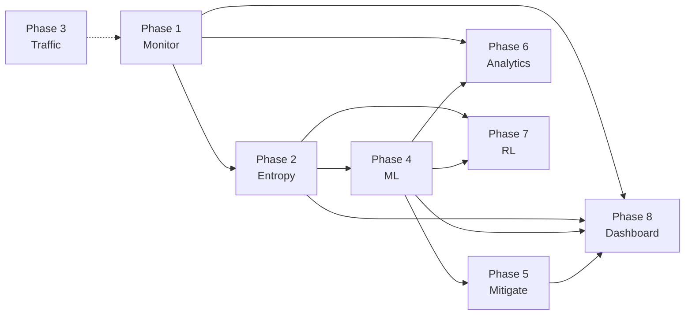

# Module Explanation

Eight-phase module walkthrough for presentations — **what each module does**, **one demo talking point**, and **one examiner question** per phase.

---

## Overview Diagram

---

## Phase 1 — Flow Statistics Monitoring

| Item | Detail |
|------|--------|
| **Package** | `controller/flow_monitor.py` |
| **Runs as** | OsKen application (`osken-manager`) |
| **Input** | OpenFlow FlowStatsReply, PortStatsReply, PacketIn |
| **Output** | `flow_stats.csv`, `port_stats.csv` |
| **Interval** | 5 seconds |

**What it does:**

- Acts as L2 learning switch (MAC → port)
- Polls per-flow packet rate, byte rate, duration
- Builds the **feature dict** every downstream phase consumes
- Spawns background `_monitor()` thread

**Demo point:** *"Every five seconds you see new rows in flow_stats.csv — that's Phase 1 feeding the entire pipeline."*

**Examiner Q:** *"Why 5 seconds?"* → Trade-off: faster poll = quicker detection but higher controller/OVS load; 5 s is standard for lab evaluation.

---

## Phase 2 — Entropy Detection Engine

| Item | Detail |
|------|--------|
| **Package** | `entropy_engine/` (4 modules) |
| **Core class** | `EntropyDetector` |
| **Input** | List of flow_feature dicts from Phase 1 |
| **Output** | `entropy_logs.csv`, `detection_alerts.csv`, `entropy_baselines.json` |

**What it does:**

- Maintains sliding window (100 flows) per switch
- Computes 5 Shannon entropy dimensions + composite score
- Status: NORMAL / WARNING / ALERT
- Alert types: `SRC_MAC_ENTROPY_COLLAPSE`, `DST_MAC_ENTROPY_COLLAPSE`, etc.

**Demo point:** *"Watch src_entropy drop from 1.0 to 0.04 during SYN flood — that's entropy collapse."*

**Examiner Q:** *"Why five dimensions?"* → Different attacks affect different distributions (source diversity vs destination focus vs packet dominance).

---

## Phase 3 — Traffic Generation & Attack Simulation

| Item | Detail |
|------|--------|
| **Package** | `traffic_generator/` (7 modules) |
| **Entry point** | `traffic_scheduler.py --scenario N` |
| **Input** | CLI scenario ID (1–5) |
| **Output** | `scenario_logs.csv`, `attack_logs.csv`, `traffic_logs.csv` |

**Scenarios:**

| ID | Name | Attack |
|----|------|--------|
| S1 | Normal baseline | ICMP light only |
| S2 | SYN flood | hping3 SYN |
| S3 | UDP flood | hping3 UDP |
| S4 | Burst | Short SYN burst |
| S5 | Mixed | SYN then UDP |

**What it does:**

- Creates Mininet topology (5 hosts, 1 switch)
- Logs ATTACK_START/STOP ground truth for metrics
- Safety: `ALLOWED_SUBNETS` blocks external targets

**Demo point:** *"Scenario logs give us ground truth — we know exactly when the attack started for latency measurement."*

**Examiner Q:** *"Is this real DDoS?"* → Emulated lab traffic using hping3 at high rates; valid for controlled SDN research, not internet-scale.

---

## Phase 4 — ML Anomaly Detection

| Item | Detail |
|------|--------|
| **Package** | `ml_models/` (8 modules) |
| **Core class** | `AnomalyDetector` |
| **Input** | 15-dim vector from `FeatureBuilder` |
| **Output** | `ml_predictions.csv`, `ml_alerts.csv`, `logs/models/*.pkl` |

**What it does:**

- Combines Phase 1 flow stats + Phase 2 entropy into one vector
- Isolation Forest (40%) + Decision Tree (60%) ensemble vote
- `Explainer` provides attack type hint and feature narrative
- Trains synthetic on first run; `--from-csv` for real logs

**Demo point:** *"ML says ATTACK at 85% with SYN_FLOOD hint — and the explainer shows which features crossed normal ranges."*

**Examiner Q:** *"Why ensemble?"* → IF catches novel anomalies; DT learns known patterns; together more robust than either alone.

---

## Phase 5 — Automated Mitigation

| Item | Detail |
|------|--------|
| **Package** | `mitigation/` (5 modules) |
| **Core class** | `MitigationEngine` |
| **Input** | ML/entropy alert + flow features |
| **Output** | `mitigation_actions.csv`, OpenFlow DROP rules |

**What it does:**

- Identifies attacker MAC (highest packet rate)
- Confidence gate (RL-adaptive, default 80%)
- Installs `OFPFlowMod` DROP priority 200
- FLOW_PAIR for SYN/UDP; auto-expiry 30–120 s
- Whitelist: broadcast, multicast, LLDP never blocked

**Demo point:** *"Blocklist shows FLOW_PAIR — only attacker-to-victim blocked, not the whole network."*

**Examiner Q:** *"False positive risk?"* → Streak confirmation, confidence gate, whitelist, S1 validation shows zero FP blocks.

---

## Phase 6 — Advanced Analytics

| Item | Detail |
|------|--------|
| **Package** | `advanced_analytics/` (2 modules) |
| **Components** | `ADWINDetector`, `HDBSCANClusterer` |
| **Output** | `drift_alerts.csv`, `cluster_labels.csv`, `cluster_summary.json` |

**ADWIN:**

- Online drift on packet_rate, flow_count, entropy_score, byte_rate
- Fires early warning when distribution shifts

**HDBSCAN:**

- Batch every 10 cycles (~50 s)
- Labels clusters NORMAL / ATTACK / SUSPICIOUS / NOISE

**Demo point:** *"ADWIN often fires one cycle before ML — it's our early alarm."*

**Examiner Q:** *"Does HDBSCAN block traffic?"* → No — profiling and analysis only; detection/mitigation handled by entropy and ML.

---

## Phase 7 — PPO Reinforcement Learning

| Item | Detail |
|------|--------|
| **Package** | `rl_engine/` (5 modules) |
| **Core classes** | `PPOAgent`, `ThresholdAdapter`, `SDNEnvironment` |
| **Output** | `rl_decisions.csv`, `ppo_weights.pkl` |

**What it does:**

- 10-dim state → 3-dim action (threshold deltas)
- Reward: TP bonus, FP/FN penalties
- Updates policy every 20 transitions
- `conf_threshold` wired to mitigation engine

**Demo point:** *"RL panel shows pkt_threshold and conf_threshold shifting — the system adapts live."*

**Examiner Q:** *"Why PPO not Q-learning?"* → Continuous action space (threshold adjustments); PPO handles continuous control well; implemented in NumPy without GPU.

---

## Phase 8 — Live Dashboard

| Item | Detail |
|------|--------|
| **Package** | `dashboard/` |
| **Files** | `api.py`, `control.py`, `static/index.html` |
| **Port** | 8080 |
| **Reads** | All `logs/*.csv` |

**What it does:**

- Live charts: traffic, entropy, ML, RL, alerts, blocks, drift
- Master Control: archive, restart, scenarios, metrics, retrain
- Background jobs with log tail polling

**Demo point:** *"Entire experiment lifecycle from browser — no SSH required for demo."*

**Examiner Q:** *"Production ready?"* → No auth/TLS — lab demonstration tool; documented limitation.

---

## Supporting Module — Metrics Script

| Item | Detail |
|------|--------|
| **File** | `scripts/compute_metrics.py` |
| **Output** | `metrics_report.json` |

Joins scenario ground truth with detection/block timestamps → latency and false-positive statistics.

---

## Module Interaction Table (slide-ready)

| Phase | Module | Feeds | Fed by |
|-------|--------|-------|--------|
| 1 | flow_monitor | 2,4,5,6,7 | OpenFlow |
| 2 | entropy_engine | 4,5,7 | 1 |
| 3 | traffic_generator | (traffic) | — |
| 4 | ml_models | 5,6,7 | 1,2 |
| 5 | mitigation | OVS | 4,1,7 |
| 6 | advanced_analytics | logs | 4,1 |
| 7 | rl_engine | 5 gates | 4,2 |
| 8 | dashboard | operator | all logs |

---

## 60-Second Module Summary (read aloud)

> Phase 1 collects OpenFlow statistics every five seconds. Phase 2 computes Shannon entropy and fires alerts on collapse. Phase 3 runs reproducible attack scenarios with ground-truth logging. Phase 4 classifies traffic with an Isolation Forest and Decision Tree ensemble on a fifteen-dimensional feature vector. Phase 5 installs surgical OpenFlow DROP rules. Phase 6 adds ADWIN drift detection and HDBSCAN profiling. Phase 7 adapts thresholds online with PPO. Phase 8 exposes everything on a live dashboard with Master Control for experiments.
