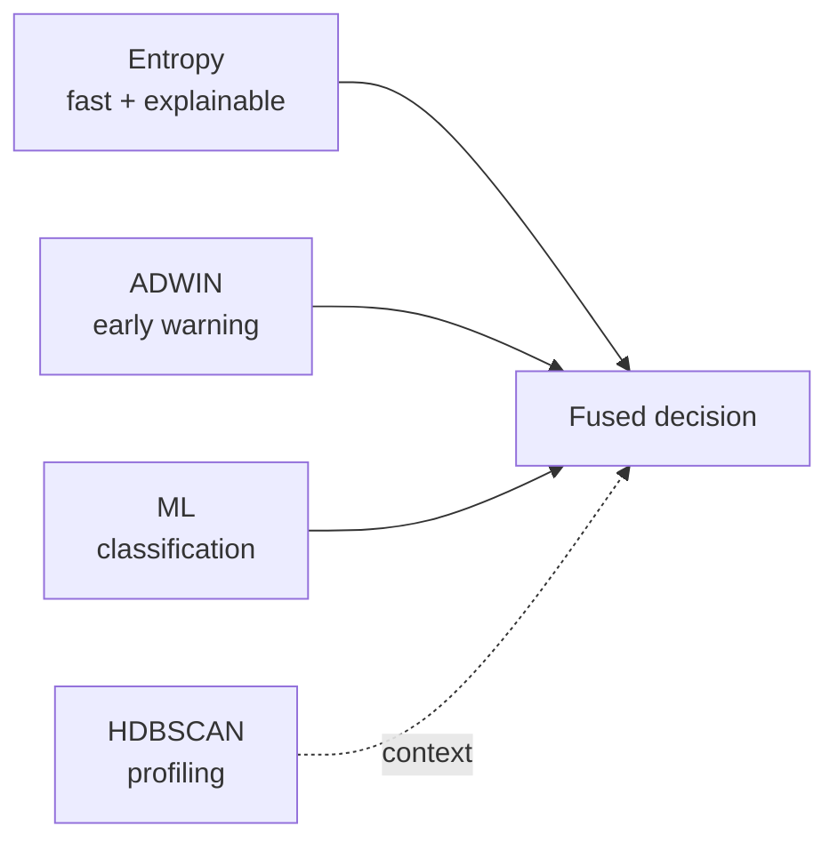
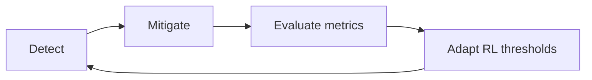
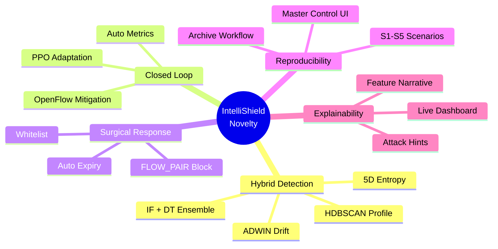

# Novelty Explanation

Research contribution framing for viva, IEEE paper, and examiner questions.

---

## 1. Core Novelty Statement

> The novelty of IntelliShield SDN is **not** any single algorithm in isolation. It is the **integration** of entropy-based detection, hybrid machine learning, concept-drift analytics, reinforcement-learning adaptation, surgical OpenFlow mitigation, and reproducible experiment infrastructure into **one closed-loop SDN security framework** with operator visibility.

**One sentence for examiners:**

> *We present a unified, self-evolving, explainable, SDN-native DDoS defence workflow — from telemetry to mitigation to metrics — in a single deployable prototype.*

---

## 2. Seven Novel Contributions

### Contribution 1 — Hybrid Multi-Layer Detection

**What exists elsewhere:** Systems using only thresholds, only ML, or only entropy.

**What we do differently:**

| Layer | Role | Speed |
|-------|------|-------|
| Shannon entropy (5D) | Interpretable collapse detection | ~5 s |
| ADWIN | Distribution shift alarm | ~5 s |
| IF + DT ensemble | Classification + anomaly | ~10–20 s |
| HDBSCAN | Traffic profiling | ~50 s |

**Novelty angle:** Complementary layers with different time horizons — not redundant duplicate detectors.

---

### Contribution 2 — Closed-Loop Detect → Mitigate → Measure → Adapt

**Gap in literature:** Many SDN IDS papers stop at **alert generation**.

**Our loop:**

**Implemented evidence:**

- OpenFlow DROP rules in `mitigation_actions.csv`
- Latency metrics in `metrics_report.json`
- RL decisions in `rl_decisions.csv`

**Novelty angle:** End-to-end **operational** security loop, not detection-only research.

---

### Contribution 3 — Surgical FLOW_PAIR Mitigation

**Common approach:** Block entire source IP/MAC — collateral damage to legitimate flows.

**Our approach:**

| Block type | When | Collateral |
|------------|------|------------|
| `FLOW_PAIR` | SYN/UDP/ICMP flood with known victim | Minimal — only src→dst pair |
| `SRC_MAC` | Volumetric / unknown victim | Broader but necessary |

**Novelty angle:** SDN programmability enables **flow-granular** response; we exploit OpenFlow match on both `eth_src` and `eth_dst`.

**Demo proof:** Other host pairs continue pinging during S2 block.

---

### Contribution 4 — Online PPO Threshold Adaptation

**Static systems:** Fixed pkt/s threshold (500), fixed ML confidence gate (60%).

**Our system:** PPO adjusts three thresholds every cycle based on reward:

- True positive → positive reward
- False positive block → penalty
- ML blind during entropy collapse → penalty; entropy path credited

**Novelty angle:** **Self-evolving** — the framework name IntelliShield reflects adaptive thresholds, not just hybrid detection.

**Implementation note:** Custom NumPy PPO — no GPU, runs on lab VM alongside controller.

---

### Contribution 5 — Fast + Slow Analytics Combination

| Signal | Answers | Latency |
|--------|---------|---------|
| Entropy ALERT | "Diversity collapsed — likely flood" | Fast |
| ADWIN drift | "Distribution just changed" | Fast |
| ML ATTACK | "Classified attack with hint" | Medium |
| HDBSCAN cluster | "Traffic group looks like ATTACK" | Slow |

**Novelty angle:** Deliberate **multi-timescale** analytics — not everything tries to be real-time.

---

### Contribution 6 — Explainability + Operator Dashboard

**Black-box ML problem:** Examiners ask "why ATTACK?"

**Our answer:**

- `Explainer` — feature narrative, normal range comparison
- Attack type hints — SYN_FLOOD, UDP_FLOOD, etc.
- Entropy dimension breakdown — which entropy collapsed
- Live dashboard — gauge, charts, blocklist, RL panel

**Novelty angle:** **Interpretable** hybrid AI for academic scrutiny and live demonstration.

---

### Contribution 7 — Reproducible Experiment Infrastructure

**Research reproducibility crisis:** Many papers lack runnable artifacts.

**Our infrastructure:**

| Artifact | Purpose |
|----------|---------|
| S1–S5 scenarios | Identical traffic every run |
| `scenario_logs.csv` | Ground-truth timestamps |
| `archive_logs()` | Clean experiment isolation |
| `compute_metrics.py` | Automated latency/FP report |
| Master Control UI | One-click batch eval |

**Novelty angle:** **System + methodology** contribution — others can rerun S2 and expect comparable results.

---

## 2b. Release 1.0 added planes

These sit **on top of** Contributions 1–7. Detail: [`../02_Novelties/`](../02_Novelties/README.md).

| # | Plane | One-line novelty |
|---|--------|------------------|
| 8 | Foundation | Typed `shared_contracts/` leaf — one vocabulary |
| 9 | P0 | Measurement integrity (windows, IEEE fields, RL scale, FLOW_PAIR) |
| 10 | R4 | Advisory **S·T·D·A·P** co-occurrence — does not DROP |
| 11 | R6 | Fusion **w = ρ × h**, signed S, calibrated confidence |
| 12 | R7 | Ordered stages; only **VERIFIED** may DROP; fail-closed |
| 13 | R5 | XAI path + RCA chain after verification |
| 14 | R8 | Alerts on **VERIFIED** by default (not every anomaly) |
| 15 | Ops profile | Lab freeze 60% vs production clamp 55–75% |
| 16 | R3 | Snapshot twin for replay/validation — **not** live OF |

**Viva distinction:** R4 is *advisory*; R7 is *authoritative* for mitigation.

---

## 3. Comparison with Common Approaches

| Approach | Typical limitation | IntelliShield difference |
|----------|-------------------|-------------------------|
| Threshold-only IDS | High FP on variable baseline | Entropy + ML + RL gates |
| ML-only SDN IDS | Black box; no mitigation | Explainer + OpenFlow block |
| Detection-only paper | No closed loop | Mitigate + metrics + adapt |
| Static configuration | Brittle over time | PPO online tuning |
| Manual experiment scripts | Hard to reproduce | Dashboard Master Control |
| Host-based IDS | No flow programmability | SDN-native OpenFlow rules |

---

## 4. What Is NOT Claimed as Novel

Honest positioning strengthens viva credibility:

| Item | Status |
|------|--------|
| Shannon entropy for DDoS | Known technique — our **multi-dimensional SDN application** is the contribution |
| Isolation Forest / Decision Tree | Standard sklearn — our **15-dim SDN feature fusion** is the contribution |
| ADWIN algorithm | Published 2007 — our **integration as early warning** is the contribution |
| PPO algorithm | Published — our **threshold-control application in SDN security** is the contribution |
| Mininet evaluation | Standard practice — our **full pipeline + metrics** is the contribution |

**Framing:** *"We do not claim to invent Shannon entropy. We claim a novel **integration architecture** that makes these techniques work together in a self-evolving SDN security pipeline."*

---

## 5. Novelty for IEEE Paper (paragraph)

> This work contributes a unified SDN framework that combines multi-dimensional Shannon entropy analysis, a hybrid Isolation Forest and Decision Tree ensemble, ADWIN-based concept drift detection, and HDBSCAN traffic profiling within a single OpenFlow controller application. Unlike detection-only prototypes, IntelliShield closes the loop with confidence-gated surgical FLOW_PAIR mitigation, online PPO-based threshold adaptation, and automated experiment metrics. Release 1.0 further adds **cross-layer correlation, reliability-aware fusion, multi-stage verification, explainable RCA, and policy alerting** on shared contracts. A **snapshot digital twin** supports observational replay of S1–S5 logs; it does not synchronise live OpenFlow. A browser-based dashboard and ground-truth logging support IEEE-style evaluation in a Mininet testbed.

---

## 6. Novelty for Viva (30 seconds)

> Sir/Madam, the novelty is integration and closure. We don't rely on one detector — we layer entropy, machine learning, drift detection, and clustering. We don't stop at alerts — we **correlate, fuse, and verify** before OpenFlow DROP, then **explain and alert**. We don't use unbounded RL gates — a lab ops profile keeps demos reproducible. A snapshot twin can replay experiment logs; it does not control the live switch.

---

## 7. Anticipated Examiner Challenges

| Challenge | Response |
|-----------|----------|
| "Entropy alone is enough" | ML adds classification and hints; RL reduces FP; mitigation needs confidence gates |
| "Why RL if ML works?" | ML classifies; RL tunes **when** to act — different problem |
| "Mininet is not real" | Acknowledged — valid for architectural proof; future work on physical OVS |
| "Synthetic ML training" | Bootstrap only; `--from-csv` retrains on real logs; S2 validates live |
| "5 s latency too slow" | Poll-bound; tunable; acceptable for prototype; ADWIN gives early signal |
| "Dashboard security?" | Lab tool; documented limitation; not production claim |
| "Is the twin a second controller?" | No — read-only snapshots; no OpenFlow from `twin/` |
| "Does correlation drop packets?" | No — R4 is advisory; only R7 VERIFIED may mitigate |

---

## 8. Novelty Diagram (slide-ready)

---

## 9. Tagline Options (for title slide or conclusion)

1. *"Detect. Explain. Mitigate. Adapt."*
2. *"Self-Evolving SDN Security — Not Just Detection."*
3. *"From Entropy Collapse to Surgical Block in One Controller."*
4. *"Eight Phases. One Pipeline. Zero SSH Demo."*
