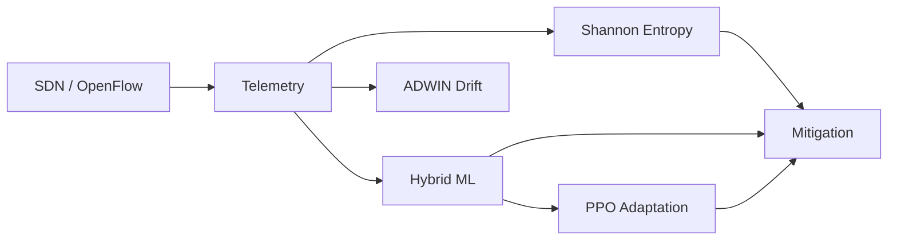

# Chapter 2 — Literature Review & Background

## 2.1 Introduction

This chapter surveys foundational concepts and related approaches relevant to IntelliShield SDN. The review establishes why SDN suits DDoS defence, how entropy and machine learning have been applied in network security, and where existing work leaves gaps that this project addresses.

## 2.2 Software Defined Networking

SDN architecture comprises three layers: application, control, and infrastructure [1]. The control plane (controller) communicates with switches via southbound protocols; OpenFlow [2] is the de facto standard for programmatic flow table management.

**Relevance to DDoS:** The controller receives global flow statistics and can install DROP rules within milliseconds — enabling detection-to-mitigation pipelines impossible in purely distributed legacy networks.

**OsKen** is an open-source Python SDN controller framework used in this project as the host for the `IntelliShieldFlowMonitor` application.

## 2.3 DDoS Attack Taxonomy

DDoS attacks are commonly classified as:

| Category | Mechanism | Example in this project |
|----------|-----------|-------------------------|
| Volumetric | High packet/bandwidth rate | SYN flood, UDP flood (S2, S3) |
| Protocol abuse | Exploit protocol state | SYN flood (half-open connections) |
| Application layer | Low-rate targeted requests | Out of scope |

This project evaluates **L3/L4 volumetric floods** emulated with `hping3` in Mininet — appropriate for SDN flow-table and statistics-based detection.

## 2.4 Entropy-Based Detection

Shannon entropy measures uncertainty in a probability distribution [3]:

```
H(X) = −Σ p(xᵢ) · log₂(p(xᵢ))
```

In network security, **entropy collapse** occurs when attack traffic concentrates on few sources or destinations, reducing diversity. Prior SDN research has applied entropy to IP address distributions for anomaly detection [4].

**IntelliShield extension:** Five normalised dimensions (source MAC, destination MAC, packet, byte, flow) with weighted composite scoring — implemented in `entropy_engine/`.

## 2.5 Machine Learning for Intrusion Detection

Network intrusion detection employs:

- **Supervised learning** (Decision Trees, SVM, neural networks) — requires labelled data.
- **Unsupervised learning** (Isolation Forest, autoencoders) — detects novel anomalies without attack labels.

Hybrid approaches combine both for robustness [5]. **Isolation Forest** [6] isolates anomalies via random partitioning; **Decision Trees** learn interpretable rules from labelled examples.

**IntelliShield approach:** 15-dimensional feature vector fusing Phase 1 flow statistics and Phase 2 entropy; ensemble vote (40% IF + 60% DT) with `Explainer` for attack type hints.

## 2.6 Concept Drift Detection

Network traffic distributions change over time (concept drift). **ADWIN** (Adaptive Windowing) [7] detects statistically significant mean shifts in data streams using Hoeffding bounds — firing before static thresholds adapt.

**IntelliShield:** Pure-Python ADWIN2 in `advanced_analytics/adwin_detector.py` tracks packet rate, flow count, entropy score, and byte rate per switch.

## 2.7 Clustering for Traffic Profiling

**HDBSCAN** [8] discovers clusters of varying density without specifying cluster count. Useful for grouping NORMAL vs ATTACK traffic patterns in feature space.

**IntelliShield:** Batch clustering every ~50 seconds on buffered ML vectors; labels clusters heuristically. Profiling layer — not a real-time blocker.

## 2.8 Reinforcement Learning in Network Security

Reinforcement learning optimises policies through reward feedback. **PPO** (Proximal Policy Optimization) [9] is a stable policy-gradient method for continuous action spaces.

**IntelliShield:** Custom NumPy PPO tunes three thresholds (packet rate, byte rate, ML confidence gate) online based on true positive / false positive / false negative rewards — implementing "self-evolving" behaviour.

## 2.9 SDN-Based DDoS Mitigation

OpenFlow enables **reactive mitigation** — installing flow rules that drop malicious traffic [2]. Prior work ranges from per-IP blocking to rate limiting. Overly broad rules cause collateral damage.

**IntelliShield contribution:** **FLOW_PAIR** mitigation — OpenFlow match on both `eth_src` and `eth_dst`, blocking only the attacker-victim pair. Rules use `hard_timeout` for automatic expiry.

## 2.10 Research Gap Analysis

| Limitation in prior work | IntelliShield response |
|--------------------------|------------------------|
| Detection only | Closed loop through OpenFlow mitigation + metrics |
| Single detector | Entropy + ML + ADWIN + HDBSCAN layers |
| Static thresholds | PPO online adaptation |
| Black-box ML | Explainer + entropy dimension alerts |
| Manual experiments | S1–S5 scenarios + dashboard Master Control |
| Non-reproducible evaluation | Ground-truth `scenario_logs.csv` + `compute_metrics.py` |

## 2.11 Theoretical Foundation Summary



## 2.12 Summary

The literature supports combining SDN programmability with entropy heuristics, hybrid ML, drift detection, and adaptive control. IntelliShield's contribution is the **integrated architecture** implementing these techniques in one controller with reproducible evaluation infrastructure. Release 1.0 further adds cross-layer correlation, reliability-aware fusion, multi-stage verification, RCA/XAI, and policy alerting (see `PROJECT_DOCS/02_Novelties/`). These are detailed in subsequent chapters.

*Full citations: see [References.md](References.md).*
