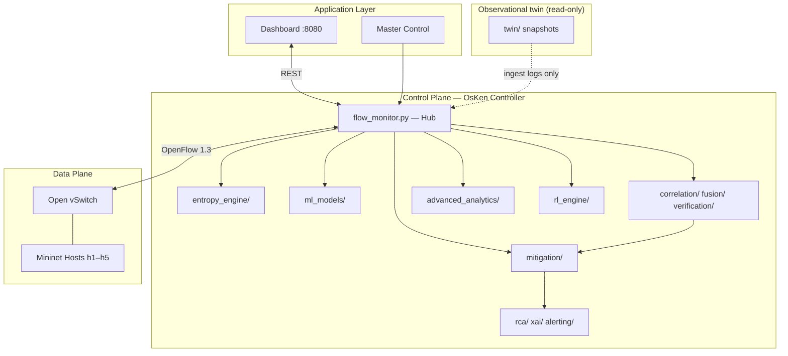
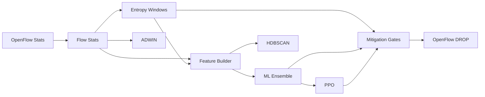

# Chapter 4 — System Design

## 4.1 Introduction

This chapter describes the architecture, component decomposition, workflows, and data model of IntelliShield SDN. Detailed Mermaid diagrams are maintained in `PROJECT_DOCS/03_System_Design/`; this chapter presents the design decisions essential for understanding the implementation.

## 4.2 Overall Architecture

IntelliShield follows a **layered SDN security architecture**:

**Design principle:** `controller/flow_monitor.py` is the **integration hub** — all phases connect through it rather than as independent microservices. This reduces latency and simplifies the laboratory deployment. Release 1.0 planes (R4–R8) hook the same cycle; `twin/` is observational and does not install OpenFlow. See `PROJECT_DOCS/02_Novelties/`.

## 4.3 Component Design

### 4.3.1 Phase 1 — Flow Monitor

| Module | Responsibility |
|--------|----------------|
| `flow_monitor.py` | OsKen app; poll stats; orchestrate pipeline |
| `flow_stats.py` | Parse OpenFlow counters; compute rates |
| `port_stats.py` | Per-port bandwidth metrics |

**Poll cycle:** Every `MONITOR_INTERVAL` (5 s), request flow stats from switch, update internal flow table, feed downstream modules.

### 4.3.2 Phase 2 — Entropy Engine

| Module | Responsibility |
|--------|----------------|
| `entropy_detector.py` | Sliding window; Shannon H; composite score |
| `entropy_alerts.py` | NORMAL / WARNING / ALERT state machine |

**Dimensions:** Source MAC, destination MAC, packet count, byte count, flow count — each normalised to probability distributions.

### 4.3.3 Phase 3 — Traffic Generator

| Module | Responsibility |
|--------|----------------|
| `attack_scenarios.py` | S1–S5 scenario definitions |
| `traffic_profiles.py` | Benign traffic parameters |
| `scenario_runner.py` | Execute and log ground truth |

### 4.3.4 Phase 4 — ML Models

| Module | Responsibility |
|--------|----------------|
| `feature_builder.py` | 15-D feature vector |
| `anomaly_detector.py` | Isolation Forest (unsupervised) |
| `classifier.py` | Decision Tree (supervised) |
| `ensemble.py` | Weighted vote + confidence |
| `explainer.py` | Attack type hints |

### 4.3.5 Phase 5 — Mitigation

| Module | Responsibility |
|--------|----------------|
| `mitigation_engine.py` | Gate logic; invoke OpenFlow install |
| `rule_builder.py` | FLOW_PAIR DROP match fields |
| `block_manager.py` | Track active blocks; expiry |

### 4.3.6 Phase 6 — Advanced Analytics

| Module | Responsibility |
|--------|----------------|
| `adwin_detector.py` | Four-metric drift streams |
| `hdbscan_clusterer.py` | Batch traffic clustering |

### 4.3.7 Phase 7 — Reinforcement Learning

| Module | Responsibility |
|--------|----------------|
| `ppo_agent.py` | NumPy PPO policy |
| `threshold_env.py` | Reward from TP/FP/FN |
| `rl_adapter.py` | Apply tuned thresholds |

### 4.3.8 Phase 8 — Dashboard

| Module | Responsibility |
|--------|----------------|
| `dashboard/app.py` | FastAPI server |
| `dashboard/control.py` | Master Control jobs |
| `static/index.html` | Live UI |

## 4.4 Processing Workflow

Each 5-second monitor cycle executes:

1. **Collect** — Request flow/port stats from switch.
2. **Compute** — Derive rates and durations per flow.
3. **Entropy** — Update windows; evaluate composite score.
4. **Features** — Build 15-D vector for ML.
5. **Classify** — Ensemble vote; generate explanation.
6. **Drift** — Feed metrics to ADWIN.
7. **Cluster** — Buffer vectors; periodic HDBSCAN (every 10 cycles).
8. **RL** — Update thresholds if warm-up complete.
9. **Mitigate** — If gates pass, install FLOW_PAIR DROP.
10. **Log** — Write events to CSV/JSON.
11. **Serve** — Dashboard reads latest state.

## 4.5 Mitigation Gate Logic

Mitigation is **not** triggered on first alert. Gates include:

| Gate | Purpose |
|------|---------|
| Warm-up (3 cycles) | Avoid blocks during controller startup |
| Attack streak (2 consecutive) | Reduce single-cycle false positives |
| ML confidence threshold | RL-tunable minimum confidence |
| Entropy or ML ATTACK | At least one detector must confirm |

## 4.6 Data Flow

**Persistence:** `logs/entropy_alerts.csv`, `ml_predictions.csv`, `mitigation_blocks.csv`, `scenario_logs.csv`, `rl_rewards.json`, model pickles in `models/`.

## 4.7 Deployment Architecture

| Process | Host | Port |
|---------|------|------|
| OsKen controller | Ubuntu VM | 6633 (OpenFlow) |
| Mininet + OVS | Ubuntu VM | — |
| FastAPI dashboard | Ubuntu VM | 8080 |

No container orchestration. Processes managed via shell scripts and dashboard Master Control.

## 4.8 Data Model (Logical)

Although no relational database is used, the system maintains logical entities:

| Entity | Key fields | Storage |
|--------|------------|---------|
| FlowRecord | src, dst, rates, duration | In-memory + CSV |
| EntropyAlert | timestamp, state, dimensions | CSV |
| MLPrediction | label, confidence, hint | CSV |
| MitigationBlock | src_mac, dst_mac, timeout | CSV |
| ScenarioLog | scenario, start, end | CSV |
| RLState | thresholds, rewards | JSON |

*ER diagram: `PROJECT_DOCS/03_System_Design/08_ER_Diagram.md`*

## 4.9 Sequence — Attack Detection to Block

1. `hping3` SYN flood starts (ground truth logged).
2. Next poll: flow rates spike; entropy on src_mac collapses.
3. `entropy_alerts` → ALERT; ADWIN fires on packet_rate.
4. ML ensemble → ATTACK, hint SYN_FLOOD, confidence 0.82.
5. Streak counter = 2 → `MitigationEngine` approves block.
6. `rule_builder` creates FLOW_PAIR match; `flow_monitor` sends `OFPT_FLOW_MOD`.
7. Block logged; dashboard updates; metrics computed post-run.

*Full sequence diagram: `PROJECT_DOCS/03_System_Design/06_Sequence_Diagram.md`*

## 4.10 Design Decisions Summary

| Decision | Rationale |
|----------|-----------|
| Single hub controller | Low latency; simple VM deployment |
| 5 s poll interval | Balance CPU load vs responsiveness |
| Hybrid ML | Unsupervised novelty + supervised accuracy |
| FLOW_PAIR blocking | Surgical; preserves other flows |
| File-based logs | Sufficient for lab; no DB overhead |
| PPO threshold tuning | Adaptive without retraining full models |

## 4.11 Summary

IntelliShield's design centres on a hub-and-spoke controller architecture with gated mitigation, multi-layer detection, and file-based telemetry. The modular phase structure maps cleanly to implementation (Chapter 5) and test coverage (Chapter 6).
